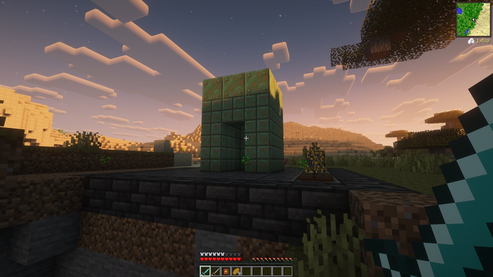
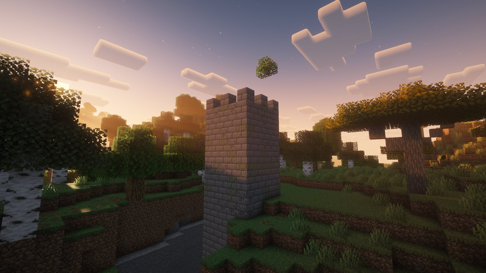
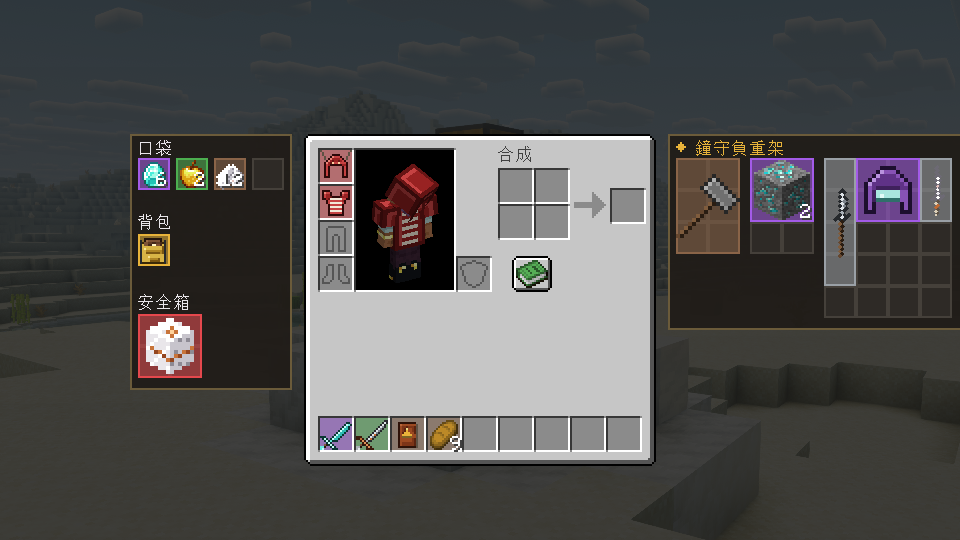

<div align="center">

[EN](docs/README.en.md) | **繁中**

<h1>
  <picture>
    <source media="(prefers-color-scheme: dark)" srcset="assets/logo/mistinn-wordmark-light.png">
    
  </picture>
</h1>

**鏽錨站特派的追獵者，走進世界邊緣的禁區。**

一款魂系的 Minecraft Java 模組：以鹽為貨幣、死亡化為殘香、在金鐘旁歇息，<br>
七個品級的裝備，以及參考撤離射擊遊戲的格子背包。

[](https://github.com/keeiv/mistinn-exile/actions/workflows/ci.yml)


[森之宿茶室](https://moriteahouse.shizune.life) ·
[功能一覽](#功能一覽) ·
[開始遊玩](#開始遊玩) ·
[第二階段設計](docs/phase2-design.md) ·
[貢獻指南](CONTRIBUTING.md)

</div>


## 目錄

- [功能一覽](#功能一覽)
- [開始遊玩](#開始遊玩)
- [世界與建築](#世界與建築)
- [操作](#操作)
- [品級與裝備](#品級與裝備)
- [格子背包](#格子背包)
- [從原始碼建置](#從原始碼建置)
- [專案結構](#專案結構)
- [接下來](#接下來)
- [參與貢獻](#參與貢獻)
- [授權](#授權)

## 功能一覽

| 範圍 | 做什麼 |
| --- | --- |
| 鹽 | 貨幣。擊敗生物獲得：敵對生物給等同最大生命值的鹽，其他生物給五分之一（至少 1）。建築裡撿到的鹽，右鍵使用後每個換成 10 點。 |
| 殘香與墓碑 | 死亡時身上的鹽全部化為殘香，留在陣亡點的墓碑裡；左鍵打開墓碑取回。再次死亡前沒取回，舊的殘香就會散去。 |
| 金鐘 | 存檔點。右鍵歇息：回滿生命與飽食度，並設為重生點。邊緣世界沒有這種物質，無法合成。 |
| 一次性金鐘 | 用金礦（金礦石或粗金）加鐵鍊合成，喚回你一次後碎裂。 |
| 小地圖 | 內建在右上角，北方朝上；標出你的朝向、綁定的金鐘與陣亡點，超出範圍時貼在邊緣指方向。 |
| 武器 | 直刃、大劍、長槍、短刃、戰鎚五個分支，每個分支有木、石、鐵、鑽石、獄髓五種材質，從第一天就有東西可用；另有錨刃、沉鐘大劍、霧行長槍、鹽牙四把具名武器。每把都有原版畫風的貼圖與手持模型、揮擊與命中音效、第一與第三人稱動作。 |
| 追獵者手冊 | 第一次進入世界時放在快捷欄，九頁寫著世界觀、任務與規則。 |
| 世界與建築 | 出生點必定是一座破損或仿冒的追獵者投放站；世界各處還有投放站、鹽塚、鏽錨殘骸與霧中崗哨，裡面有補給。 |
| 品級 | N、I～VI 七級；名稱顯示為品級色的「◆ 名稱」，物品欄以品級色為底。 |
| 裝備 | 每個品級各一頂頭盔、一件護甲、一個背包，耐久、防護、容量與格局都不同，各有兩行故事描述。 |
| 格子背包 | 四個口袋、依背包而定的格局、死亡不會掉落的安全箱；每件物品依種類佔用不同格數，可以旋轉。 |
| 語言 | 繁體中文與英文。 |

| | |
| --- | --- |
|  |  |

> [!TIP]
> 最簡單的玩法是使用**霧宿啟動器**：它會裝好遊戲、Java、Fabric、本模組與一整套優化模組，並依你的電腦調整成流暢、普通或超高。

### 武器

五個分支各有自己的揮擊、佔格與手感，材質決定傷害、耐久與品級：

| 分支 | 揮擊 | 每秒攻擊 | 攻擊距離 | 佔格 | 配方（`X` 材料、`#` 木棍、`.` 空格） |
| --- | --- | --- | --- | --- | --- |
| 直刃 | 由右上往左下斜斬 | 1.6 | 3 | 1×3 | `..X` / `.X.` / `#..` |
| 大劍 | 舉過肩後重劈 | 0.7 | 3.5 | 1×4 | `.XX` / `.XX` / `#..` |
| 長槍 | 後收再突刺 | 1.1 | 4 | 1×4 | `..X` / `.#X` / `#..` |
| 短刃 | 一次揮擊兩段交叉斬 | 2.6 | 2.6 | 1×2 | `X` / `#` |
| 戰鎚 | 側邊蓄力後橫掃，額外擊退 | 0.8 | 3 | 2×3 | `XXX` / `XXX` / `.#.` |

| 材質 | 品級 | 耐久 | 直刃 | 大劍 | 長槍 | 短刃 | 戰鎚 |
| --- | --- | --- | --- | --- | --- | --- | --- |
| 木 | N | 59 | 4 | 7 | 4.5 | 2.5 | 6 |
| 石 | N | 131 | 5 | 8 | 5.5 | 3.5 | 7 |
| 鐵 | I | 250 | 6 | 9 | 6.5 | 4.5 | 8 |
| 鑽石 | IV | 1561 | 7 | 10 | 7.5 | 5.5 | 9 |
| 獄髓 | V | 2031 | 8 | 11 | 8.5 | 6.5 | 10 |

材料和原版工具一樣（任何木板、圓石類、鐵錠、鑽石）；獄髓武器在鍛造台由鑽石武器升級。具名武器：

| 武器 | 揮擊 | 傷害 | 每秒攻擊 | 攻擊距離 |
| --- | --- | --- | --- | --- |
| 錨刃 | 由右上往左下斜斬 | 7 | 1.6 | 3 |
| 沉鐘大劍 | 舉過肩後重劈，命中時鐘鳴 | 12 | 0.7 | 3.5 |
| 霧行長槍 | 後收再突刺 | 8 | 1.1 | 4.5 |
| 鹽牙 | 一次揮擊兩段交叉斬 | 5 | 2.6 | 2.6 |

傷害為面板數值（含徒手的 1 點）。



## 開始遊玩

需要 Minecraft Java 版 26.3、[Fabric Loader](https://fabricmc.net/use/) 0.20.1 以上、[Fabric API](https://modrinth.com/mod/fabric-api) 與 Java 25。

1. 安裝 Fabric Loader，建立 26.3 的設定檔。
2. 把 `mistinn-<版本>.jar` 與 Fabric API 放進 `mods` 資料夾。
3. 進入生存模式的世界。

> [!NOTE]
> 本模組只支援 Minecraft 26.3。創造模式保留原版物品欄，格子背包只在生存與冒險模式啟用。

## 世界與建築

鏽錨站把追獵者從邊緣外投進禁區。你醒來的地方不是真正的投放站，而是兩種之一：早已**破損的追獵者投放站**，或是有人照著鏽錨站的樣子蓋的**仿冒的追獵者投放站**。出生點固定在平台上，不會卡在牆裡；快捷欄裡有一本《追獵者手冊》。

| 建築 | 在哪裡 | 裡面有什麼 |
| --- | --- | --- |
| 追獵者投放站 | 陸地，少見 | 一座一次性金鐘；補給桶裡是石與鐵武器、口糧、I～II 級裝備 |
| 鹽塚 | 海灘與惡地 | 頂上的箱子：鹽、石英、低階背包，偶爾有鹽牙 |
| 鏽錨殘骸 | 海灘 | 半埋在沙裡的巨錨，旁邊埋著箱子：鐵武器、I～III 級護甲，偶爾有錨刃 |
| 霧中崗哨 | 陸地，很少見 | 塔頂瞭望者的箱子：鐵與鑽石武器、II～IV 級裝備，偶爾有霧行長槍或一次性金鐘 |

| | |
| --- | --- |
|  |  |
|  |  |

## 操作

| 按鍵 | 作用 |
| --- | --- |
| 右鍵金鐘 | 歇息、設為重生點 |
| 左鍵墓碑 | 取回殘香裡的鹽 |
| `M` | 切換小地圖縮放（每格 1／2／4 方塊） |
| `E` | 開啟物品欄與格子背包 |
| 點擊格子 | 拿起或放下物品 |
| `R`（拿著物品時） | 旋轉 |
| `Q`（滑鼠指著物品時） | 丟棄 |
| Shift＋點擊 | 背包物品送到快捷欄；箱子物品放進格子背包 |

## 品級與裝備

| 品級 | 顏色 | 頭盔 | 護甲 | 背包 |
| --- | --- | --- | --- | --- |
| N | 鏽褐 | 鏽皮兜帽 | 鏽皮背心 | 鏽扣麻袋 |
| I | 灰 | 碼頭工盔 | 碼頭工護甲 | 碼頭帆布包 |
| II | 綠 | 巡潮盔 | 巡潮胸甲 | 巡潮背包 |
| III | 藍 | 錨衛盔 | 錨衛胸甲 | 錨衛行軍包 |
| IV | 紫 | 霧行面盔 | 霧行重甲 | 霧行登山包 |
| V | 金 | 鐘守冠盔 | 鐘守聖甲 | 鐘守負重架 |
| VI | 紅 | 鏽神骸盔 | 鏽神鱗甲 | 鏽神骸匣 |

- 頭盔耐久 70～640、護甲耐久 110～940，品級越高防護越好，護甲也越重（移動速度 0%～−6%）。
- 原版物品依材質分級：鐵 I、金 II、綠寶石 III、鑽石 IV、獄髓 V；其餘依原版稀有度。
- 用鹽可以在鐵砧修理裝備。

## 格子背包

| 背包 | 格局 | 容量 | 移動速度 |
| --- | --- | --- | --- |
| N 鏽扣麻袋 | 3×2 | 6 | — |
| I 碼頭帆布包 | 4×3 | 12 | — |
| II 巡潮背包 | 3×5 | 15 | −1% |
| III 錨衛行軍包 | 2×2、2×2、4×3 | 20 | −1% |
| IV 霧行登山包 | 4×6 | 24 | −1% |
| V 鐘守負重架 | 2×3、2×3、4×5 | 32 | −2% |
| VI 鏽神骸匣 | 2×4、2×4、5×6 | 46 | −2% |

- 口袋四格（各 1×1）、安全箱 2×2。死亡時口袋與背包整個掉落，安全箱保留。
- 佔格依物品種類：鑽石與錠 1×1、木棍 1×2、工具與劍 1×3、礦石等方塊 2×2、護甲 2×2 或 2×3。
- 背包裡的東西存在背包物品本身，換背包時內容會跟著走。



## 從原始碼建置

需要 JDK 25。原始碼放在 OneDrive 或含中文的路徑時，請用 `build.ps1`：它會把資料夾對應到磁碟代號，並把 Gradle 的快取與輸出放到 `~/.gradle` 底下。

```powershell
.\build.ps1 build               # 產生 mistinn-<版本>.jar
.\build.ps1 runClient           # 開發用客戶端
.\build.ps1 runClientGameTest   # 自動測試：真正的客戶端跑完核心流程並截圖
```

一般路徑可以直接使用 `./gradlew build`。

貼圖、模型與音效都是森之宿茶室自己做的原創素材，倉庫裡只放成品（PNG、OGG、JSON），不放繪製用的原始檔。

## 專案結構

```text
src/main/java/life/shizune/mistinn/
  bell/        金鐘：歇息與重生
  block/       金鐘、墓碑
  gear/        各品級裝備的數值
  grid/        格子背包：佔格、規則、伺服器端操作、網路封包
  residue/     死亡、殘香與墓碑
  salt/        鹽
  tier/        品級
  weapon/      武器分支與材質
  world/       出生點與世界建築
  mixin/       物品欄、揮擊音效
src/client/java/life/shizune/mistinn/client/
  anim/        第一與第三人稱揮擊動作
  grid/        格子背包面板
  map/         小地圖
  tier/        「◆ 名稱」與提示
src/gametest/  客戶端遊戲測試與拍攝
docs/          設計文件
```

## 接下來

1. **第二階段：禁區與燈守**。霧岸燈塔、第一位燈守「熄燈人」、霧中的小怪與依品級的戰利品，設計見 [docs/phase2-design.md](docs/phase2-design.md)。
2. **格子背包後續**：胸掛、箱子與背包並排拖放、背包背在身上的模型。
3. **之後**：在金鐘用鹽升級、更多武器與蓄力重擊、精力條與翻滾、多人合作。

## 參與貢獻

歡迎錯誤修復、功能、測試、美術與文件更新。請先讀 [貢獻指南](CONTRIBUTING.md)。

> [!IMPORTANT]
> 這個專案不排斥 AI：用 AI 工具協助完成的貢獻，和手寫的一視同仁。但 Pull Request 必須沒有安全隱患才會合併，而且**素材必須是原創**，不接受其他遊戲或材質包的素材。要求寫在貢獻指南的[使用 AI 工具](CONTRIBUTING.md#使用-ai-工具)。

問題回報請到[森之宿茶室官網](https://moriteahouse.shizune.life/account)。

## 授權

Copyright (c) 2026 Keeiv。

採用 **GNU Affero General Public License v3.0 only（AGPL-3.0-only）**，條文見 [LICENSE](LICENSE)，著作權聲明見 [NOTICE](NOTICE)。可以複製、修改、散布與商業使用；散布修改後的版本時，須以相同授權提供完整的對應原始碼。

所有貼圖、模型與音效為原創，與程式碼使用相同授權。

> [!NOTE]
> 字標使用 [Fusion Pixel Font](https://github.com/TakWolf/fusion-pixel-font)（SIL Open Font License 1.1）繪製。Minecraft 是 Mojang Studios 的商標，本模組與 Mojang、Microsoft 沒有關聯。
