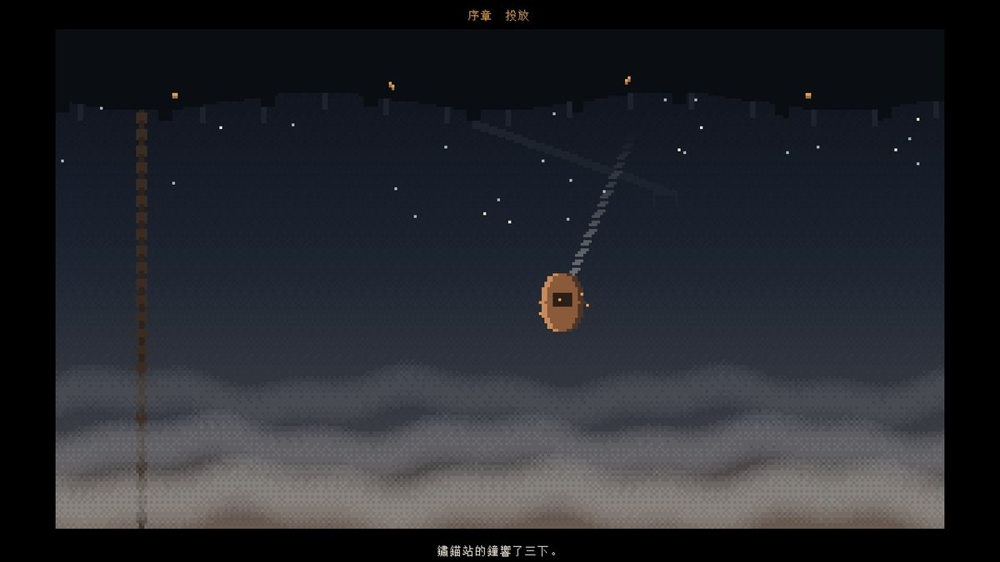

<div align="center">

[EN](docs/README.en.md) | **繁中**

<h1>
  <picture>
    <source media="(prefers-color-scheme: dark)" srcset="assets/logo/mistinn-wordmark-light.png">
    
  </picture>
</h1>

**鏽錨站特派的追獵者，走進世界邊緣的禁區。**

一款魂系的 Minecraft Java 模組：以鹽為貨幣、死亡化為殘香、在金鐘旁歇息，<br>
四肢分開計算的傷害、七個品級的裝備、參考撤離射擊遊戲的格子背包，以及守在燈塔頂的燈守。

[](https://github.com/keeiv/mistinn-exile/actions/workflows/ci.yml)


[森之宿茶室](https://moriteahouse.shizune.life) ·
[功能一覽](#功能一覽) ·
[開始遊玩](#開始遊玩) ·
[第二階段設計](docs/phase2-design.md) ·
[貢獻指南](CONTRIBUTING.md)

</div>


<details>
<summary>主選單</summary>


</details>

## 目錄

- [功能一覽](#功能一覽)
- [開始遊玩](#開始遊玩)
- [故事模式](#故事模式)
- [世界與建築](#世界與建築)
- [四肢傷害](#四肢傷害)
- [死亡與任務終止](#死亡與任務終止)
- [揮擊、精力與翻滾](#揮擊精力與翻滾)
- [霧岸燈塔與熄燈人](#霧岸燈塔與熄燈人)
- [操作](#操作)
- [品級與裝備](#品級與裝備)
- [格子背包](#格子背包)
- [從原始碼建置](#從原始碼建置)
- [專案結構](#專案結構)
- [接下來](#接下來)
- [參與貢獻](#參與貢獻)
- [授權](#授權)

## 功能一覽

| 範圍 | 做什麼 |
| --- | --- |
| 鹽 | 貨幣。擊敗生物獲得：敵對生物給等同最大生命值的鹽，其他生物給五分之一（至少 1）。建築裡撿到的鹽，右鍵使用後每個換成 10 點。 |
| 殘香與墓碑 | 死亡時身上的鹽全部化為殘香，身上帶的東西（裝備、快捷欄、口袋、胸掛與背包；安全箱除外）也一起收進陣亡點的墓碑，不會掉在地上；左鍵打開墓碑全部取回。再次死亡前沒取回，舊的殘香就會散去：鹽沒了，東西散落在原地。 |
| 死亡過場 | 被生物殺死時其他生物全部隱去，追獵者單膝跪地、往側邊倒下、化成煙；其他死因則直接倒下。之後是「任務終止」畫面：死因、鏽錨站的一句話，以及回歸任務或安息。 |
| 故事模式 | 建立單人世界前，先選擇故事模式或自由探索。故事模式有序章與第一章：任務目標、無線電對話、像素風故事卡與遊戲內的過場，按 `K` 開任務日誌。後面的章節還在製作中。 |
| 金鐘 | 存檔點。右鍵歇息：所有部位回滿（包括歸零的）、回滿飽食度，並設為重生點。邊緣世界沒有這種物質，無法合成。 |
| 四肢傷害 | 原版愛心由頭、軀幹、雙手、雙腿六個部位取代，各 80 健康值，任三個部位歸零才會死亡；每個部位只由覆蓋它的裝備保護，歸零會有壞死效果。 |
| 出血與骨折 | 受到攻擊可能出血，部位會慢慢壞死，要用止血帶止住；摔落、爆炸與重擊可能骨折，骨折的手腳在壞死前就跟壞死一樣（腿斷了只能跳撲），要用手術包接骨，夾板能暫時撐住。 |
| 醫療與維修 | 強效注射器、手術包、止疼片、止血帶、夾板，以及 III～VI 級的護甲與頭盔維修包；使用要花幾秒，各有動作與音效，受到重擊或翻滾會中斷。 |
| 鐘鳴膏 | 用金礦、鹽與蜂蜜瓶調成；離開金鐘時，唯一能救回歸零部位的東西。 |
| 合成 | 每件醫療道具、維修包、裝備與武器都能合成；只有金鐘與鏽神的鹽塊不行，VI 級裝備要用到鏽神的鹽塊。 |
| 一次性金鐘 | 用金礦（金礦石或粗金）加鐵鍊合成，喚回你一次後碎裂。 |
| 小地圖 | 內建在右上角，北方朝上；標出你的朝向、綁定的金鐘與陣亡點，超出範圍時貼在邊緣指方向。 |
| 武器 | 直刃、大劍、長槍、短刃、戰鎚五個分支，每個分支有木、石、鐵、鑽石、獄髓五種材質，從第一天就有東西可用；另有錨刃、沉鐘大劍、霧行長槍、鹽牙四把具名武器。每把都有原版畫風的貼圖與手持模型、揮擊與命中音效、第一與第三人稱動作。 |
| 揮擊 | 每一擊分成蓄力、爆發、過衝與回收：蓄力時吃力發抖，出手加速，武器的重量把身體帶過頭。第三人稱扭腰跨步，第一人稱的視角跟著揮擊轉動，命中時頓挫。 |
| 精力與翻滾 | 揮擊、衝刺與翻滾都花精力。翻滾有無敵時間，距離看雙腿、動作看雙手；雙腿都壞死時只能跳撲，落地的衝擊會分到上半身。 |
| 主選單 | 原創的霧中海岸與熄滅的燈塔，霧會飄、海會閃、燈室裡的餘燼忽明忽暗。 |
| 追獵者手冊 | 第一次進入世界時放在快捷欄，九頁寫著世界觀、任務與規則。 |
| 世界與建築 | 出生點必定是一座破損或仿冒的追獵者投放站；世界各處還有投放站、鹽塚、鏽錨殘骸與霧中崗哨，裡面有補給。 |
| 品級 | N、I～VI 七級；名稱顯示為品級色的「◆ 名稱」，物品欄以品級色為底。 |
| 裝備 | 每個品級各有頭盔、面罩、護甲、胸掛與背包，N～V 另有護腿與靴子；耐久、防護、容量與格局都不同，各有兩行故事描述。 |
| 格子背包 | 四個口袋、胸掛與背包的格子、死亡不會掉落的安全箱；每件物品依種類佔用不同格數，可以旋轉，格子裡照佔格顯示外型。背包與胸掛會穿在角色身上。生存模式的物品欄改成原創介面，原版的 27 格完全封閉。 |
| 霧岸燈塔 | 海岸上熄滅的燈塔，頂層燈室由第一位燈守**熄燈人**看守；它的每個招式打向固定的部位。戰鬥有專屬配樂，進入黑暗階段時換成更急促的曲子。 |
| 語言 | 繁體中文與英文。 |

| | |
| --- | --- |
|  |  |

### 武器

五個分支各有自己的揮擊、佔格與手感，材質決定傷害、耐久與品級：

| 分支 | 揮擊 | 每秒攻擊 | 攻擊距離 | 佔格 | 配方（`X` 材料、`#` 木棍、`.` 空格） |
| --- | --- | --- | --- | --- | --- |
| 直刃 | 由右上往左下斜斬 | 1.6 | 3 | 1×3 | `..X` / `.X.` / `#..` |
| 大劍 | 舉過肩後重劈 | 0.7 | 3.5 | 1×4 | `.XX` / `.XX` / `#..` |
| 長槍 | 後收再突刺 | 1.1 | 4 | 1×4 | `..X` / `.#X` / `#..` |
| 短刃 | 一次揮擊兩段交叉斬 | 2.6 | 2.6 | 1×2 | `X` / `#` |
| 戰鎚 | 側邊蓄力後橫掃，額外擊退 | 0.8 | 3 | 2×3 | `XXX` / `XXX` / `.#.` |

| 材質 | 品級 | 耐久 | 直刃 | 大劍 | 長槍 | 短刃 | 戰鎚 |
| --- | --- | --- | --- | --- | --- | --- | --- |
| 木 | N | 59 | 4 | 7 | 4.5 | 2.5 | 6 |
| 石 | N | 131 | 5 | 8 | 5.5 | 3.5 | 7 |
| 鐵 | I | 250 | 6 | 9 | 6.5 | 4.5 | 8 |
| 鑽石 | IV | 1561 | 7 | 10 | 7.5 | 5.5 | 9 |
| 獄髓 | V | 2031 | 8 | 11 | 8.5 | 6.5 | 10 |

材料和原版工具一樣（任何木板、圓石類、鐵錠、鑽石）；獄髓武器在鍛造台由鑽石武器升級。具名武器：

| 武器 | 揮擊 | 傷害 | 每秒攻擊 | 攻擊距離 |
| --- | --- | --- | --- | --- |
| 錨刃 | 由右上往左下斜斬 | 7 | 1.6 | 3 |
| 沉鐘大劍 | 舉過肩後重劈，命中時鐘鳴 | 12 | 0.7 | 3.5 |
| 霧行長槍 | 後收再突刺 | 8 | 1.1 | 4.5 |
| 鹽牙 | 一次揮擊兩段交叉斬 | 5 | 2.6 | 2.6 |

傷害為面板數值（含徒手的 1 點）。


## 開始遊玩

需要 Minecraft Java 版 26.3、[Fabric Loader](https://fabricmc.net/use/) 0.20.1 以上、[Fabric API](https://modrinth.com/mod/fabric-api) 與 Java 25。

1. 安裝 Fabric Loader，建立 26.3 的設定檔。
2. 把 `mistinn-<版本>.jar` 與 Fabric API 放進 `mods` 資料夾。
3. 進入生存模式的世界。

> [!NOTE]
> 本模組只支援 Minecraft 26.3。創造模式保留原版物品欄，格子背包只在生存與冒險模式啟用。

## 故事模式



在世界清單建立新世界時，先選擇**故事模式**或**自由探索**。自由探索沒有任務，其餘玩法都一樣；故事模式目前有序章「投放」與第一章「熄燈」。

- **保證出現的地點**：故事世界第一次啟動時，會在離出生點 150～240 格的平地蓋一座完整的追獵者投放站，並在最近的海岸蓋一座霧岸燈塔，劇情要去的地方一定找得到。
- **任務目標**：顯示在畫面左上角，附上提示與距離；換新目標時會亮起。小地圖上的琥珀色菱形是目的地。
- **無線電**：投放站的無線電燒壞了，拿著 4 個紅石右鍵修好後，鏽錨站的通訊員「舵」會開始通話，台詞以字幕逐字出現。
- **故事卡**：章節開頭與結尾是全畫面的像素插畫，點擊繼續，`Esc` 略過。
- **過場**：熄燈人倒下時，畫面上下出現黑邊，視角離開你、繞著它，聽它說完最後的話；`Esc` 略過。
- **任務日誌**（`K`）：看完成的目標，以及所有聽過的通話。

| 章 | 目標 |
| --- | --- |
| 序章　投放 | 收集 10 點鹽 → 找到完整的投放站 → 修好無線電 |
| 第一章　熄燈 | 前往霧岸燈塔 → 在門口的金鐘歇息 → 登上燈室 → 擊倒熄燈人 → 把鏽神的鹽塊交回投放站 |

## 世界與建築

鏽錨站把追獵者從邊緣外投進禁區。你醒來的地方不是真正的投放站，而是兩種之一：早已**破損的追獵者投放站**，或是有人照著鏽錨站的樣子蓋的**仿冒的追獵者投放站**。出生點固定在平台上，不會卡在牆裡；快捷欄裡有一本《追獵者手冊》。

| 建築 | 在哪裡 | 裡面有什麼 |
| --- | --- | --- |
| 追獵者投放站 | 陸地，少見 | 一座一次性金鐘；補給桶裡是石與鐵武器、口糧、I～II 級裝備 |
| 鹽塚 | 海灘與惡地 | 頂上的箱子：鹽、石英、低階背包，偶爾有鹽牙 |
| 鏽錨殘骸 | 海灘 | 半埋在沙裡的巨錨，旁邊埋著箱子：鐵武器、I～III 級護甲，偶爾有錨刃 |
| 霧中崗哨 | 陸地，很少見 | 塔頂瞭望者的箱子：鐵與鑽石武器、II～IV 級裝備，偶爾有霧行長槍或一次性金鐘 |

| | |
| --- | --- |
|  |  |
|  |  |

## 四肢傷害


| 部位 | 健康值 | 防護 |
| --- | --- | --- |
| 頭部（含臉） | 80 | 頭頂：頭盔；臉：面罩 |
| 軀幹 | 80 | 護甲 |
| 左手、右手 | 各 80 | 無 |
| 左腿、右腿 | 各 80 | 護腿與靴子 |

- **死亡**：任三個部位歸零。打在已歸零部位的傷害會打折分給其他部位，所以不會打不死。
- **命中**：依高度與方向決定。高處從正面來是臉，從背後來是頭頂；中段打軀幹或靠近那一側的手；低處打那一側的腿。摔落打雙腿，溺水與飢餓打軀幹，火焰與爆炸平均分到全身。
- **恢復**：飽食度 6 以上時緩慢自然恢復；藥水與金蘋果先補最低的部位。歸零的部位只有金鐘或鐘鳴膏能救回。
- **壞死效果**：腿變慢、跳不高；手降低攻擊、攻速與挖掘；軀幹讓飢餓加快；頭讓畫面四周變暗、小地圖失效。
- **HUD**：原本愛心的位置改成小人像，依健康值由綠轉紅；出血的部位會閃紅，骨折畫上裂痕，綁了止血帶與夾板也看得到。物品欄右側列出每個部位的狀態與剩餘時間。

### 出血與骨折

| 傷 | 從哪來 | 會怎樣 | 怎麼處理 |
| --- | --- | --- | --- |
| 出血 | 生物的攻擊、箭矢 | 那個部位每秒少 0.5，直到壞死；不會自然恢復 | **止血帶**止住出血。綁超過 3 分鐘，部位開始壞死；只有手術包或金鐘能解下 |
| 骨折（手腳） | 摔落、爆炸、很重的一擊 | 壞死前就跟壞死一樣：腿斷了不能翻滾、只能跳撲，還會變慢；手斷了攻擊與挖掘變弱 | **夾板**撐住 4 分鐘，鬆了又斷著；**手術包**才能接骨 |

- **手術包**一次處理一個部位：先救回壞死的部位，再接骨、解下止血帶、縫合出血。
- 在**金鐘**歇息會處理掉所有的傷。止疼片只讓你感覺不到壞死，對骨折沒用。

## 死亡與任務終止

| | |
| --- | --- |
|  |  |

- **被生物殺死**（包括燈守）：其他生物全部隱去，視角繞到追獵者前上方。追獵者單膝跪地、手撐著地面發抖，隨後往側邊倒下，化成煙，原地留下殘香。
- **其他死因**（飢餓、摔落、溺水、火焰等）：踉蹌一下，直接向前撲倒，之後一樣化成煙。
- **任務終止**：畫面暗下，紅字「任務終止」，下面是死因，以及鏽錨站依死因說的一句話。選「回歸任務」在綁定的金鐘重生，選「安息」存檔後回到主選單。
- 墓碑在身體化成煙時才出現。如果那個位置在這幾秒內被放了東西，墓碑會在附近另找位置，小地圖的標記也會跟著移過去。

## 揮擊、精力與翻滾

| | |
| --- | --- |
|  |  |

- **揮擊**：每一擊都分成蓄力、爆發、過衝與回收四段。蓄力越到後面越吃力，手臂微微發抖；出手時加速甩出；武器的重量把身體帶過頭；最後慢慢收回。重武器的蓄力與回收更長。
- **視角**：第一人稱的視角跟著揮擊轉動、下壓與傾斜，命中時頓挫一下。按 `J` 可以關掉，設定存在 `config/mistinn-client.properties`。
- **精力**：上限 100，揮擊（揮空也算）、衝刺與翻滾都要花，花完停一秒才開始回復。精力歸零時跑不動，也不能出手。

| 武器 | 每次揮擊的精力 |
| --- | --- |
| 短刃 | 7 |
| 直刃 | 11 |
| 長槍 | 13 |
| 大劍 | 22 |
| 戰鎚 | 24 |
| 其他（空手等） | 4 |

- **翻滾**（左 Alt）：花 22 精力，方向跟著移動鍵，沒按方向時往後跳步。翻滾中有無敵時間，腿完整時 10 tick，腿越傷越短，翻得也越近。
- **翻滾的動作看雙手**：健全的手抱身撐地；壞死的手垂著被甩，翻滾往那一側歪；兩手都壞死時只能用肩膀翻。
- **跳撲**：雙腿都壞死時沒辦法翻滾，只能往前撲。花 28 精力、沒有無敵時間，落地的衝擊（12 點）平分給頭、軀幹與雙手，撲越多次身體越差。
- 軀幹壞死時精力回復變慢，腿壞死時衝刺更耗精力。

## 霧岸燈塔與熄燈人

鏽錨站說，世界邊緣的海岸上立著一座座熄滅的燈塔，每一座都有燈守看守。海灘上偶爾能找到**霧岸燈塔**：門口有一座金鐘，塔內的梯子通往補給層，最頂上的燈室就是熄燈人的地方。

| | |
| --- | --- |
|  |  |

| 招式 | 預備動作 | 打在哪裡 |
| --- | --- | --- |
| 橫掃 | 提燈亮起、身體後仰 | 軀幹，或靠近那一側的手 |
| 下砸 | 跳起前地面浮出鹽粒 | 落地的衝擊波打雙腿 |
| 勾拉 | 燈鉤往後拉、鏈子作響 | 把你拉到身邊，再打臉，只有面罩能減傷 |

- 生命 300、護甲 8，有頭目血條。
- 生命一半以下，燈室裡的燈全熄，你會陷入黑暗。對著四座燈台按右鍵點亮，全部亮起時它會失衡五秒，受到的傷害 ×1.5；之後它會把燈台一座座吹熄。
- 擊倒後掉落**鏽神的鹽塊**、3000 鹽，以及 30% 機率一件 III～IV 級的裝備。
- 進入燈室，或它受傷後在 32 格內，就會響起燈守戰的配樂；生命一半以下換成黑暗階段的曲子，戰鬥結束就停。

## 操作

| 按鍵 | 作用 |
| --- | --- |
| 右鍵金鐘 | 歇息、設為重生點、救回所有部位 |
| 左鍵墓碑 | 取回殘香裡的鹽與東西 |
| `M` | 切換小地圖縮放（每格 1／2／4 方塊） |
| `E` | 開啟物品欄（裝備、胸掛、背包與身體） |
| 右鍵頭盔欄 | 切換成面罩欄 |
| 右鍵燈台 | 點亮 |
| 右鍵投放站無線電 | 拿著 4 個紅石修好；故事中拿著鏽神的鹽塊交回 |
| `K` | 任務日誌 |
| 左 Alt | 翻滾；雙腿壞死時跳撲 |
| `J` | 切換第一人稱的揮擊視角 |
| 點擊格子 | 拿起或放下物品 |
| 拖曳 | 在格子之間移動，或在格子背包與快捷欄、箱子之間搬移 |
| `R`（拿著物品時） | 旋轉 |
| `Q`（滑鼠指著物品時） | 丟棄 |
| Shift＋點擊 | 背包物品送到快捷欄；箱子物品放進格子背包 |

## 品級與裝備

| 品級 | 顏色 | 頭盔 | 面罩 | 護甲 | 護腿 | 靴子 | 胸掛 | 背包 |
| --- | --- | --- | --- | --- | --- | --- | --- | --- |
| N | 鏽褐 | 鏽皮兜帽 | 鏽皮面巾 | 鏽皮背心 | 鏽皮綁腿 | 鏽皮短靴 | 鏽皮彈帶 | 鏽扣麻袋 |
| I | 灰 | 碼頭工盔 | 碼頭工護目罩 | 碼頭工護甲 | 碼頭工護腿 | 碼頭工工作靴 | 碼頭工腰掛 | 碼頭帆布包 |
| II | 綠 | 巡潮盔 | 巡潮面罩 | 巡潮胸甲 | 巡潮腿甲 | 巡潮長靴 | 巡潮胸掛 | 巡潮背包 |
| III | 藍 | 錨衛盔 | 錨衛護顎 | 錨衛胸甲 | 錨衛腿甲 | 錨衛戰靴 | 錨衛胸掛 | 錨衛行軍包 |
| IV | 紫 | 霧行面盔 | 霧行濾面 | 霧行重甲 | 霧行腿甲 | 霧行登山靴 | 霧行胸掛 | 霧行登山包 |
| V | 金 | 鐘守冠盔 | 鐘守面甲 | 鐘守聖甲 | 鐘守腿甲 | 鐘守鐵靴 | 鐘守戰術背心 | 鐘守負重架 |
| VI | 紅 | 鏽神骸盔 | 鏽神骸面 | 鏽神鱗甲 | — | — | 鏽神骸掛 | 鏽神骸匣 |

- 頭盔耐久 70～640、面罩 50～480、護甲 110～940、護腿 90～610、靴子 60～430；品級越高防護越好，護甲與護腿也越重。
- 頭盔只保護頭頂，臉要靠面罩；護甲只保護軀幹；護腿與靴子保護雙腿；手沒有防護。
- 原版物品依材質分級：鐵 I、金 II、綠寶石 III、鑽石 IV、獄髓 V；其餘依原版稀有度。
- 用鹽可以在鐵砧修理裝備。

## 格子背包

| 背包 | 格局（上方小口袋＋主袋） | 容量 | 移動速度 |
| --- | --- | --- | --- |
| N 鏽扣麻袋 | 3×2 | 6 | — |
| I 碼頭帆布包 | 4×3 | 12 | — |
| II 巡潮背包 | 1×2、1×2＋3×4 | 16 | −1% |
| III 錨衛行軍包 | 1×2、2×2、1×2＋4×4 | 24 | −1% |
| IV 霧行登山包 | 1×2、2×2、1×2＋4×5 | 28 | −1% |
| V 鐘守負重架 | 1×2、3×2、1×2＋5×5 | 35 | −2% |
| VI 鏽神骸匣 | 1×2、3×2、1×2＋5×6 | 40 | −2% |

| 胸掛 | 格局 | 容量 |
| --- | --- | --- |
| N 鏽皮彈帶 | 1×2 ×2 | 4 |
| I 碼頭工腰掛 | 1×2 ×4 | 8 |
| II 巡潮胸掛 | 2×2＋1×2 ×4 | 12 |
| III 錨衛胸掛 | 2×2 ×2＋1×2 ×4 | 16 |
| IV 霧行胸掛 | 2×2 ×2＋1×3 ×4 | 20 |
| V 鐘守戰術背心 | 2×2 ×3＋1×3 ×4 | 24 |
| VI 鏽神骸掛 | 2×3 ×2、2×2＋1×3 ×4 | 28 |

- 口袋四格（各 1×1）、安全箱 2×2。撿到的東西依口袋、胸掛、背包的順序放入。
- 死亡時口袋、胸掛、背包與面罩連同身上其他東西收進墓碑，安全箱保留。
- 佔格依物品種類：鑽石與錠 1×1、木棍 1×2、工具與劍 1×3、礦石等方塊 2×2、護甲 2×2 或 2×3；注射器、止疼片與止血帶 1×1，手術包與夾板 1×2，維修包隨品級變大（護甲：III 1×2、IV 1×3、V／VI 2×2；頭盔：III／IV 1×2、V 1×3、VI 2×2）。
- 背包裡的東西存在背包物品本身，換背包時內容會跟著走。
- 穿著的背包與胸掛會顯示在角色身上。


## 從原始碼建置

需要 JDK 25。原始碼放在 OneDrive 或含中文的路徑時，請用 `build.ps1`：它會把資料夾對應到磁碟代號，並把 Gradle 的快取與輸出放到 `~/.gradle` 底下。

```powershell
.\build.ps1 build               # 產生 mistinn-<版本>.jar
.\build.ps1 runClient           # 開發用客戶端
.\build.ps1 runClientGameTest   # 自動測試：真正的客戶端跑完核心流程並截圖
```

一般路徑可以直接使用 `./gradlew build`。

貼圖與模型是森之宿茶室自己做的原創素材；音效以 CC0 公眾領域錄音剪接、疊加與處理，再加上專案自己的雜訊合成製成（來源見[授權](#授權)與 [CREDITS.md](CREDITS.md)）。倉庫裡只放成品（PNG、OGG、JSON），不放繪製與生成用的原始檔。

## 專案結構

```text
src/main/java/life/shizune/mistinn/
  bell/        金鐘：歇息與重生
  body/        四肢傷害、出血與骨折、恢復與鐘鳴膏
  stamina/     精力、翻滾與跳撲
  block/       金鐘、墓碑
  gear/        各品級裝備的數值
  grid/        格子背包：佔格、規則、胸掛與面罩、伺服器端操作、網路封包
  keeper/      燈守：熄燈人與燈台
  residue/     死亡、殘香與墓碑
  story/       故事模式：世界模式、進度、保證出現的地點與無線電
  salt/        鹽
  tier/        品級
  weapon/      武器分支與材質
  world/       出生點與世界建築
  mixin/       物品欄、揮擊音效
src/client/java/life/shizune/mistinn/client/
  anim/        揮擊動作與第一人稱的揮擊視角
  move/        翻滾與跳撲的動作
  title/       主選單與模式選擇
  music/       燈守戰的配樂
  death/       死亡過場與任務終止畫面
  story/       任務目標、字幕、故事卡、過場與任務日誌
  gear/        穿在身上的面罩、胸掛與背包
  body/        部位 HUD
  grid/        物品欄介面與格子背包面板
  keeper/      熄燈人的外觀
  map/         小地圖
  tier/        「◆ 名稱」與提示
src/gametest/  客戶端遊戲測試與拍攝
docs/          設計文件
```

## 接下來

1. **故事模式的後續章節**：第二章「鹽之路」，之後是沉鐘、鏽輪兩位燈守，以及霧宿與結局。
2. **禁區的其餘部分**：靠近燈塔時變濃的霧與小地圖的霧、燈室的霧牆、霧中的小怪（鹽屍、霧影、燈奴）與霧中分身，設計見 [docs/phase2-design.md](docs/phase2-design.md)。
3. **更多燈守**：沉鐘與鏽輪。
4. **之後**：在金鐘用鹽升級、更多武器與蓄力重擊、多人合作。

## 參與貢獻

歡迎錯誤修復、功能、測試、美術與文件更新。請先讀 [貢獻指南](CONTRIBUTING.md)。

> [!IMPORTANT]
> 這個專案不排斥 AI：用 AI 工具協助完成的貢獻，和手寫的一視同仁。但 Pull Request 必須沒有安全隱患才會合併，而且**素材必須是原創**，不接受其他遊戲或材質包的素材。要求寫在貢獻指南的[使用 AI 工具](CONTRIBUTING.md#使用-ai-工具)。

問題回報請到[森之宿茶室官網](https://moriteahouse.shizune.life/account)。

## 授權

Copyright (c) 2026 Keeiv。

採用 **GNU Affero General Public License v3.0 only（AGPL-3.0-only）**，條文見 [LICENSE](LICENSE)，著作權聲明見 [NOTICE](NOTICE)。可以複製、修改、散布與商業使用；散布修改後的版本時，須以相同授權提供完整的對應原始碼。

所有貼圖與模型為原創，與程式碼使用相同授權。

音效的素材來源（皆為 [CC0 1.0](https://creativecommons.org/publicdomain/zero/1.0/) 公眾領域授權，可與 AGPL 併用）：

| 素材 | 作者 | 授權 | 網址 |
| --- | --- | --- | --- |
| RPG Audio、Impact Sounds、Interface Sounds、Casino Audio | Kenney Vleugels（Kenney.nl） | CC0 1.0 | <https://kenney.nl/assets> |
| Various Scissors | sinny（OpenGameArt） | CC0 1.0 | <https://opengameart.org/content/various-scissors> |
| Epic Boss Battle [Seamlessly Looping] | Juhani Junkala（SubspaceAudio，OpenGameArt） | CC0 1.0 | <https://opengameart.org/content/boss-battle-music> |
| Determined Pursuit (epic orchestra loop) | Emma_MA（OpenGameArt） | CC0 1.0 | <https://opengameart.org/content/determined-pursuit-epic-orchestra-loop> |

錄音經剪接、疊加、濾波與變速後，再與專案自己的雜訊合成（摩擦顆粒、撕裂、搖晃顆粒、呼吸）混在一起；合成的部分與程式碼使用相同授權。燈守戰的兩首配樂整首使用，只調整了音量。每個 OGG 用了哪些素材，逐檔列在 [CREDITS.md](CREDITS.md)。

> [!NOTE]
> 字標使用 [Fusion Pixel Font](https://github.com/TakWolf/fusion-pixel-font)（SIL Open Font License 1.1）繪製。Minecraft 是 Mojang Studios 的商標，本模組與 Mojang、Microsoft 沒有關聯。
