<div align="center">

[EN](docs/README.en.md) | **繁中**

<h1>
  <picture>
    <source media="(prefers-color-scheme: dark)" srcset="assets/logo/mistinn-wordmark-light.png">
    
  </picture>
</h1>

**鏽錨站特派的追獵者，走進世界邊緣的禁區。**

一款魂系的 Minecraft Java 模組：以鹽為貨幣、死亡化為殘香、在金鐘旁歇息，<br>
四肢分開計算的傷害、七個品級的裝備、參考撤離射擊遊戲的格子背包，以及守在燈塔頂的燈守。

[](https://github.com/keeiv/mistinn-exile/actions/workflows/ci.yml)


[森之宿茶室](https://moriteahouse.shizune.life) ·
[功能一覽](#功能一覽) ·
[開始遊玩](#開始遊玩) ·
[第二階段設計](docs/phase2-design.md) ·
[第三階段設計](docs/phase3-design.md) ·
[第四階段設計](docs/phase4-design.md) ·
[第五階段設計](docs/phase5-design.md) ·
[貢獻指南](CONTRIBUTING.md)

</div>


<details>
<summary>主選單</summary>

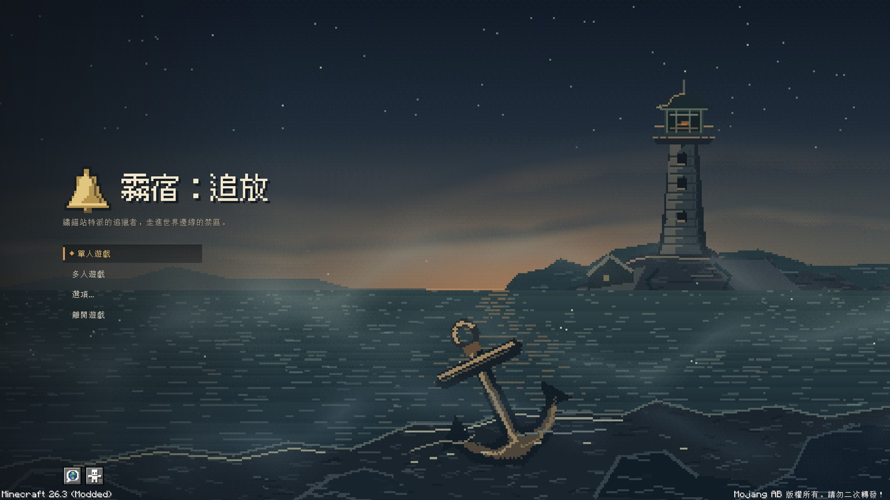

</details>

<details>
<summary>世界地圖</summary>

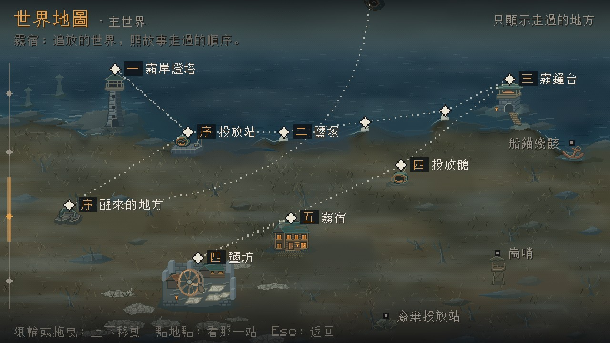

</details>

## 目錄

- [功能一覽](#功能一覽)
- [開始遊玩](#開始遊玩)
- [難度與鏽錨站](#難度與鏽錨站)
- [故事模式](#故事模式)
- [世界與建築](#世界與建築)
- [四肢傷害](#四肢傷害)
- [原版怪物與處決](#原版怪物與處決)
- [死亡與任務終止](#死亡與任務終止)
- [揮擊、精力與翻滾](#揮擊精力與翻滾)
- [霧岸燈塔與熄燈人](#霧岸燈塔與熄燈人)
- [霧鐘台與沉鐘](#霧鐘台與沉鐘)
- [鹽坊與鏽輪](#鹽坊與鏽輪)
- [屬性與技能](#屬性與技能)
- [成就](#成就)
- [操作](#操作)
- [品級與裝備](#品級與裝備)
- [格子背包](#格子背包)
- [從原始碼建置](#從原始碼建置)
- [專案結構](#專案結構)
- [接下來](#接下來)
- [參與貢獻](#參與貢獻)
- [授權](#授權)

## 功能一覽

| 範圍 | 做什麼 |
| --- | --- |
| 鹽 | 貨幣。擊敗生物獲得：敵對生物給等同最大生命值的鹽，其他生物給五分之一（至少 1），精英怪物再乘上詞綴數加一。建築裡撿到的鹽，右鍵使用後每個換成 10 點。 |
| 殘香與墓碑 | 死亡時身上的鹽全部化為殘香，身上帶的東西（裝備、快捷欄、口袋、胸掛與背包；安全箱除外）也一起收進陣亡點的墓碑，不會掉在地上；右鍵使用墓碑可全部取回。再次死亡前沒取回，舊的殘香就會散去：鹽沒了，東西散落在原地。 |
| 死亡過場 | 被生物殺死時其他生物全部隱去，追獵者單膝跪地、往側邊倒下、化成煙；其他死因則直接倒下。之後是「任務終止」畫面：死因、鏽錨站的一句話，以及回歸任務或安息。 |
| 故事模式 | 序章與三章：任務目標、無線電對話、前人留下的編號牌、像素風故事卡與遊戲內的過場，按 `K` 開任務日誌。後面的章節還在製作中。 |
| 追獵者訓練 | 建立單人世界時可選。跟著發光箭頭、教官的無線電和鏽錨站的工作人員（先向軍需官秤砣報到，右鍵和他們說話），在圍著巨錨蓋在海上的鏽錨站演練裝備、蓄力重擊、衝刺、翻滾與滑鏟、看準怪物出手、不出聲地穿過聽診場、醫療、合成、手冊與屬性、金鐘重生、殘香、無線電和燈守戰；借你練習的滑鏟、屬性點與訓練中拿到的成就，出發時都會收回。入座投放艙後選擇故事模式或自由探索。 |
| 難度 | 故事與訓練建立世界時選輕鬆、普通或鏽錨站。鏽錨站只吃得下站裡的二十種食物，外頭的武器打得輕、壞得快，手腳會斷，倒下時裝備磨損、鹽散去四成，怪物與燈守不留情（起手更短、攻擊加倍、假動作），安全箱 3×3，見[難度與鏽錨站](#難度與鏽錨站)。 |
| 金鐘 | 右鍵敲響可設定重生點，同時恢復身體：所有部位回滿（斷掉的手腳不會長回來）、止血並接好骨頭、解下止血帶與夾板、吃飽、滅火，負面狀態效果全部解除。每口鐘對每位追獵者各自冷卻現實時間一小時，隊友不必等你。邊緣世界沒有這種物質，無法合成。 |
| 四肢傷害 | 原版愛心由頭、軀幹、雙手、雙腿六個部位取代，各 80 健康值（體質最高加到 120），任三個部位歸零才會死亡；每個部位只由覆蓋它的裝備保護，歸零會有壞死效果。 |
| 出血與骨折 | 受到攻擊可能出血，部位會慢慢壞死，可用止血帶止住。摔落、爆炸與重擊可能骨折，腿斷了只能跳撲。手術包能接骨，夾板能暫時撐住。 |
| 醫療與維修 | 強效注射器、手術包、止疼片、止血帶、夾板，以及 III～VI 級的護甲與頭盔維修包；使用要花幾秒，各有動作與音效，受到重擊或翻滾會中斷；放在口袋或胸掛的可以按住 `R` 用輪盤直接使用。輕鬆與普通難度每位追獵者在每個世界會收到一次醫療用品（兩條止血帶、夾板、止疼片、強效注射器），鏽錨站沒有。 |
| 合成 | 每件醫療道具、維修包、裝備與武器都能合成或鍛造，追獵者手冊的「合成」頁籤列出每一個配方的圖與說明（依武器、裝備、醫療、維修包、食物、其他分章，點目錄就翻到）。永久金鐘在世界裡找到，鏽神的鹽塊由燈守掉落，也是 VI 級裝備的材料。紅石息壤會自己長出紅石，幾分鐘熟一次，熟了空手右鍵收成二到三個，修無線電不必再到處找紅石：地表的草地上偶爾有一小片草紅石息壤（從上面看得到草間的紅點），泥土層裡有泥紅石息壤，找到時都已經熟了；泥紅石息壤也能用四塊泥土、一個骨粉、一個鐵粒合成兩塊，草紅石息壤沒有絲綢之觸挖掉會變成泥紅石息壤。新生成的區塊才會有，舊存檔已經走過的地方不會補上。武器與頭盔、護甲、護腿、靴子都能在附魔台或鐵砧附魔：武器吃鋒利、不死剋星、節肢剋星、燃燒、擊退、掠奪，護甲照部位吃各種保護與專屬附魔，全部都能耐久與修補；重擊同樣算進鋒利與燃燒。 |
| 一次性金鐘 | 用金礦（金礦石或粗金）加鐵鍊合成。敲響時一樣會恢復身體。每位追獵者都能讓它記住一次，它會把記住的每個人各喚回一次，最後一個人被喚回後就碎裂。有人敲過的鐘打碎時不會掉落。 |
| 小地圖 | 內建在右上角，北方朝上；標出你的朝向、綁定的金鐘與陣亡點，超出範圍時貼在邊緣指方向。 |
| 武器 | 直刃、大劍、長槍、短刃、戰鎚、鐮刀六個分支，每個分支有木、石、鐵、鑽石、獄髓五種材質，從第一天就有東西可用；另有錨刃、沉鐘大劍、霧行長槍、鹽牙四把具名武器，以及熄燈鉤鐮、霧燈杖、潮鐘巨鎚、鐘舌、鏽輪緣五把要滿足條件才拿得動的特殊武器。每把都有原版畫風的貼圖與手持模型、揮擊與命中音效、第一與第三人稱動作。 |
| 揮擊 | 每一擊分成蓄力、爆發、過衝與回收，在接觸點放出原版像素風的劍氣，方向跟著招式：直刃斜斬、大劍直劈、長槍一道直線、短刃交錯兩刀、戰鎚橫掃、鐮刀上撩。按住右鍵可以**蓄力重擊**，打中範圍裡的每一個。第三人稱扭腰跨步，第一人稱的視角跟著揮擊轉動，命中時頓挫。 |
| 原版怪物 | 叫聲由 CC0 錄音合成，更低沉也更野蠻；動作依骨架與移動方式重做。追獵時壓低身體，出手前有看得見、聽得見的前搖，可以翻滾閃開。雙腿都壞死時會被處決，見[原版怪物與處決](#原版怪物與處決)。 |
| 精英怪物 | 自然生成的怪物偶爾是精英：看著時名字發金光，身邊飄著金色的塵，血量多一半，帶一到三個詞綴（迅捷、鐵皮、巨大、嗜血、霧行、鹽爆、號令）。夜裡、離出生點越遠越常見；打倒給更多鹽，還可能掉醫療用品。見[精英怪物](#精英怪物)。 |
| 霧潮 | 世界第三晚起，每晚約 15% 的機會（輕鬆 10%、鏽錨站 25%）：遠處的鐘一響，霧從四面八方湧來、整晚不散，視野只剩二三十格。每 20 秒在每位追獵者 20～36 格外的暗處走出一到三隻當地的怪物（48 格內已有 16 隻敵對生物就不再出），精英多一倍，海邊的海盜夜襲也加倍。天亮霧退；升起時在場、一次都沒倒下的追獵者得到成就。關閉怪物生成的遊戲規則時不會有怪物走出來。 |
| 精力與翻滾 | 揮擊、衝刺與翻滾都花精力。翻滾有無敵時間，距離看雙腿、動作看雙手。腿傷可能迫使你跳撲，落地衝擊由上半身承受。 |
| 主選單 | 原創的霧中海岸與熄滅的燈塔，霧會飄、海會閃、燈室裡的餘燼忽明忽暗。 |
| 世界地圖 | 主選單的「世界地圖」是一整張往下捲的世界剖面：終界、海上的鏽錨站與站底下的水、霧岸、地獄。打開時跟著投放艙從鏽錨站沉過水、落到霧岸，故事走過的路照章節一站一站畫出來；點一站就看那一章的故事卡與要做的事。這台電腦還沒看過的章節蓋在霧裡，也可以選擇全部揭開。 |
| 霧海的海盜 | 坐船駛到看不見陸地的遠海、航行一陣子之後，霧裡會傳來號角：畫面拉到海面上，一艘黑帆海盜船從濃霧中駛出，船名與船長的名字浮現，戰鬥配樂響起（空白鍵或 Esc 可以跳過）；船在附近側舷對著你停下，先開一炮警告。甲板上有刀手、火槍手、炮手和船長。炮手還活著，兩側的船炮就會輪流開炮（拋物線、落水炸起水柱、會打壞小船）；火槍手瞄準時會先響一聲拉擊錘，聽到就閃。可以撐過炮擊，也可以頂著炮火划到船邊從梯子爬上去。船長倒下就奪下這艘船：船員跳海逃走，船留在原地，船尾船長室有戰利品箱（有時有藏寶圖），船艙的木桶裡還有補給。血條上的 ◆ 是還站著的船員。每奪下一艘，之後的海盜就更多、更強。參戰的人都離開或倒下，船和船員會留在原地等你回來。 |
| 海盜夜襲 | 夜裡待在海邊時，海盜可能划船登岸：兩三個刀手和一個火槍手，船留在水邊。每位追獵者兩個遊戲日最多一次，會越來越多人。打倒他們就守住了海岸；天亮或拖太久，剩下的會退回海裡。 |
| 泰拉 | 每個世界在出生點 1200～3200 格外有六塊泰拉高地（彼此至少相隔 1300 格，避開海洋與河流，舊存檔也會規劃），半徑 180 格，在區塊載入時成形：外圈「晶脈荒原」是灰紫的晶脈土與晶脈岩、晶脈露頭與晶格露頭，草木稀疏；中圈「雲梯谷」是玉草地、玉草、玉蕨、水邊的霧蘆、野生的晶苗與霧松林；核心「晶冠」長著高聳的晶格尖塔與晶簇。三圈各有自己的天色、霧與水色，走進去會顯示地名。原本的樹會變成霧松；只改天然地形，方塊實體 6 格內不動。新方塊 20 種：晶脈岩可以磨製、做成磚，霧松原木可以做木板，玉草偶爾掉晶苗，晶苗種在耕地或玉草地上會結出晶屑。雲梯谷與晶冠的天空有晶龍：晶格長成的飛龍，在高處盤旋、俯衝咬擊後拉高（俯衝時目標身邊會響起一聲晶體尖鳴，腳下出現越來越大、越來越深的影子）；沒有血肉，不中毒、不受墜落傷害，子彈、箭與長槍的傷害 ×0.7，大劍與戰鎚 ×1.3；沒人時會降落休息，有人靠近再起飛；打碎後掉晶屑，追獵者擊殺有四分之一的機會掉晶核。雲梯谷的坡地墊成每 3 格一層的梯田（只往上墊、不往下挖，台階外牆砌晶脈岩磚，部分平台是水田；台階牆面偶爾有泉水從石縫湧出、落到下一層，牆越高越常見）。每塊泰拉的晶冠正中央是古龍的巢（兩層高的台座，八道晶格輻條，外圍一圈九座向外傾的高大晶格尖塔，中間留空），住著一隻晶冠古龍：追獵者走到中心 96 格內牠就升空，體型是晶龍的 2.2 倍、320 生命、頭目血條；會在目標腳邊標出五圈光、隨後晶格噴發，半血時叫來兩隻晶龍，之後在巢裡與空中輪替（每次地上 20 秒、空中 15 秒）：地上會先捲身再用尾巴橫掃 6.5 格內，或低頭刨地後直線衝撞；衝撞撞上尖塔、台座或山壁會暈 4 秒，這段時間受到的傷害 ×1.5；打倒後掉 8～14 晶屑、3～5 顆晶核與一件 V 級裝備，三天後晶冠會再長出一隻。晶脈荒原（雲梯谷較少）的地上有晶蜥：三隻一群，白天晚上都會出現，沒事時趴在石頭上不動、像一塊露頭，有人走到 7 格內或被打時整群一起跳起來；咬一口會讓身上每件護甲多掉 4 點耐久；同樣沒有血肉、鈍器加傷，打碎後掉 1～2 晶屑。晶耕族守衛也會打牠們。夜裡，高地上空會掛著幾道緩緩擺動的晶光極光，底部玉綠、往上淡成淡紫，天亮就散。泰拉有自己的配樂（弦樂與晶體鐘聲）與環境音（高地的風、晶體的嗡鳴，偶爾有晶片相碰的輕響），走進去就換掉原本的背景音樂；和晶冠古龍交戰時（牠在 40 格內，或已經受傷時 72 格內）換成牠自己的戰鬥曲（大提琴短弓、銅管與晶體鐘聲）。 |
| 晶耕族與家園 | 每塊泰拉的雲梯谷裡有一座晶耕族聚落，在周圍區塊都載入並轉換後一次蓋好（附近有玩家的方塊實體就不蓋）：圓形甲板廣場、樞紐核心與四盞燈柱、三座中繼塔與連到樞紐的晶能管線、有窗的工坊、晶田與水渠、貨箱。設施方塊共 11 種，像基岩一樣打不壞、炸不掉、推不動，也沒有配方與掉落。聚落裡有交易長老（用晶屑與晶核換歸途晶片、食物、醫療用品與 IV 級裝備，也收購裂晶）、拿長槍的守衛（會跟怪物與靠近的晶龍打）與兩名晶耕者。傷害任何一位，整座聚落記恨五分鐘：守衛會追打、長老拒絕交易。拿三顆晶核右鍵樞紐核心，樞紐亮起，聚落成為全體追獵者的家園。 |
| 晶耕族的工具 | 晶耕族的交易長老另外賣兩件工具。晶屑磨石（4 晶屑換 2 個）：拿著使用 1.6 秒，在刃上抹一層晶屑，3 分鐘內你的近戰攻擊打在晶龍、晶蜥與晶冠古龍身上不會被晶面滑開（長槍、拳頭不再 ×0.7），而且傷害再 ×1.15（大劍與戰鎚的 ×1.3 也一起乘上）；子彈與箭不受影響。共鳴音叉（1 晶核，64 耐久）：敲響後 40 格內的晶龍與晶蜥發光 10 秒，連趴在石頭上不動的晶蜥也藏不住；每敲一次掉 1 耐久，冷卻 10 秒。 |
| 晶蜥同伴 | 蹲著的追獵者要走到 1.5 格內才會吵醒趴著的晶蜥（站著是 7 格）。拿晶屑對趴著的晶蜥按右鍵：用掉一個，1/3 機率馴服，失敗就整群跳起來；每人最多帶 3 隻。馴服的晶蜥不會再把任何玩家當目標，主人打不傷牠；離主人 10 格以上會跟過去，28 格以上直接閃到主人身邊；會咬主人打的與攻擊主人的生物，也會咬主人 12 格內的敵對怪物；主人站著不動時會趴下埋伏，敵對怪物走進 7 格就跳起來。主人蹲著空手按右鍵讓牠守在原地（一直趴著），再按一次跟上；拿晶屑按右鍵回復 8 點。牠倒下時主人會收到訊息。同伴不會被晶耕族守衛、滑鏟、鹽彈與響鈴誘餌當成敵人，也不算在霧潮的擁擠計數裡。 |
| 晶嵐 | 有追獵者在泰拉高地裡時，那塊高地偶爾會颳起晶嵐（每秒 1/300，過後平靜至少 5 分鐘）：先有 10 秒的風變與晶體鳴響，接著 90～120 秒的晶嵐。這段時間頭頂看得到天的追獵者每 2 秒被晶塵割一次（輕鬆 1.05、普通 1.5、鏽錨站 2.4，護甲照算，不擊退、擋不住），戴著的頭盔也多掉 1 點耐久；屋簷、設施甲板、樹葉或岩簷底下都安全。晶嵐裡每 3 秒有 2/3 的機會在每位追獵者 4～10 格外的空地落下 1～2 個晶屑，1/12 是歸途晶片。畫面會蒙上淡青的霧、露天處落下晶粒，四周晶體鳴響、風一陣陣吹過。自動測試的世界不會自己颳。 |
| 晶脈遺跡 | 泰拉外圈晶脈荒原的區塊有 1/40 的機會立著一座古晶格塔的殘基（整座都在同一個區塊裡）：5×5 碎裂的晶脈岩磚地板、四根高 1～4 格的斷柱、一根 4～7 格高還站著的晶格芯柱（頂上一簇晶簇）、一截倒下的晶格橫樑，中間一個箱子。箱子必有 3～8 個晶屑，另外一樣是晶核、1～2 個歸途晶片、2 個晶屑磨石、強效注射器或共鳴音叉，1/4 機率再多一件 III～IV 級的輕裝或重裝護甲或背包。殘基裡趴著三隻像碎石一樣的晶蜥守著。 |
| 晶潮 | 已點亮的家園偶爾會在夜裡遭晶潮圍攻：天黑時，樞紐 48 格內有追獵者的家園各擲一次（輕鬆 15%、普通 25%、鏽錨站 40%；點亮後的前半天不算，訓練世界與自動測試世界不會自己發生）。先有 15 秒的預警（晶田鳴響），接著三波從樞紐 24～36 格外的地底湧出：晶蜥 4／5／6 隻（每多一位追獵者各加一隻），第二、三波再加 1、2 隻晶龍；一出來就衝向最近的追獵者，晶耕族守衛也會一起打。前一波倒光才出下一波（最多等 60 秒）。三波都守住，樞紐 64 格內的追獵者各得 300 鹽與一顆晶核；天亮時剩下的會碎成晶屑退回地底，所有人離開樞紐 96 格超過 30 秒也一樣。 |
| 家園的成長 | 把更多晶核交給已點亮的樞紐，家園會長大三級（依序要 3、5、8 顆晶核）。第 1 級：晶田每天早上送 3 個晶屑到樞紐（最多存 32 個），空手按樞紐就能收下；第 2 級：多一位晶耕族守衛，每天送 5 個；第 3 級：歸途傳送到這座家園後的冷卻減半，守住晶潮的謝禮（鹽與晶核）加倍。空手按樞紐時會說明目前等級與下一級要幾顆晶核。 |
| 大地圖與歸途 | 按 M 打開地圖：走過的地形都記在這台電腦上（依世界分開，存在設定資料夾），標出自己、家園、看過的晶耕族聚落、走過的泰拉範圍、開啟中的空裂與傷痕、懸賞與補給桶；滾輪以游標為中心縮放，拖曳移動。在地圖上點家園就出發：從一座家園到另一座立刻抵達、不花費；從野外出發要原地站 8 秒並消耗一片歸途晶片，移動或受傷就中斷。倒地、扶人或拖人時、受傷後 10 秒內不能出發，抵達後兩分鐘才能再走。 |
| 空裂領域 | 世界第四天起，每天在隨機時刻擲一次（輕鬆 20%、普通 30%、鏽錨站 45%），在離所有追獵者至少 96 格、最遠 192 格的陸地上撕開一道天空裂隙：高空一道長約 150 格的裂口，底下半徑 40 格內的天變朱紅、水變血紅，地面從中心向外燒成赤壤與焦岩，長出裂晶與血棘（只改天然地形，箱子這類方塊實體 6 格內不動）。有追獵者走進 48 格，裂隙會落下三波裂隙行者，最後一波由裂隙使者帶領（頭目血條，會把人拉近，並在腳邊標出三處落雷；半血時怒吼、把 6 格內的人震開，之後落雷改成從牠腳下朝目標一路裂出去的七道、一道接一道打下，並且每 10 秒左右在目標背後撕開裂隙、0.7 秒後從那裡走出來）；全部倒下就縫合，在場的人各得 600 鹽，打倒使者的人再多 400 與一件 III～V 級裝備。從第二波起還會落下一群裂隙獵犬：焦黑、從裂縫透出光的獵犬，成群在 5 格外繞著目標轉，只有繞到目標側面或背後（視線 55 度外）的那隻會伏低撲咬，一次一隻；正面對著的不會撲，但等太久還是會撲；貼著牠站會被咬。最後一波的獵犬（以及空裂之地自然出現的獵犬，每五群約一群）由一隻裂隙頭犬帶領：體型大 45%、70 生命、咬得更重、紅色名字；每 7～11 秒停下來嚎叫一次，24 格內同一獵物的獵犬加速 5 秒，而且繞圈位置相隔最遠的兩隻會不管方向同時撲上來；打倒頭犬，整群會掉頭逃開 10 秒，頭犬留下 2～3 個裂晶，1/4 機率再掉一件 III～IV 級裝備。空裂之地的獵犬在夜裡沒有獵物時偶爾會嚎叫，遠處就聽得到。縫合後留下永久的「空裂之地」，夜裡會自然生成裂隙行者與成群的獵犬。沒人處理的裂隙每天天亮擴大 8 格（最多 64），並放出零星的行者或獵犬；一個世界最多 12 道傷痕，滿了以後會重新撕開舊傷。開啟中的裂隙底下會響起急促的戰鬥配樂，縫合後的空裂之地換成緩慢的哀歌。 |
| 裂隙信標 | 用 5 片裂晶、1 顆晶核和 1 塊鐵錠合成（裂晶圍住晶核，鐵錠在下）。舉高使用 3 秒，遠處會撕開一道空裂，位置的規則和它自己降臨時一樣（離所有追獵者 96～192 格的陸地），之後一切照常：三波、使者、縫合獎勵。只能在主世界用；已經有裂隙開著、和平難度或訓練世界時不會回應，找不到地方時也不會用掉。 |
| 空投補給 | 手冊的「補給」分頁可以花鹽向鏽錨站訂購：止血帶、夾板、止疼片、強效注射器、手術包、紙彈、鹽彈、信號焰、響鈴誘餌和 III 級護甲維修包，價格 50～600 鹽。一次只能訂一份，半分鐘到一分鐘後木桶拖著煙與火從天而降，落在追獵者 8～16 格外的空地上，小地圖標出位置，桶子清空或兩分鐘後消失；落點附近都沒有空位時，物品直接掉在地上，不會蓋掉任何方塊。落地聲 32 格內聽得到，附近的怪物會過來查看。 |
| 霧中懸賞 | 世界第二天起，早晨約三成五的機會發布懸賞：某位追獵者 150～300 格外有一隻三個詞綴、血量加倍、不怕陽光的精英，聊天室說明方向與距離，小地圖用紅叉標出。追獵者走到 48 格內牠才現身。打倒的人領 800 鹽、32 格內的隊友各 400，並掉一件 III 或 IV 級的裝備；三天沒人處理就撤銷。 |
| 投擲道具 | 鹽彈落地炸開，4 格內的怪物硬直、正在起手的攻擊被打斷，但很吵會引來附近的怪物；信號焰燒半分鐘，照亮四周並讓 16 格內的怪物在霧裡發光現形；響鈴誘餌響十秒，把 20 格內閒著的怪物引過去。工作台合成，一秒丟一個。 |
| 火槍與手槍 | 從海盜身上搶來（船長一定帶著手槍，火槍手偶爾會留下火槍，船長的箱子也可能有）。按住使用鍵舉槍瞄準，放開射出一發紙彈；長槍打得遠、傷害高，手槍舉得快。紙彈用紙、火藥、鐵粒合成三發，從快捷欄、副手或口袋、胸掛、背包裡拿。 |
| 追獵者手冊 | 第一次進入世界時放在快捷欄。原創的手冊介面：四十頁世界觀、任務、規則與獵物，屬性、技能樹、合成表、補給與成就。 |
| 成就 | 三十五個成就（其中一個是隱藏的），從第一次狩獵、用六種武器各打倒一隻怪物、一記重擊打中三隻，到打倒熄燈人、沉鐘與鏽輪、奪下海盜船、守住海岸、打倒帶三個詞綴的精英，以及故事的兩個結局；達成時右上角跳出原版的進度提示並給鹽，全部記在原版進度畫面裡霧宿自己的分頁，見[成就](#成就)。 |
| 世界與建築 | 出生點必定是一座破損或仿冒的追獵者投放站；世界各處還有投放站、鹽塚、鏽錨殘骸與霧中崗哨，裡面有補給。 |
| 品級 | N、I～VI 七級；名稱顯示為品級色的「◆ 名稱」，物品欄以品級色為底。 |
| 裝備 | 每個品級各有頭盔、面罩、護甲、胸掛與背包，N～V 另有護腿與靴子；另有輕裝（頭盔、護甲、背包）與重裝（頭盔、護甲、胸掛、背包）兩條產線，見[輕裝與重裝](#輕裝與重裝)；耐久、防護、容量與格局都不同，各有兩行故事描述。 |
| 格子背包 | 四個口袋、胸掛與背包的格子、死亡不會掉落的安全箱。每件物品依種類佔用不同格數，可以旋轉。背包、胸掛和部分醫療用品有依佔格繪製的專用圖，穿戴的背包與胸掛也會顯示在身上；七種胸掛照著各自的物品圖做成立體：彈帶上一排子彈、碼頭工的帆布腰掛、巡潮的直袋與信號燈袋、錨衛的銅扣方袋、霧行的長袋與文件袋、鐘守的整件背心（每個袋蓋一口小鐘）、鏽神的肋骨，都穿在胸甲外面；第一人稱低頭時，過肩的背帶不會擋在眼前。生存與冒險模式使用原創物品欄，封閉原版的 27 格。 |
| 霧岸燈塔 | 海岸上熄滅的燈塔，頂層燈室由第一位燈守**熄燈人**看守。它有 37 招，會一邊看你一邊往前推演六步，學你的習慣、用假動作騙你翻滾；每一招都有聽得見、看得見的預兆，四個誠實的信號告訴你接下來是哪一類招。戰鬥有專屬配樂，進入黑暗階段時換成更急促的曲子。 |
| 霧鐘台 | 霧岸外淺水礁石上的鐘樓，由第二位燈守**沉鐘**看守。它每敲一聲鐘，聲波就沿地面滾開，房裡的霧濃一層；蓄滿的重擊能敲響它自己的鐘，把霧打散。見[霧鐘台與沉鐘](#霧鐘台與沉鐘)。 |
| 鹽坊 | 內陸的廢棄鹽坊，由第三位燈守**鏽輪**看守。它滾動衝撞、越滾越快，正面包鐵、背後是弱點；引它撞上柱子就會卡住。見[鹽坊與鏽輪](#鹽坊與鏽輪)。 |
| 屬性與技能 | 擊倒燈守帶回鏽神的鹽塊，在手冊的技能頁學會大技能點**滑鏟**；之後用鹽一點一點加力量、速度、體質與智力，見[屬性與技能](#屬性與技能)。 |
| 語言 | 繁體中文與英文。 |

| | |
| --- | --- |
| 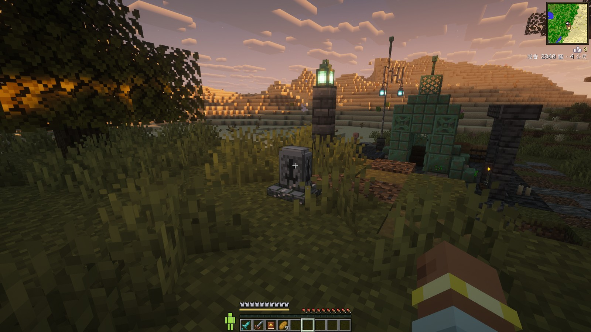 | 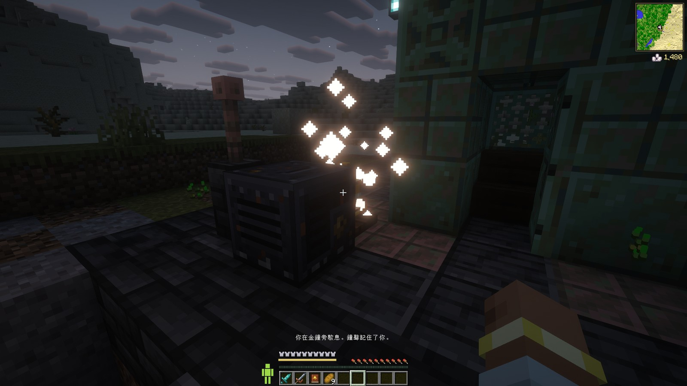 |

### 武器

六個分支各有自己的揮擊、佔格與手感，材質決定傷害、耐久與品級：

| 分支 | 揮擊 | 每秒攻擊 | 攻擊距離 | 佔格 | 配方（`X` 材料、`#` 木棍、`.` 空格） |
| --- | --- | --- | --- | --- | --- |
| 直刃 | 由右上往左下斜斬 | 1.6 | 3 | 1×3 | `..X` / `.X.` / `#..` |
| 大劍 | 舉過肩後重劈 | 0.7 | 3.5 | 1×4 | `.XX` / `.XX` / `#..` |
| 長槍 | 後收再突刺 | 1.1 | 4 | 1×4 | `..X` / `.#X` / `#..` |
| 短刃 | 一次揮擊兩段交叉斬 | 2.6 | 2.6 | 1×2 | `X` / `#` |
| 戰鎚 | 側邊蓄力後橫掃，額外擊退 | 0.8 | 3 | 2×3 | `XXX` / `XXX` / `.#.` |
| 鐮刀 | 雙手握，從左下往右上撩 | 1.0 | 3.8 | 2×4 | `XXX` / `..#` / `.#.` |

| 材質 | 品級 | 耐久 | 直刃 | 大劍 | 長槍 | 短刃 | 戰鎚 | 鐮刀 |
| --- | --- | --- | --- | --- | --- | --- | --- | --- |
| 木 | N | 59 | 4 | 7 | 4.5 | 2.5 | 6 | 5.5 |
| 石 | N | 131 | 5 | 8 | 5.5 | 3.5 | 7 | 6.5 |
| 鐵 | I | 250 | 6 | 9 | 6.5 | 4.5 | 8 | 7.5 |
| 鑽石 | IV | 1561 | 7 | 10 | 7.5 | 5.5 | 9 | 8.5 |
| 獄髓 | V | 2031 | 8 | 11 | 8.5 | 6.5 | 10 | 9.5 |

材料和原版工具一樣（任何木板、圓石類、鐵錠、鑽石）；獄髓武器在鍛造台由鑽石武器升級。具名武器：

| 武器 | 揮擊 | 傷害 | 每秒攻擊 | 攻擊距離 |
| --- | --- | --- | --- | --- |
| 錨刃 | 由右上往左下斜斬 | 7 | 1.6 | 3 |
| 沉鐘大劍 | 舉過肩後重劈，命中時鐘鳴 | 12 | 0.7 | 3.5 |
| 霧行長槍 | 後收再突刺 | 8 | 1.1 | 4.5 |
| 鹽牙 | 一次揮擊兩段交叉斬 | 5 | 2.6 | 2.6 |

傷害為面板數值（含徒手的 1 點）。

### 特殊武器

四把特殊武器要滿足條件才能完全發揮。條件不夠時攻擊力減半、揮得慢、也不能蓄力重擊；說明文字會列出條件，達成的綠色、還沒達成的紅色。

| 武器 | 分支 | 條件 | 特殊重擊 | 取得 |
| --- | --- | --- | --- | --- |
| 熄燈鉤鐮 | 鐮刀（8 傷） | 打倒熄燈人、力量 3 | 迴鐮之後，把打中的最遠一個鉤到腳邊並打斷牠的攻擊 | 熄燈人倒下時掉落 |
| 霧燈杖 | 長槍（6 傷） | 智力 4 | 燈爆：前方炸開一團藍火，半徑 3.5 格內都受傷並著火，威力是（6 + 智力）×（1 + 蓄力比例） | `..L` / `.#.` / `#..`（L 靈魂燈籠） |
| 潮鐘巨鎚 | 戰鎚（13 傷） | 力量 5、體質 3 | 鐘震：以自己為中心半徑 4.5 格一整圈震飛 | `IBI` / `.#.` / `.#.`（I 鐵磚、B 鐘） |
| 鐘舌 | 戰鎚（11 傷） | 打倒沉鐘、力量 4 | 反鳴：蓄滿時敲出一圈聲波，打斷身邊 6 格內所有正在預備出手的敵人，打不打得到都算 | 沉鐘倒下時掉落 |
| 鏽輪緣 | 大劍（12 傷） | 打倒鏽輪、體質 4 | 輾勢：蓄滿時整個人往前滾出約六格，路上每一個都被輾過（各吃六成傷害）、甩到一邊；撞上牆會停下來，暈兩秒 | 鏽輪倒下時掉落 |


## 開始遊玩

最簡單的方式是用[霧宿啟動器](https://github.com/keeiv/mistinn-launcher/releases)：它會下載遊戲、Java、Fabric 與本模組，並依你的電腦調好設定。目前是離線啟動器，請使用離線帳號遊玩。

自己安裝的話，需要 Minecraft Java 版 26.3、[Fabric Loader](https://fabricmc.net/use/) 0.20.1 以上、[Fabric API](https://modrinth.com/mod/fabric-api) 與 Java 25。

1. 安裝 Fabric Loader，建立 26.3 的設定檔。
2. 把 `mistinn-<版本>.jar` 與 Fabric API 放進 `mods` 資料夾。
3. 進入生存模式的世界。

> [!NOTE]
> 本模組只支援 Minecraft 26.3。創造模式保留原版物品欄，格子背包只在生存與冒險模式啟用。

舊存檔裡的鐘鳴膏會在讀取時轉成等量的粗金。

### 好友連機

房主進入故事模式或自由探索世界後，按 Esc → **世界與連機** → **開放房間**，畫面上會出現一串 `MIST-` 開頭的邀請碼，按 **複製邀請碼** 傳給好友。好友在霧宿啟動器按 **加入好友** 貼上邀請碼，就會直接進到房間；在遊戲裡也可以從 **多人遊戲 → 用邀請碼加入** 貼上。房主可以在同一頁關閉房間，存檔留在房主電腦。

- **不用設定路由器**：房間經由 [e4mc](https://modrinth.com/mod/e4mc)（MIT 授權）的公共中繼站對外開放，霧宿啟動器會自動裝好它。中繼站由 e4mc 的作者經營，遊戲的連線會經過它。
- **離線帳號也能加入**：只有拿到邀請碼的人進得來。房間每次開放都會換一組新的邀請碼，關閉後舊的就不能用了。名字跟房裡的人重複時會被擋下。
- **同一個版本**：雙方要用同一個版本的霧宿，版本不同時加入畫面會直接說明。
- **皮膚**：啟動器裡設定的皮膚會同步給房裡的每個人。
- **最多三人**：一個世界最多三位追獵者，第四位會在加入時被擋下，畫面會說明。
- **一起成長**：大技能（用鏽神的鹽塊解鎖，例如滑鏟）全隊共用，一個人學會，所有人都會，之後才加入的人也一樣；小技能和鹽還是各自的。舊存檔裡已經學會的大技能，下次登入時會分給其他人。
- **標記給隊友看**：按 `G` 在準星指著的地方打標記，最遠一百六十格。指著怪物時標記會跟著牠、顯示「敵人」，指著掉落物顯示「東西」。全隊都看得到你顏色的標記、距離和是誰標的，小地圖上也會閃，十二秒後消失；轉頭看不到時，準星周圍會有指向它的小記號。每人同時最多三個。
- **故事全隊共用**：故事模式的目標是全隊一起的。任何一人完成目標（拿到鹽、走到地點、修好無線電、交付、打倒燈守、敲鐘……），全隊一起推進到下一步，同一段台詞與字卡大家都會收到：在附近的看完整過場，離得遠的看字幕，全螢幕字卡等他們沒在戰鬥時才跳出。晚進來或離線過的隊友，一進世界就直接跟上全隊的進度。石堆下的名牌每人各拿一份。
- **不會誤傷隊友**：每個世界第一次載入時會把友軍傷害關掉（舊存檔也一樣），之後房主想打開可以輸入 `/gamerule pvp true`。
- **認得出彼此**：每位追獵者的名字有自己的顏色（名牌、聊天、玩家列表），小地圖上用同一個顏色標出隊友的位置，離得遠時貼在地圖邊緣指方向。
- **標記信標**：火把、鐵錠、木棒直排合成兩個。插在地上標記一個地方，全隊的小地圖都畫出它，看向它時畫面上會浮出名字和距離（一千格內）。用鐵砧取名就是它的名字，顏色是插下的人的顏色，拿染料右鍵可以換色。一個世界最多 64 個，超過時最舊的先消失。
- **倒地與救援**：有隊友還站著時，致命的一擊會讓你倒地而不是死亡（彎腰抱著傷處跪倒，再往後倒成仰躺，一手壓著傷口，會喘氣、轉頭找隊友、不時舉手求救）：不能移動、攻擊或用東西，怪物和燈守不再追你；一分鐘內沒人救就會失血而死，倒地時每挨一下少十秒（一秒最多算一次）。隊友靠近 **按住 F** 原地救援（救援者雙膝跪在你身旁、雙手壓住傷口一下一下按壓，你會轉頭看著對方），或 **按 H** 拖著你走（再按一次放下；拖人的彎腰用左手往後拉，被拖的人仰躺、頭朝著對方、舉手抓住對方的手，腳在地上拖），都要十秒；救起來時每個部位至少回到上限的四分之一。只有你一個人、大家都倒下、被處決的最後一擊、掉進虛空或 `/kill`，照樣直接死亡。倒地時離線，下次進來還是倒地。按鍵可以在控制設定的「霧宿」分類裡改。
- **更新說明**：遊戲改了舊存檔的玩法時，玩過的人下次進來會在聊天欄看到每項更新一行的說明，只出現一次；最後一行提醒按 T 往上捲動看完。
- **中繼站連不上時**：畫面會改成直連，填一個好友連得到的位址（公開 IP、網域或虛擬區網的位址）。使用公開 IPv4 時，請在路由器將 TCP 連接埠（預設 `25565`）轉發到房主電腦，並允許該連線通過防火牆。 [Minecraft Java 版多人連線說明](https://help.minecraft.net/hc/en-us/articles/32899741198989)

故事世界會保存燈守被擊倒和鹽塊已交回的進度。較晚加入的好友走到對應的目標時，也可以繼續推進自己的任務。

## 難度與鏽錨站

故事模式和追獵者訓練建立世界時，會先問這一趟要多難，普通是預設。直接建立的自由探索不問，一律普通；從追獵者訓練搭投放艙去故事或自由探索，沿用訓練時選的難度（難度存在世界裡）。

| | 輕鬆 | 普通 | 鏽錨站 |
| --- | --- | --- | --- |
| 挨打的傷害 | ×0.7 | ×1 | ×1.25 |
| 流血、骨折的機率 | ×0.5 | ×1 | ×1.5 |
| 流血的速度 | ×0.75 | ×1 | ×1.5 |
| 自然恢復 | 快一倍 | 原本 | 慢一倍 |
| 飢餓消耗 | ×0.8 | ×1 | ×1.25 |

**鏽錨站**另外照站裡的規矩：

- **只吃站裡的食物**：
  - 原版食物一到手上就變成紅名的「受潮的食物」；吃一個，飢餓上限就少一隻雞腿，最低四隻，飢餓條上畫成發霉的格子。蛋糕不能吃。
  - 動物與漁獲改掉豬牛羊的油脂、牛筋、雞的邊腳料、魚雜，燒過、煮過再吃，或做成硬麵餅、海藻餅、油渣粥、骨湯、魚雜湯、蘑菇糊。
  - 箱子裡有配給餅乾與鏽罐頭。這二十種食物在每種難度都有。
- **外頭的武器**：原版武器（獄髓除外）攻擊減半、耐久耗損 2.5 倍；站裡的武器攻擊 +5%、耐久耗損 1.15 倍。
- **斷肢**：
  - 已毀的手腳再挨重擊、一擊打穿，或止血帶綁到壞死，那一肢可能就斷了，到死都不會回來。
  - 斷一腳不能衝刺、跳、翻滾、滑鏟，兩腳都斷只能爬。
  - 斷了慣用手不能挖也不能打；斷掉的那隻手什麼都拿不了，要兩隻手的東西也用不了。
- **倒下時**：帶在身上的裝備扣六成耐久（最少留一點），鹽散去四成，醒來只剩一半的健康值和 10 點飢餓度。
- **安全箱**：擴大成 3×3。
- **不留情的怪物**：
  - 怪物起手只剩一半左右（殭屍 7 刻 → 4 刻）。
  - 約三成是假動作：起手到一半停住，緊接著用極短的第二次起手真的打下來；約四分之一會多撐幾刻才出手，專抓提早翻滾的人。
  - 近戰的間隔減半，每 0.5 秒就來一下；骷髏射箭也快將近一倍。
  - 一群裡同時撲上來的從兩隻變三隻；你發出的聲音傳得遠一半；敵對生物跑得快 15%，追得更遠。
- **不留情的燈守**：
  - 起手快一半，收招快將近一倍，出招也更快。
  - 看你的動作幾乎沒有延遲，邊走邊重想的頻率加倍。
  - 更愛用假動作和延遲出手，還多了一種更長的延遲。
  - 要連續四記重擊才會失衡，追你的腳步也更快。
- 在訓練場裡，斷肢與加重的死亡懲罰不算。

## 故事模式


在世界清單建立新世界時，可以選擇**故事模式**、**自由探索**或**追獵者訓練**。自由探索沒有任務，其餘玩法都一樣。故事模式有序章「投放」、第一章「熄燈」、第二章「鹽之路」、第三章「沉鐘」、第四章「鹽坊」與第五章「錨」，第五章由你決定結局。

追獵者訓練會以標準生存設定建立存檔，把你送到鏽錨站：一座圍著斜插海中的巨錨、蓋在海上的基地。你在宿舍醒來；碼頭、市集與食堂、鍛造間、操練場、醫務室、工坊、檔案室、鐘樓與紀念牆、通訊室和燈室分佈在三層甲板上，越往上越冷清，最上面是霧邊的投放吊臂。十五位工作人員守在各自的崗位上：右鍵可以和他們說話、問問題，走近時他們會招呼你一句；碼頭工搬著貨來來去去，舵也不時透過廣播說話；走近鍛造間聽得到打鐵，碼頭有木桶、鍊條和船邊的水聲。掉進海裡會被撈回最近的甲板。課程最後，全站的人聚到投放台，先送同寢的第3411號下去；輪到你走進投放艙、按下控制鈕入座，選擇在同一個存檔裡開始故事或自由探索之後，站裡的鐘響三下，每響一下，甲板上的人就少一些，然後畫面轉黑。練習用的鹽和裝備會留在訓練場。


- **保證出現的地點**：故事世界第一次啟動時，會在離出生點約 150～240 格處蓋一座完整的投放站，優先選平坦的陸地。接著從投放站搜尋海岸來蓋燈塔，找不到海岸時改選較遠的空地。
- **任務目標**：顯示在畫面左上角，附上提示與距離；換新目標時會亮起。小地圖上的琥珀色菱形是目的地。
- **無線電**：投放站的無線電燒壞了，拿著 4 個紅石右鍵修好後，鏽錨站的通訊員「舵」會開始通話，台詞以字幕逐字出現。
- **故事卡**：章節開頭與結尾是全畫面的像素插畫，點擊繼續，`Esc` 略過。
- **過場**：熄燈人、沉鐘倒下與鏽輪停下時，畫面上下出現黑邊，視角離開你、繞著它，聽它說完最後的話；`Esc` 略過。
- **鹽之路**：第一章結束後，第一次在夜裡走到外頭，霧裡會傳來三下鐘聲。故事在投放站往海的另一頭（和燈塔反方向）蓋一座霧鐘台，路上三座鹽塚，每座底下壓著一塊前人的編號牌，寫著他們最後留下的話。
- **回音**：敲響霧鐘台的鐘之後，鏽錨站放下一個補給艙，落在往內陸的路上；艙裡的無線電把你派往內陸的鹽坊。鹽坊和補給艙在第一次走到這裡時才蓋，舊存檔停在「等待鏽錨站的回音」的獵人，下次進世界就會接到第四章。
- **兩個結局**：鏽輪停下以後，回到投放站的無線電，舵要你把鏽神的鹽塊送回來，第3401號卻插進來叫你別送，帶去霧裡的旅店「霧宿」。拿著鹽塊右鍵無線電，送進回收艙，是結局「錨」；帶到霧宿丟進爐火，是結局「霧宿」。先做的那一個就是這個世界的結局，多人時大家共用；結局之後世界照常，可以繼續狩獵。霧宿在第一次走到第五章時才蓋。
- **任務日誌**（`K`）：看完成的目標，以及所有聽過的通話。

| 章 | 目標 |
| --- | --- |
| 序章　投放 | 收集 10 點鹽 → 找到完整的投放站 → 修好無線電 |
| 第一章　熄燈 | 前往霧岸燈塔 → 在門口的金鐘歇息 → 登上燈室 → 擊倒熄燈人 → 把鏽神的鹽塊交回投放站 |
| 第二章　鹽之路 | 聽夜裡的鐘聲 → 找到三座鹽塚 → 前往霧鐘台 |
| 第三章　沉鐘 | 在霧鐘台的金鐘歇息 → 登上鐘樓 → 打倒沉鐘 → 敲響霧鐘台的鐘 |
| 第四章　鹽坊 | 找到新放下來的投放艙 → 前往鹽坊 → 在門口的金鐘歇息 → 走進輪場 → 讓鏽輪停下來 |
| 第五章　錨 | 聽鏽錨站的回音 → 送，或不送（結局「錨」或「霧宿」） |

## 世界與建築

鏽錨站把追獵者從邊緣外投進禁區。你醒來的地方不是真正的投放站，而是兩種之一：早已**破損的追獵者投放站**，或是有人照著鏽錨站的樣子蓋的**仿冒的追獵者投放站**。出生點固定在平台上，不會卡在牆裡；快捷欄裡有一本《追獵者手冊》。

| 建築 | 在哪裡 | 裡面有什麼 |
| --- | --- | --- |
| 追獵者投放站 | 陸地，少見 | 一座一次性金鐘；補給桶裡是石與鐵武器、口糧、I～II 級裝備 |
| 鹽塚 | 海灘與惡地 | 頂上的箱子：鹽、石英、低階背包，偶爾有鹽牙 |
| 鏽錨殘骸 | 海灘 | 半埋在沙裡的巨錨，旁邊埋著箱子：鐵武器、I～III 級護甲，偶爾有錨刃 |
| 霧中崗哨 | 陸地，很少見 | 塔頂瞭望者的箱子：鐵與鑽石武器、II～IV 級裝備，偶爾有霧行長槍或一次性金鐘 |

| | |
| --- | --- |
| 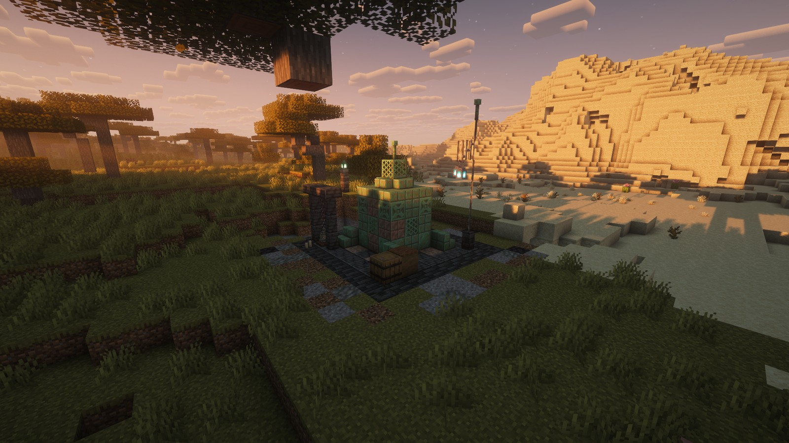 |  |
| 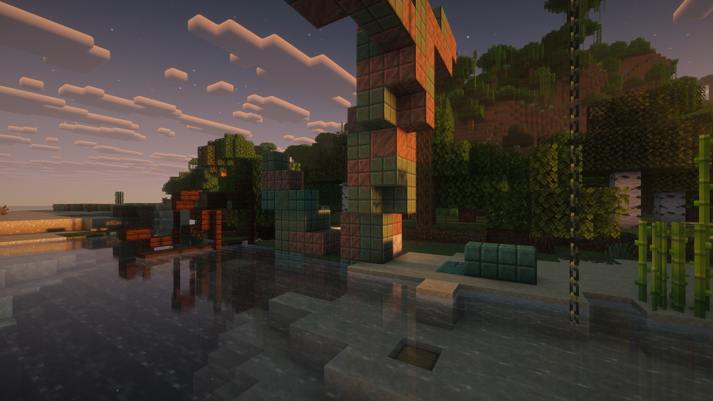 |  |

**腳步與落地**：石頭、木頭、草、碎石、沙、雪、羊毛、金屬八類地面（共 35 種方塊）的腳步聲與從高處落地的聲音，換成 Kenney 的 CC0 錄音再處理，踩上去聽得出是什麼地面，獵人與怪物都一樣。

## 四肢傷害


| 部位 | 健康值 | 防護 |
| --- | --- | --- |
| 頭部（含臉） | 80 | 頭頂：頭盔；臉：面罩 |
| 軀幹 | 80 | 護甲 |
| 左手、右手 | 各 80 | 無 |
| 左腿、右腿 | 各 80 | 護腿與靴子 |

- **死亡**：任三個部位歸零。打在已歸零部位的傷害會打折分給其他部位，所以不會打不死。
- **命中**：依高度與方向決定。高處從正面來是臉，從背後來是頭頂；中段打軀幹或靠近那一側的手；低處打那一側的腿。摔落打雙腿，溺水與飢餓打軀幹，火焰與爆炸平均分到全身。
- **恢復**：飽食度 6 以上時，仍有健康值且未持續失血的部位會緩慢恢復。藥水與金蘋果先補健康值最低的存活部位。手術包一次能救回一個歸零部位。
- **壞死效果**：腿變慢、跳不高；手降低攻擊、攻速與挖掘；軀幹讓飢餓加快；頭讓畫面四周變暗、小地圖失效。
- **HUD**：原本愛心的位置改成小人像，依健康值由綠轉紅；出血的部位會閃紅，骨折畫上裂痕，綁了止血帶與夾板也看得到。物品欄右側列出每個部位的狀態與剩餘時間。

### 出血與骨折

| 傷 | 從哪來 | 會怎樣 | 怎麼處理 |
| --- | --- | --- | --- |
| 出血 | 生物的攻擊、箭矢 | 那個部位每秒少 0.5，直到壞死，不會自然恢復 | **止血帶**止住出血。綁超過 3 分鐘，部位開始壞死。只有手術包能解下 |
| 骨折（手腳） | 摔落、爆炸、很重的一擊 | 壞死前就跟壞死一樣：腿斷了不能翻滾、只能跳撲，還會變慢；手斷了攻擊與挖掘變弱 | **夾板**撐住 4 分鐘，鬆了又斷著；**手術包**才能接骨 |

- **手術包**一次處理一個部位，依序優先處理壞死、骨折、止血帶和出血。歸零的部位會回到 24 點健康值。
- **止疼片**只會暫時壓住壞死的影響。

## 原版怪物與處決

| | |
| --- | --- |
|  |  |
|  |  |
|  |  |

- **聽覺與嗅覺**：獵人的動作會發出聲音，附近沒在追人的敵對怪物會先停住、轉頭朝聲音，再走過去查看，找不到就作罷。聽到不等於看到：牠們要親眼看見你才會鎖定。

  | 動作 | 傳多遠（格） |
  | --- | --- |
  | 揮擊、翻滾、跳撲 | 10 |
  | 跑步、滑鏟 | 12 |
  | 開始治療 | 16 |
  | 重擊 | 18 |
  | 在金鐘休息 | 24 |

  蹲著揮擊、翻滾、滑鏟、跑步時聲音減半；治療和鐘聲蹲著也一樣響。流血的獵人每兩秒散出血腥味，20 格內的怪聞得到，不需要看見；每有一個壞死的部位再遠 4 格。終界使者、殭屍化豬布林、狼、北極熊這類被惹才會攻擊的生物不受影響，豬布林、疣豬獸、伏守者、旋風人、嘎枝照原版的方式找人。
- **圍獵**：三隻以上的近戰怪物追同一個獵人時，最多兩隻同時上前出手，其餘的散開在你周圍約 4.5 格繞著、盯著你。出手過的或拖太久沒打到的，會把機會讓給繞到你最背後的那一隻，所以攻擊一直來，而且常常來自你看不到的方向。只有一兩隻時照常各自追擊；你雙腿壞死、可以被處決時，牠們不再輪流，誰搆得到誰上。
- **被注視時靜止**：殭屍一類的活屍（殭屍、屍殼、溺屍、殭屍村民）在 12 到 32 格外追你時，只要你正眼看著牠，牠就停在原地回瞪你；你一轉頭，牠就比平常走得更快地逼過來。盯著也只能拖 3 秒，之後不管你看不看，牠都會過來。進到 12 格內就照常追擊。其他怪物不會這樣。
- **追獵與前搖**：怪物盯上獵人後壓低身體逼近；每次近戰出手前先蓄力（殭屍、蜘蛛較快，伏守者、劫毀獸較慢），同時發出前搖嘶吼，蓄滿後撲出。前搖期間翻滾或拉開距離可以躲過，跑得太遠會被追一小段。
- **叫聲**：殭屍類、豬布林類、伏守者、終界使者、蜘蛛類、狼、北極熊等 35 種怪物的叫聲（狼的 7 種變種各有一套）由 OpenGameArt 的 CC0 錄音疊合後重新處理；骷髏類與嘎枝沒有喉嚨，前搖改成骨頭與木頭的聲音。
- **處決**：雙腿都壞死時，近身的怪物會把追獵者壓制住處決。每一族有自己的雙人招式：

| 招式 | 誰會用 | 怎麼殺 |
| --- | --- | --- |
| 撕咬關節技 | 殭屍、殭屍村民、屍殼、沉屍、殭屍化豬布林 | 從背後抓住手腕反折到斷，壓低後咬肩、撕扯 |
| 撲咬脖子 | 蜘蛛、洞穴蜘蛛、狼、蠹魚、終界蟎、夜魅，以及所有幼年怪物 | 撲倒後騎在身上咬喉嚨 |
| 跳起重壓 | 史萊姆、岩漿立方怪、硫磺方塊 | 跳高後壓扁，彈起再壓一次 |
| 拳頭重壓 | 伏守者、嘎枝 | 伏守者夾起舉過頭砸地；嘎枝一拳打倒；接著打斷雙臂、捶向肋骨 |
| 衝刺撕咬 | 劫毀獸、豬布獸、豬屍獸、北極熊 | 撞飛後咬住腹部甩動、拖行 |
| 踩踏處刑 | 衛道士、豬布林、豬布林蠻兵、惱鬼 | 踹倒、腳踩胸口、武器往下刺 |
| 斬殺 | 凋零骷髏，以及沒拿弓的骷髏類 | 砍斷雙臂，按住額頭割喉 |
| 扭頸 | 終界使者 | 擰住雙腕，夾頭舉起後扭斷 |
| 爆頭 | 拿弓的骷髏、流髑、沼骸、枯骸 | 站定瞄準，一箭射穿頭部 |

- 處決中另一名追獵者擊中怪物就能救人；被處決的本人打不斷。找不到站位（在走廊、洞穴裡）時不會發動，照一般攻擊處理。
- 雙方的身體不會互相穿過：每一招都對每種怪物逐 tick 量測，模型方塊互相壓進的深度不超過 0.1 格。

### 精英怪物

自然生成的殭屍類、骷髏類、蜘蛛、終界使者與凋零骷髏，偶爾是在霧裡待太久的**精英**：看著牠時名字發金光（例如「迅捷・鐵皮 殭屍」），身邊飄著金色的塵，血量多一半，還帶一到三個詞綴。白天在任何地方約 3%，夜裡 5%，離出生點每遠 500 格再多 1%（最多多 4%）；輕鬆難度減半，鏽錨站多一半。第二個詞綴有四分之一的機會，離出生點 1500 格以外還可能有第三個。訓練世界、和平難度、幼年與騎乘中的怪物不會是精英。

| 詞綴 | 做什麼 |
| --- | --- |
| 迅捷 | 移動快三成 |
| 鐵皮 | 護甲 +8，幾乎擊不退 |
| 巨大 | 體型大三成、血量再多八成、打得重三成、慢一成；處決招式是照一般體型量的，牠不處決，直接殺 |
| 嗜血 | 每一擊都會讓打中的部位流血，造成的傷害回到牠身上 |
| 霧行 | 被追獵者打中時有三成五的機會沒入霧裡，從你身旁或背後走出來（三秒一次；起手、硬直與處決中不會） |
| 鹽爆 | 死後一秒半炸開，白色的鹽會先聚起來、發出嘶聲，快退開 |
| 號令 | 盯上追獵者時，12 格內的同類怪物加速、加力，沒有目標的也會跟著撲上來 |

- 精英在打你（或被你打）時，24 格內的追獵者畫面上方會出現牠的金色血條。
- 打倒精英給的鹽是同類的（詞綴數＋1）倍，算上多出來的血量；追獵者擊殺時每個詞綴有六成機會掉一樣東西：鹽、止血帶、夾板、止痛藥，少數是手術包或強效注射器。

## 死亡與任務終止

| | |
| --- | --- |
|  | 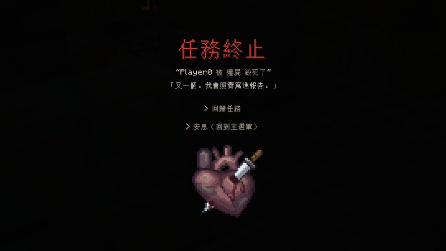 |

- **被生物殺死**（包括燈守）：其他生物全部隱去，視角繞到追獵者前上方。追獵者單膝跪地、手撐著地面發抖，隨後往側邊倒下，化成煙，原地留下殘香。
- **其他死因**（飢餓、摔落、溺水、火焰等）：踉蹌一下，直接向前撲倒，之後一樣化成煙。
- **任務終止**：畫面暗下，紅字「任務終止」，下面是死因，以及鏽錨站依死因說的一句話。選「回歸任務」在綁定的金鐘重生，選「安息」存檔後回到主選單。最下方是一顆被短刀貫穿、逐漸停止跳動的心臟；被處決時換成被咬開的心臟，死因裡的「處決」兩字是赤紅色。
- 墓碑在身體化成煙時才出現。如果那個位置在這幾秒內被放了東西，墓碑會在附近另找位置，小地圖的標記也會跟著移過去。

## 揮擊、精力與翻滾

| | |
| --- | --- |
|  |  |

- **揮擊**：每一擊都分成蓄力、爆發、過衝與回收四段。蓄力越到後面越吃力，手臂微微發抖；出手時加速甩出；武器的重量把身體帶過頭；最後慢慢收回。重武器的蓄力與回收更長。
- **劍氣**：每一擊在接觸點放出一道原版像素風的劍氣，方向跟著招式，左手揮擊時鏡像。
- **蓄力重擊**：拿著武器**按住右鍵**蓄力，準星下方出現蓄力條，**放開**就是重擊。重擊打中範圍裡的每一個（不只準星上的那個），傷害是武器攻擊力 ×（1 + 蓄力比例），力量每點再加 4%；蓄滿時鐘聲一響，還能打斷被打中的怪正在蓄的攻擊。不到 30% 就放開不會出手。蓄力時走得慢、不能跑，精力不會回復；放開時扣揮擊精力 ×（1 + 蓄力比例），武器耐久扣 2。速度屬性讓蓄力變快。

| 分支 | 蓄滿 | 重擊 |
| --- | --- | --- |
| 短刃 | 0.6 秒 | 前方 90° 交錯兩刀，每刀 0.6 倍 |
| 直刃 | 0.8 秒 | 前方 110° 斜斬 |
| 長槍 | 0.9 秒 | 一直線貫穿，比平常遠 2 格 |
| 鐮刀 | 1 秒 | 前方 200° 迴鐮，把打中的拉近 |
| 戰鎚 | 1.2 秒 | 前方 180° 橫掃，擊退加重 |
| 大劍 | 1.3 秒 | 前方 50° 直劈，比平常遠 1 格，落點再震一圈（半傷） |

| | |
| --- | --- |
| 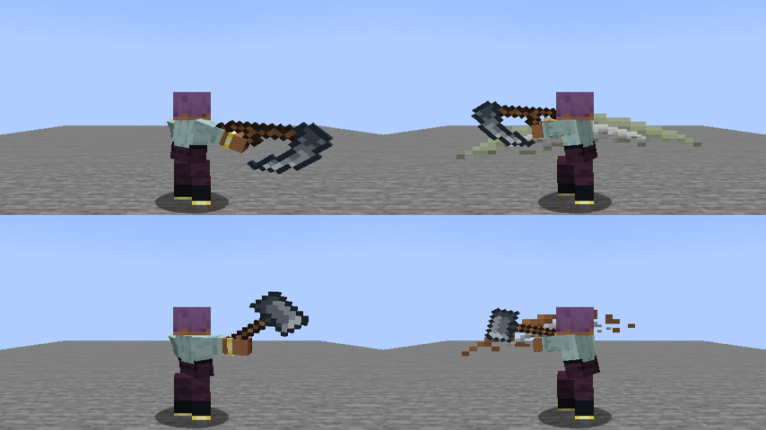 |  |

- **視角**：第一人稱的視角跟著揮擊轉動、下壓與傾斜，命中時頓挫一下（重擊更重）。按 `J` 可以關掉，設定存在 `config/mistinn-client.properties`。
- **精力**：上限 100（體質每點 +3），揮擊（揮空也算）、衝刺與翻滾都要花，花完停一秒才開始回復。精力歸零時跑不動，也不能出手。

| 武器 | 每次揮擊的精力 |
| --- | --- |
| 短刃 | 7 |
| 直刃 | 11 |
| 長槍 | 13 |
| 大劍 | 22 |
| 戰鎚 | 24 |
| 鐮刀 | 15 |
| 其他（空手等） | 4 |

- **翻滾**（左 Alt）：花 22 精力，方向跟著移動鍵，沒按方向時往後跳步。翻滾中有無敵時間，腿完整時 10 tick，腿越傷越短，翻得也越近。
- **翻滾的動作看雙手**：健全的手抱身撐地；壞死的手垂著被甩，翻滾往那一側歪；兩手都壞死時只能用肩膀翻。
- **跳撲**：任一腿骨折且未上夾板，或雙腿都壞死且未受止疼片作用時，只能往前撲。花 28 精力，期間仍會受傷。一般跳撲的落地衝擊是 12 點，分給仍有健康值的頭、軀幹與雙手。
- 軀幹壞死時精力回復變慢，腿壞死時衝刺更耗精力。

### 自己的眼睛

第一人稱看得到自己的身體：低頭是胸口、走動的雙腿，雙手垂在身側拿著東西，只有揮擊、蓄力、拉弓、進食、挖掘時才舉到眼前，做完再放下。

- **手握著東西一起動**：做事的是身體自己的手臂，從肩膀舉到眼前，拳頭握在握柄上；揮擊、重擊、拉弓、挖掘、進食，都是這雙手帶著東西在動，不會另外浮出一雙手，身體也不會少了手臂。手舉起來做事時，身體會往前站到視線下方、轉正面向你看的方向，手才伸得夠遠。六種武器各有自己的揮法，整段揮擊手都留在視線裡；慣用左手時左右對調。
- **視角跟著身體走**：走路時視角隨左右腳輕輕搖，衝刺時搖得更明顯；從高處落地會往下一沉，越高越重。精力剩不到 35% 時視角隨著喘息起伏。
- **跑步的姿勢**：衝刺時身體前傾、雙臂用力擺動，和視角的搖晃是同一個步伐。拿著武器的那隻手擺得小一些。
- **處置用自己的雙手**：注射、止血帶、夾板、手術時，身體自己的雙手舉到眼前：一隻手拿著器材，另一隻前臂伸出來讓它處理，拿針的手不會扎在自己那隻手臂上。注射器退後再扎進手腕附近的前臂、止血帶套過手掌拉到前臂再絞緊、夾板沿著前臂貼好、手術一針一針縫，都看得見；服藥是單手把藥瓶舉到嘴邊仰頭倒。另一隻手原本拿的東西會先收起來，做完再拿回來；慣用左手時左右對調。修護甲與修頭盔仍是低頭看著身上的工作，一拍一拍按壓。
- **自己的聲音**：第一次進入世界時會問要用男聲、女聲，還是不使用聲音（可以先試聽），之後跟著這位獵人保存；按 `V` 隨時可以更改。受傷、重傷、重擊與翻滾的用力、喘不過氣、重重落地、倒下，都聽得見自己；附近的人也聽得見你的叫聲。

## 霧岸燈塔與熄燈人

鏽錨站說，世界邊緣的海岸上立著一座座熄滅的燈塔，每一座都有燈守看守。海灘上偶爾能找到**霧岸燈塔**。門口的石龕裡有一座金鐘，沿塔內的螺旋樓梯經過補給層，最頂上的燈室就是熄燈人的地方。

| | |
| --- | --- |
|  |  |

熄燈人比人還高、駝著背，提燈頭掛在彎折的脖子上往前垂，右側和正面裂開，裡面一隻燃燒的眼；手臂細長，末端是三根鉤爪，鎖鏈從肩上斜掛到腰間。

### 它會想

熄燈人不照固定的順序出招。它一直在看你：站多遠、往哪跑、在做什麼（揮擊、翻滾、治療、衝刺）、精力剩多少、腿還在不在。它看到的永遠比實際晚 0.2 秒，像人一樣需要反應時間。

- **往前想六步**：每到能出手的時候，它會在招式之間推演最多六步，估算你可能的反應（往左翻、往右翻、往後翻、後退、反擊、硬吃），選分數最高的一條路，只走第一步，下一刻再重新想。
- **會學你**：同一場戰鬥裡，它記得你看到每一種預兆後做了什麼、什麼時候翻滾、喜歡站多遠、收招後多久反擊。總是提早翻滾的人，會看到它用假動作，或停在半空等你翻完；總往同一邊翻的人，會吃到蓋住那一邊的招。燈室裡 30 秒沒有活著的追獵者，它就忘了。
- **假動作**：假橫掃、假鉤鎖、假突刺和真招的聲音、動作一模一樣，在出手前轉成另一招；有些招會在前搖最後一刻停住，等你的翻滾用掉。
- **會挑人**：多人時，它偏好剛打過它的人、正在治療的人、精力見底或雙腿壞死的人。
- **躲不掉**：退到燈室角落也一樣會被它追上。

### 每一招都有預兆

一共 37 招，每一招開頭都有自己的聲音與動作；假動作借用它模仿的那一招。重招的前搖至少 0.7 秒，輕招至少 0.4 秒，抓取至少 0.8 秒。

| | |
| --- | --- |
|  |  |
| 耍槍：信號，接下來一定是刺擊 | 滑鏟：沿地面掃雙腿，跳起來能躲 |

| 類別 | 招式 | 打在哪裡 |
| --- | --- | --- |
| 步法 | 左右側步、後撤步、繞行、後跳、滑鏟、高速突襲 | 滑鏟打雙腿；高速突襲 0.4 秒衝近 8 格，接一記突刺打軀幹 |
| 近身 | 橫掃、雙段橫掃、迴旋掃、突刺、三連刺、下劈、反手撩、掃腿、槍柄撞擊、燈籠砸擊、抓取摔投 | 下劈打頭、燈籠砸擊打臉、反手撩打手臂、掃腿打雙腿，其餘大多打軀幹；迴旋掃連背後也打得到 |
| 中遠距離 | 跳砸、跳砸衝擊波、延遲跳砸、鉤鎖、鉤鎖甩地、鉤鎖回拉反刺、擲鉤掃場 | 跳砸與擲鉤打雙腿，衝擊波只打貼地的人；鉤鎖把你拉近再打臉 |
| 假動作 | 假橫掃、假鉤鎖、假突刺 | 不打人，出手前轉成下一招 |
| 黑暗階段 | 熄燈、霧中突襲、魂火橫掃 | 霧中突襲從背後打軀幹，魂火會點燃 |

招式之間能自然接續，例如橫掃接突刺、側步接下劈、突刺接掃腿再接下劈、後撤接鉤鎖。連招是它當下選出來的，不是固定套路。

### 看懂信號

它沒出手時不會呆站：會歪頭、換腳、喘一口氣，這些不代表什麼。下面四個動作是**信號**，而且是誠實的：做了之後 3 秒內會打人的下一招，一定屬於那一類，假動作也不會模仿信號。

| 信號 | 接下來 |
| --- | --- |
| 耍槍：長槍在手中轉一圈 | 刺擊：突刺、三連刺、高速突襲 |
| 甩燈籠：提燈繞一圈，火光變亮 | 燈籠：燈籠砸擊、魂火橫掃 |
| 拉緊鎖鏈：鏈子繃直作響 | 鉤鎖：鉤鎖、鉤鎖甩地、鉤鎖回拉反刺、擲鉤掃場 |
| 壓低身體：像要撲過來 | 突進：滑鏟、跳砸、跳砸衝擊波 |

### 黑暗階段


- 生命 300、護甲 8，有頭目血條。
- 生命一半以下，燈室裡的燈全熄，你會陷入黑暗；它的眼變成冷藍色的魂火，開始使用霧中突襲與魂火橫掃。霧中突襲出現前一定先有低語與遠方的鐘聲。
- 對著四座燈台按右鍵點亮，全部亮起時它會失衡五秒，受到的傷害 ×1.5；之後它會轉向燈台，把火一座座吸走。黑暗中，血條上的 ◆ 是點亮的燈台。
- 擊倒後掉落**鏽神的鹽塊**、3000 鹽，以及 30% 機率一件 III～IV 級的裝備。
- 進入燈室，或它受傷後在 32 格內，就會響起燈守戰的配樂。生命一半以下，熄燈時先響一聲低鐘，再接進黑暗階段的曲子。戰鬥結束就停。

## 霧鐘台與沉鐘

霧岸外的淺水裡，偶爾會有一座立在礁石上的**霧鐘台**（和燈塔差不多少見）：從前起霧時，這裡敲鐘替船指路。上岸處的石龕裡有一口金鐘，三層的方塔底層半淹在水裡，樓梯沿牆往上，補給一樣越往上越好；頂上露天的鐘樓吊著一口大鐘，第二位燈守**沉鐘**就站在鐘下。

沉鐘是溺死的敲鐘人，肩膀以上罩在一口裂開的銅鐘裡，鐘面長滿銅綠和藤壺，雙手握著拴鍊的鐘舌。它比熄燈人矮，卻寬得多，用的是同一套會推演、會學你的大腦。

- 生命 360、護甲 10，推不動，有頭目血條。
- **鐘響**：它用鐘舌敲自己的鐘，一圈聲波沿著地面往外滾。聲波經過時站在地上會被打中頭，跳起來或翻滾就能躲過。鐘響之前，鐘會先低鳴。
- **霧層**：每響一聲，房裡的霧就濃一層，看得到的距離從 16 格一路縮到 4.5 格，小地圖也跟著縮；十五秒沒響散一層。到第四層它會接連三響**深響**，一圈比一圈遠。血條上的 ◆ 是現在的霧層。
- **反鳴**：蓄滿的重擊會敲響它自己的鐘，霧散一層；連三記它會失衡五秒、受到的傷害 ×1.5，霧再散兩層。
- 生命一半以下鐘會裂開：鐘響變成雙響，霧散得更慢；它還會跳起來把鐘罩到你頭上，罩住就看不見也動不了，裡面再敲一響，落地前翻滾離開就躲得掉。
- 你上到鐘樓，霧就封住樓梯口，直到它倒下。
- 沒有獵人時，它在夜裡會不時自己敲一下鐘，聲音傳得很遠，不起霧也不打人；在霧裡迷路時可以循聲找過去。
- 擊倒後掉落**鏽神的鹽塊**、3500 鹽，以及 30% 機率一件 III～IV 級的裝備。

## 鹽坊與鏽輪

| | |
| --- | --- |
| 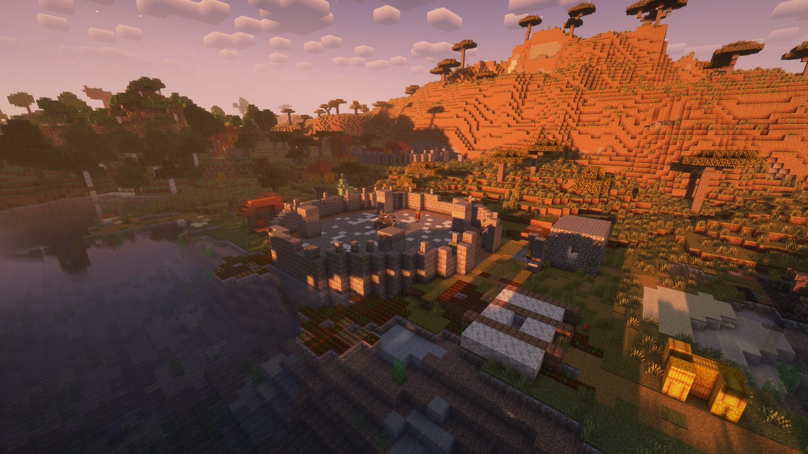 |  |

內陸平地上，比燈塔更少見的是廢棄的**鹽坊**：一圈石牆圍起的圓形輪場，場裡四根石柱，牆邊是乾掉的水道；門外有一口金鐘、存著補給的煮鹽房，和結成鹽殼的曬鹽池。輪場中央停著第三位燈守**鏽輪**。

鏽輪是那座提滷水的大輪子，還在轉。輪緣包著鐵、釘著鉚釘，輪輻之間掛著破木斗；輪軸往後接著一副軛，軛上鍊著一個彎著腰的人，腳拖在地上。它和另外兩位燈守一樣，用會推演、會學你的大腦打。

- 生命 420、護甲 12，推不動，有頭目血條。
- **正面與背面**：從它的正面打，打在鐵輪緣上，只吃三成五的傷害、冒火花；從背後打，打在輪軸和那個人身上，吃一倍半，蓄滿的重擊從背後算兩記失衡。它轉身很慢，繞到背後就是破綻。
- **輾壓衝撞**：輪子往後一沉、原地空轉刮出火花，接著直直滾向你，輾到雙腿。每滾完一趟沒撞到東西，它的勢就多一層（最多三層），越滾越快、越痛；血條上的 ◆ 是它現在的勢。它也會假裝要衝，空轉後改成別的招。
- **卡住**：衝撞中撞上牆或柱子會卡住約兩秒半，勢歸零，背後完全露出來；卡住時挨一記蓄滿的重擊，直接失衡五秒。引它去撞柱子。
- **近身**：輪緣橫掃、彈跳砸地（落地的震波打地上的人，跳起或翻滾可躲），衝過頭會倒滾回來。在它背後待太久，那個人會甩鍊；甩完鍊子要歇三秒，這段時間輪子會轉過來。
- 生命一半以下，那個人掙斷一條鍊子，輪緣的鐵片掉了，正面減傷剩五成五；衝撞會中途轉向你一次，砸地和撞牆會潑出鹽滷，踩在上面會變慢；還會沿場邊繞一圈再切進來。
- 你走進輪場，霧就封住門口，直到它倒下。
- 擊倒後掉落**鏽神的鹽塊**、特殊武器**鏽輪緣**、4000 鹽，以及 30% 機率一件 IV～V 級的裝備。

## 屬性與技能

| | |
| --- | --- |
|  | 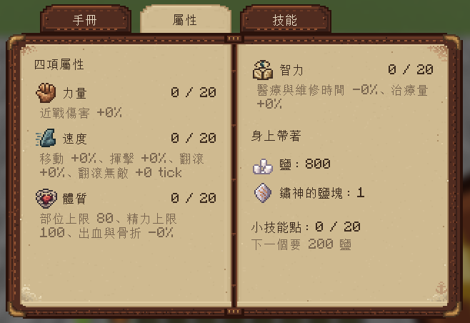 |

擊倒燈守，帶回鏽神的鹽塊，追獵者才開始成長。打開**追獵者手冊**的「技能」頁：大技能點用鏽神的鹽塊解鎖，第一個是**滑鏟**；之後用鹽一點一點買小技能點，加四項屬性。每個節點都要先學會前一個；點一下選取，再點一下學會。

| 屬性 | 每點的效果（0～20） |
| --- | --- |
| 力量 | 近戰傷害 +3% |
| 速度 | 移動 +1%、揮擊 +1.5%、翻滾初速 +1.5%；每 5 點翻滾無敵多 1 tick |
| 體質 | 每個部位的健康上限 +2（最高 120）、精力上限 +3（最高 160）、出血與骨折的機率 −3% |
| 智力 | 醫療與維修的使用時間 −2.5%（最少剩一半）、手術包與注射器的治療量 +3% |

- **大技能點**：消耗一個鏽神的鹽塊，從手上、快捷欄或格子背包裡找。之後的燈守守著其他大技能點，手冊上先標為「未開放」。
- **小技能點**：第一個 200 鹽，之後每買一個貴 100。四條分支各五點。
- **滑鏟**（跑步時按蹲下）：腳先著地滑行約五格，越滑越慢。身體只後仰約 40 度、頭抬著看前方，前腳伸直、後腳收在下面，低的那一側用手撐著地，另一隻手在前面保持平衡，最後撐地站起來；花 18 精力，冷卻 1.2 秒，會中斷手上的治療。沿途的敵對生物被掃到腳，各受 3 點傷害並被鏟起，每隻只中一次。滑鏟沒有無敵時間，雙腿都壞死時不能滑。
- 技能跟著存檔，死亡不會失去。手冊的「屬性」頁列出每項屬性現在帶來的效果，以及身上的鹽與鏽神的鹽塊。

## 成就

| | |
| --- | --- |
| 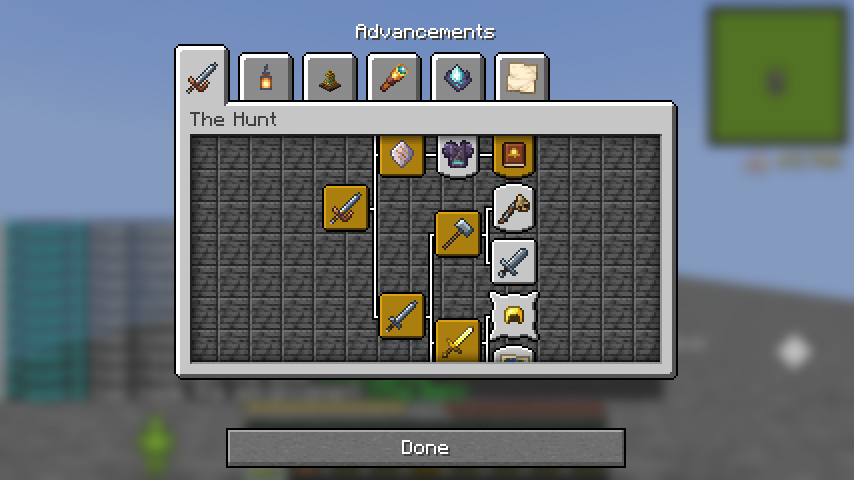 |  |

成就就是遊戲原本的**進度**：按 `L` 打開進度畫面，霧宿有自己的一個分頁（金鐘圖示），從手冊的「成就」書籤也能直接翻到。做到值得記住的事，畫面右上角會跳出原版的提示（排在小地圖左邊，不會互相遮住）、響一聲鐘音，並給一點鹽（只在第一次）；聊天室也會像原版進度一樣公告誰達成了什麼（滑鼠移到名稱上看條件，`/gamerule show_advancement_messages false` 可以關掉）。「百兵」會顯示六種武器分支已經完成幾種。成就跟著存檔，死亡不會失去；舊存檔的成就會在進入世界時自動搬進進度裡，不會重複給鹽；打倒熄燈人也是熄燈鉤鐮的條件。

| 成就 | 條件 | 獎勵鹽 |
| --- | --- | --- |
| 第一次狩獵 | 親手打倒一隻怪物 | 50 |
| 百兵 | 用直刃、大劍、長槍、短刃、戰鎚、鐮刀各打倒一隻怪物 | 600 |
| 一擊三命 | 一記重擊打中三隻以上 | 200 |
| 打斷 | 用蓄滿的重擊打斷怪物正在蓄的攻擊 | 200 |
| 間不容髮 | 在翻滾的無敵時間裡躲過一次攻擊 | 150 |
| 鏟倒 | 用滑鏟鏟到一隻怪物 | 150 |
| 第一個技能 | 在手冊學會滑鏟 | 100 |
| 專精 | 任一項屬性到 5 | 300 |
| 全面 | 四項屬性都至少 1 | 200 |
| 名器認主 | 用特殊武器打出它自己的重擊 | 400 |
| 打倒熄燈人 | 熄燈人在你附近倒下 | 1000 |
| 打倒沉鐘 | 沉鐘在你附近倒下 | 1200 |
| 打倒鏽輪 | 鏽輪在你附近停下 | 1500 |
| 霧海奪船 | 奪下一艘海盜船：船長在你附近倒下 | 1200 |
| 船隊剋星 | 這個世界奪下第三艘海盜船時，你在附近 | 2000 |
| 守住海岸 | 擊退一次海盜的夜間登陸 | 400 |
| 神射手 | 用火槍或手槍打倒一個海盜 | 300 |
| 精英獵手 | 打倒一隻精英怪物 | 300 |
| 三重威脅 | 打倒一隻帶著三個詞綴的精英 | 900 |
| 熬過霧潮 | 霧潮升起時在場，撐到天亮、一次也沒有倒下 | 500 |
| 賞金獵人 | 打倒一隻鏽錨站懸賞的精英 | 500 |
| 縫合天空 | 在一道空裂縫合時身在它底下 | 600 |
| 碎晶 | 打碎一隻晶龍 | 400 |
| 家園 | 喚醒一座晶耕族聚落的樞紐 | 500 |
| 晶冠 | 打倒一隻晶冠古龍 | 1000 |
| 撞上晶塔 | 晶冠古龍的衝撞撞上石頭暈倒時，在牠 24 格內 | 300 |
| 守住晶田 | 守住一次家園的晶潮 | 600 |
| 嚎聲止息 | 打倒一隻裂隙頭犬 | 400 |
| 鏽錨使徒 | 隱藏成就，達成方式不公開；取得後受到的傷害減少 8%，四項屬性各多 2 點（可以越過上限） | 5000 |
| 錨 | 把鏽神的鹽塊送上去 | 2000 |
| 霧宿 | 把鏽神的鹽塊丟進霧宿的爐火 | 2000 |
| 妙手 | 用手術包救回一個壞死的部位 | 150 |
| 鐘聲 | 在金鐘休息 | 50 |
| 拾回 | 從自己的墓碑取回殘香 | 100 |
| 鹽商 | 身上帶著 5000 鹽 | – |

## 操作

| 按鍵 | 作用 |
| --- | --- |
| 右鍵金鐘 | 敲響、設為重生點並恢復身體 |
| 右鍵墓碑 | 取回殘香裡的鹽與東西 |
| `M` | 打開地圖（走過的地形、家園、泰拉、空裂、懸賞與補給；點家園前往） |
| `N` | 切換小地圖縮放（每格 1／2／4 方塊） |
| `E` | 開啟物品欄（裝備、胸掛、背包與身體） |
| 右鍵頭盔欄 | 切換成面罩欄 |
| 右鍵燈台 | 點亮 |
| 右鍵投放站無線電 | 拿著 4 個紅石修好；故事中拿著鏽神的鹽塊交回 |
| `K` | 任務日誌 |
| 左 Alt | 翻滾或跳撲，依腿傷與藥效決定 |
| 跑步時按蹲下 | 滑鏟（學會之後） |
| 拿著武器按住右鍵 | 蓄力；放開時重擊 |
| 右鍵追獵者手冊，或按 `B` | 打開手冊：頁面、屬性、技能與合成表 |
| 按住 `R` | 快捷輪盤：口袋與胸掛裡的食物、醫療與維修包直接使用；移動滑鼠選，放開使用；移回中間再放開就收起；走路不受影響 |
| 按住 `F`（隊友倒地時） | 原地救援，十秒 |
| `H`（隊友倒地時） | 拖著隊友走並救援，十秒；再按一次放下 |
| `G` | 在準星指著的地方、怪物或掉落物上打標記給全隊看 |
| `J` | 切換第一人稱的揮擊視角 |
| `V` | 更改聲音（男聲、女聲、不使用） |
| 點擊格子 | 拿起或放下物品 |
| 拖曳 | 在格子之間移動，或在格子背包與快捷欄、箱子之間搬移 |
| `R`（拿著物品時） | 旋轉 |
| 右鍵 | 拿起一半；拿著東西時放下一個 |
| 拿著東西點另一樣東西 | 兩樣交換 |
| 雙擊 | 把格子與快捷欄裡同樣的東西收成一疊（安全箱不動） |
| 「整理」鈕（背包、胸掛標題旁） | 同樣的東西疊起來，大的先放；放不回去就不動 |
| `Q`（滑鼠指著物品時） | 丟一個；`Ctrl`＋`Q` 丟一整疊 |
| 數字鍵、`F`（滑鼠指著格子時） | 和那一格快捷欄、副手交換 |
| Shift＋點擊 | 格子裡的東西：開著箱子就放進箱子，護甲直接穿上，其他送到快捷欄；箱子裡的東西先放快捷欄，滿了再放格子；快捷欄上的東西放進格子，背包與胸掛直接穿上 |

## 品級與裝備

| 品級 | 顏色 | 頭盔 | 面罩 | 護甲 | 護腿 | 靴子 | 胸掛 | 背包 |
| --- | --- | --- | --- | --- | --- | --- | --- | --- |
| N | 鏽褐 | 鏽皮兜帽 | 鏽皮面巾 | 鏽皮背心 | 鏽皮綁腿 | 鏽皮短靴 | 鏽皮彈帶 | 鏽扣麻袋 |
| I | 灰 | 碼頭工盔 | 碼頭工護目罩 | 碼頭工護甲 | 碼頭工護腿 | 碼頭工工作靴 | 碼頭工腰掛 | 碼頭帆布包 |
| II | 綠 | 巡潮盔 | 巡潮面罩 | 巡潮胸甲 | 巡潮腿甲 | 巡潮長靴 | 巡潮胸掛 | 巡潮背包 |
| III | 藍 | 錨衛盔 | 錨衛護顎 | 錨衛胸甲 | 錨衛腿甲 | 錨衛戰靴 | 錨衛胸掛 | 錨衛行軍包 |
| IV | 紫 | 霧行面盔 | 霧行濾面 | 霧行重甲 | 霧行腿甲 | 霧行登山靴 | 霧行胸掛 | 霧行登山包 |
| V | 金 | 鐘守冠盔 | 鐘守面甲 | 鐘守聖甲 | 鐘守腿甲 | 鐘守鐵靴 | 鐘守戰術背心 | 鐘守負重架 |
| VI | 紅 | 鏽神骸盔 | 鏽神骸面 | 鏽神鱗甲 | — | — | 鏽神骸掛 | 鏽神骸匣 |

- 頭盔耐久 70～640、面罩 50～480、護甲 110～940、護腿 90～610、靴子 60～430；品級越高防護越好，護甲與護腿也越重。
- 頭盔只保護頭頂，臉要靠面罩；護甲只保護軀幹；護腿與靴子保護雙腿；手沒有防護。
- 原版物品依材質分級：鐵 I、金 II、綠寶石 III、鑽石 IV、獄髓 V；其餘依原版稀有度。
- 用鹽可以在鐵砧修理裝備。

### 輕裝與重裝

每個品級除了制式裝備，還有兩條產線。輕裝擋得少、裝得少，但不拖累腳步、更安靜、體力回得快；重裝擋得多、裝得多，但更慢、更吵、體力回得慢。說明框會列出每件的負擔。

| 品級 | 輕裝（頭盔、護甲、背包） | 重裝（頭盔、護甲、胸掛、背包） |
| --- | --- | --- |
| N | 拾荒：拾荒布帽、拾荒棉襖、拾荒腰包（4 格） | 廢鐵：廢鐵桶盔、廢鐵板甲、廢鐵工具掛（6 格）、廢鐵貨架（11 格，減速 1%） |
| I | 漁夫：漁夫油布帽、漁夫油布衣、漁夫斜背包（8 格） | 裝卸工：裝卸工鐵盔、裝卸工厚皮甲、裝卸工工具背心（12 格）、裝卸工大麻袋（17 格，減速 2%） |
| II | 斥潮：斥潮輕盔、斥潮皮甲、斥潮快取包（11 格） | 堤防：堤防重盔、堤防重甲、堤防彈藥背心（16 格）、堤防補給包（26 格，減速 2%） |
| III | 錨衛斥候：錨衛斥候盔、錨衛斥候甲、錨衛突擊包（16 格） | 錨衛破陣：錨衛破陣盔、錨衛破陣甲、錨衛突擊背心（20 格）、錨衛攻城包（36 格，減速 3%） |
| IV | 霧隱：霧隱兜帽、霧隱軟甲、霧隱輕裝包（19 格） | 霧牆：霧牆全罩盔、霧牆板甲、霧牆彈藥背心（24 格）、霧牆遠征包（42 格，減速 3%） |
| V | 鐘聲傳令：鐘聲傳令盔、鐘聲傳令甲、鐘聲傳令包（24 格） | 鐘樓：鐘樓巨盔、鐘樓重鎧、鐘樓重型背心（32 格）、鐘樓負重架（53 格，減速 4%） |
| VI | 鏽羽：鏽羽骸冠、鏽羽骸衣、鏽羽骸囊（26 格） | 鏽棺：鏽棺骸首、鏽棺骸鎧、鏽棺骸掛（34 格）、鏽棺（56 格，減速 5%） |

- 輕盔：耐久七成、護甲少 1；噪音 −5%、體力回復 +4%。重盔：耐久 1.4 倍、護甲與韌性各多 1，II 級起有面甲（臉部護甲 +1，疊在面罩上）；移動 −1%、揮擊 −3%、噪音 +5%、體力回復 −4%。
- 輕甲：耐久四分之三、護甲少 2、不減速；噪音 −10%、體力回復 +8%。重甲：耐久 1.4 倍、護甲多 2、韌性多 1.5、擊退抗性多 0.1、再慢 3%；揮擊 −6%、噪音 +15%、體力回復 −12%。
- 輕包：容量約六成、佔格小、不減速；噪音 −5%、體力回復 +3%。重包：容量約一倍半、寬而不高、減速 1%～5%；噪音 +8%、體力回復 −8%。重型胸掛：容量約 1.4 倍、減速 0.5%～2%；噪音 +5%、體力回復 −3%。
- 噪音乘在每個動作傳出的距離上（最低剩一半），體力回復乘在回復速度上（最低剩四成）；全身的頭盔、護甲、胸掛與背包相加。
- 整套：穿齊同品級的輕盔、輕甲、輕包，噪音再 −15%、體力回復再 +10%；穿齊同品級的重盔、重甲、重型胸掛、重包，被打時流血與骨折的機率 −25%。
- 都能在工作台用同品級的材料合成（輕裝加線與羊毛、重裝加鐵或箱子），也和制式一樣會在建築的箱子裡出現；燈守掉的裝備可能是任一產線的，精英怪物被打倒時有四分之一的機會掉一件 I～III 級（依詞綴數）的裝備。

## 格子背包

| 背包 | 格局（上方小口袋＋主袋） | 容量 | 移動速度 |
| --- | --- | --- | --- |
| N 鏽扣麻袋 | 3×2 | 6 | — |
| I 碼頭帆布包 | 4×3 | 12 | — |
| II 巡潮背包 | 1×2、1×2＋3×4 | 16 | −1% |
| III 錨衛行軍包 | 1×2、2×2、1×2＋4×4 | 24 | −1% |
| IV 霧行登山包 | 1×2、2×2、1×2＋4×5 | 28 | −1% |
| V 鐘守負重架 | 1×2、3×2、1×2＋5×5 | 35 | −2% |
| VI 鏽神骸匣 | 1×2、3×2、1×2＋5×6 | 40 | −2% |

| 胸掛 | 格局 | 容量 |
| --- | --- | --- |
| N 鏽皮彈帶 | 1×2 ×2 | 4 |
| I 碼頭工腰掛 | 1×2 ×4 | 8 |
| II 巡潮胸掛 | 2×2＋1×2 ×4 | 12 |
| III 錨衛胸掛 | 2×2 ×2＋1×2 ×4 | 16 |
| IV 霧行胸掛 | 2×2 ×2＋1×3 ×4 | 20 |
| V 鐘守戰術背心 | 2×2 ×3＋1×3 ×4 | 24 |
| VI 鏽神骸掛 | 2×3 ×2、2×2＋1×3 ×4 | 28 |

- 口袋四格（各 1×1）、安全箱 2×2。撿到的東西先疊到已有的同樣物品上，再依快捷欄、口袋、背包、胸掛的順序放入。
- 死亡時口袋、胸掛、背包與面罩連同身上其他東西收進墓碑，安全箱保留。
- 佔格依物品種類：鑽石與錠 1×1、木棍 1×2、工具與劍 1×3、礦石等方塊 2×2、護甲 2×2 或 2×3；注射器、止疼片與止血帶 1×1，手術包與夾板 1×2，維修包隨品級變大（護甲：III 1×2、IV 1×3、V／VI 2×2；頭盔：III／IV 1×2、V 1×3、VI 2×2）。
- 背包裡的東西存在背包物品本身，換背包時內容會跟著走。
- 背包和胸掛不能放進口袋、背包、胸掛或安全箱（沒有包套包），只能穿在身上、放快捷欄或放箱子；舊存檔裡放在裡面的，進來或換上背包時會拿出來，放到快捷欄或腳邊。
- 穿著的背包與胸掛會顯示在角色身上。
- **聲音**：東西放進或拿出背包時，聽得出是什麼材質：武器與工具是金屬，II 級以上的護甲是鐵片，布製品沙沙作響，鹽和沙是顆粒，瓶子會輕碰，書和紙會翻動，木頭會輕敲。穿上背包、胸掛、面罩、頭盔與護甲也各有自己的聲音：甩上肩、拉緊背帶、撕開魔鬼氈、扣上扣環、隔著濾罐吸一口氣。


## 從原始碼建置

需要 JDK 25。原始碼放在 OneDrive 或含中文的路徑時，請用 `build.ps1`：它會把資料夾對應到磁碟代號，並把 Gradle 的快取與輸出放到 `~/.gradle` 底下。

```powershell
.\build.ps1 build               # 產生 mistinn-<版本>.jar
.\build.ps1 runClient           # 開發用客戶端
.\build.ps1 runClientGameTest   # 自動測試：真正的客戶端跑完核心流程並截圖
```

一般路徑可以直接使用 `./gradlew build`。

貼圖與模型是森之宿茶室自己做的原創素材；音效以 CC0 公眾領域錄音剪接、疊加與處理，再加上專案自己的雜訊合成製成（來源見[授權](#授權)與 [CREDITS.md](CREDITS.md)）。倉庫裡只放成品（PNG、OGG、JSON），不放繪製與生成用的原始檔。

## 專案結構

```text
src/main/java/life/shizune/mistinn/
  bell/        金鐘：歇息與重生
  body/        四肢傷害、出血與骨折、恢復
  stamina/     精力、翻滾與跳撲
  block/       金鐘、墓碑、紅石息壤
  gear/        各品級裝備的數值
  grid/        格子背包：佔格、規則、胸掛與面罩、伺服器端操作、快捷使用、網路封包
  boss/        燈守共用的招式、命中判定、感知、玩家模型與六步推演
  keeper/      燈守：共用的骨架、霧牆，熄燈人的招式表、黑暗與燈台，沉鐘的招式表與霧層，鏽輪的招式表與鹽滷
  medical/     醫療、用藥與裝備維修
  residue/     死亡、殘香與墓碑
  room/        好友連機的邀請碼與房間鑰匙
  skin/        皮膚同步：檢查與轉送玩家的皮膚
  team/        隊伍：人數上限、名稱顏色、友軍傷害、共用大技能、隊友位置、倒地與救援、標記信標、更新說明
  story/       故事模式：世界模式、進度、保證出現的地點與無線電
  salt/        鹽
  tier/        品級
  weapon/      武器分支與材質
  world/       出生點與世界建築
  mixin/       物品欄、揮擊音效
src/client/java/life/shizune/mistinn/client/
  anim/        揮擊動作與第一人稱的揮擊視角
  move/        翻滾與跳撲的動作
  title/       主選單與模式選擇
  worldmap/    主選單的世界地圖
  multiplayer/ 開房、用邀請碼加入、中繼與登入檢查
  skin/        套用同步來的皮膚
  team/        隊友的位置、救援按鍵與提示、倒地姿勢、畫面上的信標
  music/       燈守戰的配樂
  medical/     治療動作、音效與進度 HUD
  death/       死亡過場與任務終止畫面
  story/       任務目標、字幕、故事卡、過場與任務日誌
  gear/        穿在身上的面罩、胸掛與背包
  body/        部位 HUD
  grid/        物品欄介面、格子背包面板與快捷輪盤
  keeper/      熄燈人、沉鐘與鏽輪的外觀、待機動作與招式動畫
  map/         小地圖（地形、隊友、金鐘、墓碑）
  tier/        「◆ 名稱」與提示
src/gametest/  客戶端遊戲測試與拍攝
docs/          設計文件
```

## 接下來

1. **霧宿的人**：霧宿裡的第3401號與其他沒有回去的獵人，能對話。設計見 [docs/phase5-design.md](docs/phase5-design.md)。
2. **之後**：多人合作。

## 參與貢獻

歡迎錯誤修復、功能、測試、美術與文件更新。請先讀 [貢獻指南](CONTRIBUTING.md)。

> [!IMPORTANT]
> AI 協助與手寫的貢獻一視同仁。Pull Request 必須通過安全審查，貼圖與模型必須是原創。詳見貢獻指南的[使用 AI 工具](CONTRIBUTING.md#使用-ai-工具)。

問題回報請到[森之宿茶室官網](https://moriteahouse.shizune.life/account)。

## 授權

Copyright (c) 2026 Keeiv。

採用 **GNU Affero General Public License v3.0 only（AGPL-3.0-only）**，條文見 [LICENSE](LICENSE)，著作權聲明見 [NOTICE](NOTICE)。可以複製、修改、散布與商業使用；散布修改後的版本時，須以相同授權提供完整的對應原始碼。

所有貼圖與模型為原創，與程式碼使用相同授權。

音效與配樂的素材來源（皆為 [CC0 1.0](https://creativecommons.org/publicdomain/zero/1.0/) 公眾領域授權，可與 AGPL 併用）：

| 素材 | 作者 | 授權 | 網址 |
| --- | --- | --- | --- |
| RPG Audio、Impact Sounds、Interface Sounds、Casino Audio | Kenney Vleugels（Kenney.nl） | CC0 1.0 | <https://kenney.nl/assets> |
| Various Scissors | sinny（OpenGameArt） | CC0 1.0 | <https://opengameart.org/content/various-scissors> |
| VSCO 2 Community Edition | Versilian Studios | CC0 1.0 | <https://versilian-studios.com/vsco-community/> |

音效由錄音剪接、疊加、濾波與變速製作，部分混入專案的雜訊合成。配樂由 CC0 樂器與金屬敲擊錄音編曲。每個 OGG 用了哪些素材，逐檔列在 [CREDITS.md](CREDITS.md)。

> [!NOTE]
> 字標使用 [Fusion Pixel Font](https://github.com/TakWolf/fusion-pixel-font)（SIL Open Font License 1.1）繪製。Minecraft 是 Mojang Studios 的商標，本模組與 Mojang、Microsoft 沒有關聯。
