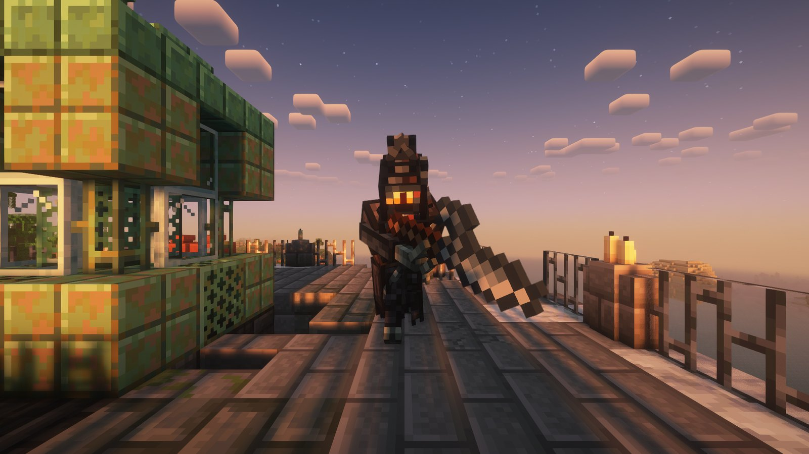
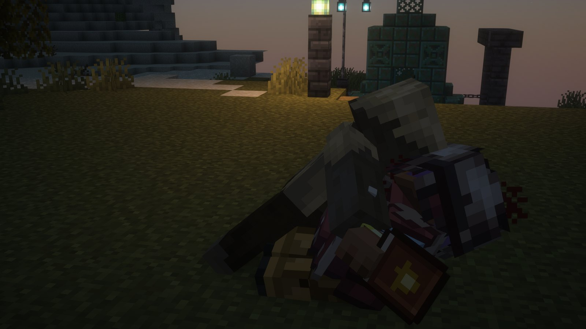
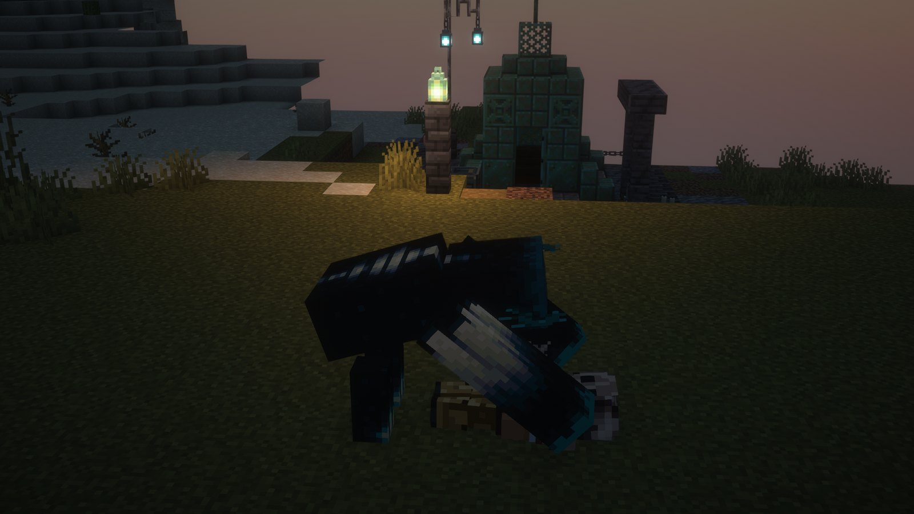
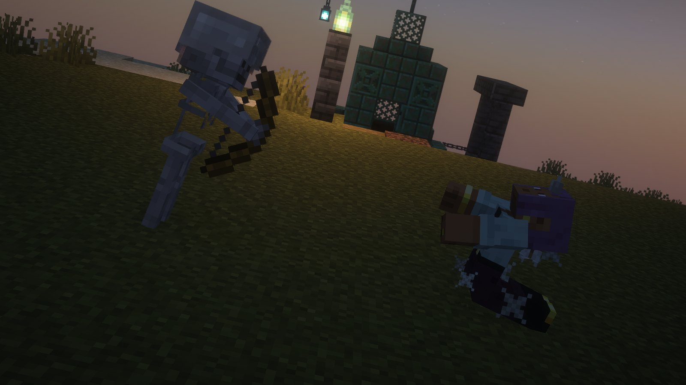
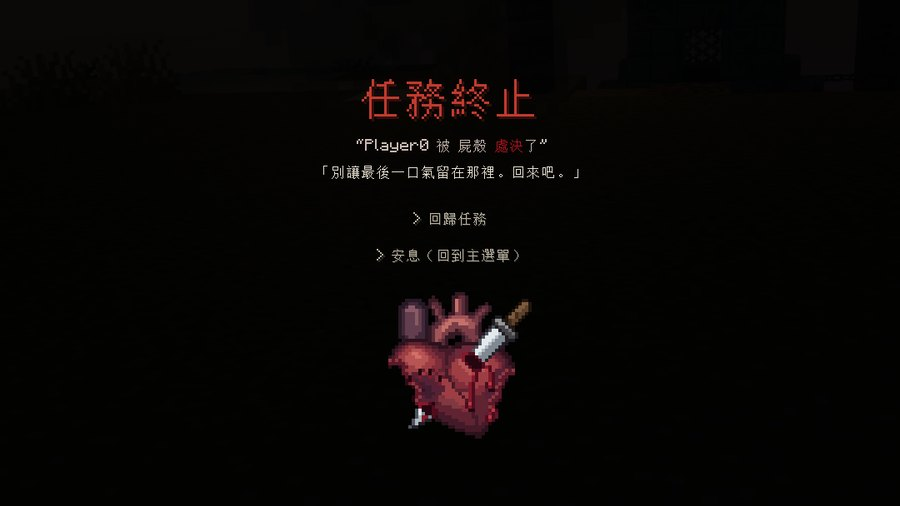
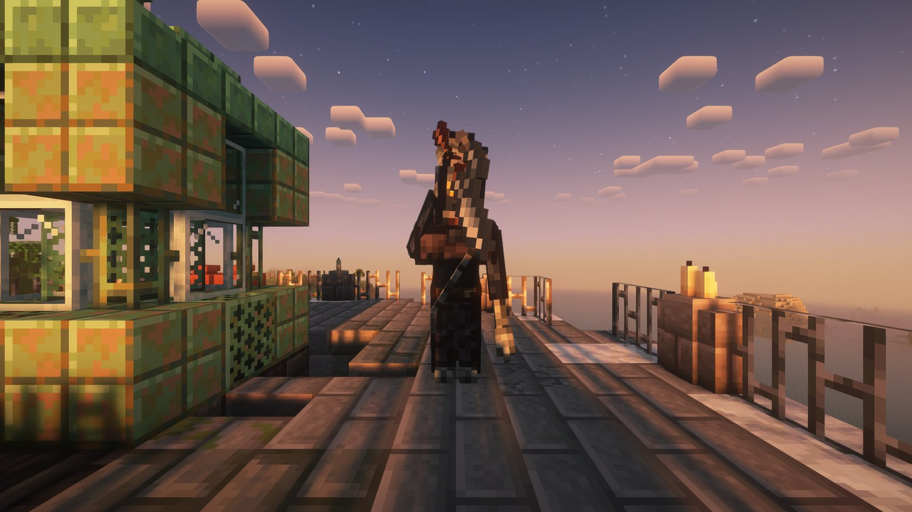
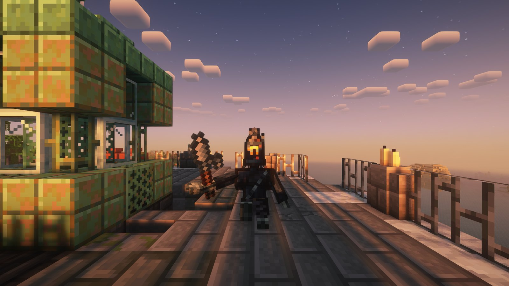
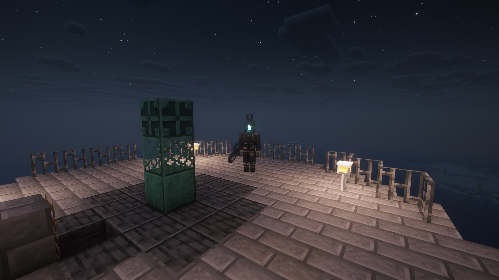

<div align="center">

[EN](docs/README.en.md) | **繁中**

<h1>
  <picture>
    <source media="(prefers-color-scheme: dark)" srcset="assets/logo/mistinn-wordmark-light.png">
    
  </picture>
</h1>

**鏽錨站特派的追獵者，走進世界邊緣的禁區。**

一款魂系的 Minecraft Java 模組：以鹽為貨幣、死亡化為殘香、在金鐘旁歇息，<br>
四肢分開計算的傷害、七個品級的裝備、參考撤離射擊遊戲的格子背包，以及守在燈塔頂的燈守。

[](https://github.com/keeiv/mistinn-exile/actions/workflows/ci.yml)


[森之宿茶室](https://moriteahouse.shizune.life) ·
[功能一覽](#功能一覽) ·
[開始遊玩](#開始遊玩) ·
[第二階段設計](docs/phase2-design.md) ·
[貢獻指南](CONTRIBUTING.md)

</div>


<details>
<summary>主選單</summary>


</details>

## 目錄

- [功能一覽](#功能一覽)
- [開始遊玩](#開始遊玩)
- [故事模式](#故事模式)
- [世界與建築](#世界與建築)
- [四肢傷害](#四肢傷害)
- [原版怪物與處決](#原版怪物與處決)
- [死亡與任務終止](#死亡與任務終止)
- [揮擊、精力與翻滾](#揮擊精力與翻滾)
- [霧岸燈塔與熄燈人](#霧岸燈塔與熄燈人)
- [屬性與技能](#屬性與技能)
- [操作](#操作)
- [品級與裝備](#品級與裝備)
- [格子背包](#格子背包)
- [從原始碼建置](#從原始碼建置)
- [專案結構](#專案結構)
- [接下來](#接下來)
- [參與貢獻](#參與貢獻)
- [授權](#授權)

## 功能一覽

| 範圍 | 做什麼 |
| --- | --- |
| 鹽 | 貨幣。擊敗生物獲得：敵對生物給等同最大生命值的鹽，其他生物給五分之一（至少 1）。建築裡撿到的鹽，右鍵使用後每個換成 10 點。 |
| 殘香與墓碑 | 死亡時身上的鹽全部化為殘香，身上帶的東西（裝備、快捷欄、口袋、胸掛與背包；安全箱除外）也一起收進陣亡點的墓碑，不會掉在地上；右鍵使用墓碑可全部取回。再次死亡前沒取回，舊的殘香就會散去：鹽沒了，東西散落在原地。 |
| 死亡過場 | 被生物殺死時其他生物全部隱去，追獵者單膝跪地、往側邊倒下、化成煙；其他死因則直接倒下。之後是「任務終止」畫面：死因、鏽錨站的一句話，以及回歸任務或安息。 |
| 故事模式 | 故事模式有序章與第一章：任務目標、無線電對話、像素風故事卡與遊戲內的過場，按 `K` 開任務日誌。後面的章節還在製作中。 |
| 追獵者訓練 | 建立單人世界時可選。跟著發光箭頭和教官指引，在海上訓練場演練裝備、戰鬥、醫療、合成、金鐘重生、殘香、無線電和燈守戰。入座投放艙後選擇故事模式或自由探索。 |
| 金鐘 | 右鍵敲響可設定重生點。每口鐘各自冷卻現實時間一小時，所有玩家共用同一口鐘的冷卻。邊緣世界沒有這種物質，無法合成。 |
| 四肢傷害 | 原版愛心由頭、軀幹、雙手、雙腿六個部位取代，各 80 健康值（體質最高加到 120），任三個部位歸零才會死亡；每個部位只由覆蓋它的裝備保護，歸零會有壞死效果。 |
| 出血與骨折 | 受到攻擊可能出血，部位會慢慢壞死，可用止血帶止住。摔落、爆炸與重擊可能骨折，腿斷了只能跳撲。手術包能接骨，夾板能暫時撐住。 |
| 醫療與維修 | 強效注射器、手術包、止疼片、止血帶、夾板，以及 III～VI 級的護甲與頭盔維修包；使用要花幾秒，各有動作與音效，受到重擊或翻滾會中斷。 |
| 合成 | 每件醫療道具、維修包、裝備與武器都能合成或鍛造。永久金鐘在世界裡找到，鏽神的鹽塊由燈守掉落，也是 VI 級裝備的材料。 |
| 一次性金鐘 | 用金礦（金礦石或粗金）加鐵鍊合成。鐘體脆弱，只能敲一次，喚回第一個敲鐘的人後就碎裂。敲過的鐘打碎時也不會掉落。 |
| 小地圖 | 內建在右上角，北方朝上；標出你的朝向、綁定的金鐘與陣亡點，超出範圍時貼在邊緣指方向。 |
| 武器 | 直刃、大劍、長槍、短刃、戰鎚、鐮刀六個分支，每個分支有木、石、鐵、鑽石、獄髓五種材質，從第一天就有東西可用；另有錨刃、沉鐘大劍、霧行長槍、鹽牙四把具名武器，以及熄燈鉤鐮、霧燈杖、潮鐘巨鎚三把要滿足條件才拿得動的特殊武器。每把都有原版畫風的貼圖與手持模型、揮擊與命中音效、第一與第三人稱動作。 |
| 揮擊 | 每一擊分成蓄力、爆發、過衝與回收，在接觸點放出原版像素風的劍氣，方向跟著招式：直刃斜斬、大劍直劈、長槍一道直線、短刃交錯兩刀、戰鎚橫掃、鐮刀上撩。按住右鍵可以**蓄力重擊**，打中範圍裡的每一個。第三人稱扭腰跨步，第一人稱的視角跟著揮擊轉動，命中時頓挫。 |
| 原版怪物 | 叫聲由 CC0 錄音合成，更低沉也更野蠻；動作依骨架與移動方式重做。追獵時壓低身體，出手前有看得見、聽得見的前搖，可以翻滾閃開。雙腿都壞死時會被處決，見[原版怪物與處決](#原版怪物與處決)。 |
| 精力與翻滾 | 揮擊、衝刺與翻滾都花精力。翻滾有無敵時間，距離看雙腿、動作看雙手。腿傷可能迫使你跳撲，落地衝擊由上半身承受。 |
| 主選單 | 原創的霧中海岸與熄滅的燈塔，霧會飄、海會閃、燈室裡的餘燼忽明忽暗。 |
| 追獵者手冊 | 第一次進入世界時放在快捷欄。原創的手冊介面：十一頁世界觀、任務與規則，以及屬性與技能樹。 |
| 世界與建築 | 出生點必定是一座破損或仿冒的追獵者投放站；世界各處還有投放站、鹽塚、鏽錨殘骸與霧中崗哨，裡面有補給。 |
| 品級 | N、I～VI 七級；名稱顯示為品級色的「◆ 名稱」，物品欄以品級色為底。 |
| 裝備 | 每個品級各有頭盔、面罩、護甲、胸掛與背包，N～V 另有護腿與靴子；耐久、防護、容量與格局都不同，各有兩行故事描述。 |
| 格子背包 | 四個口袋、胸掛與背包的格子、死亡不會掉落的安全箱。每件物品依種類佔用不同格數，可以旋轉。背包、胸掛和部分醫療用品有依佔格繪製的專用圖，穿戴的背包與胸掛也會顯示在身上。生存與冒險模式使用原創物品欄，封閉原版的 27 格。 |
| 霧岸燈塔 | 海岸上熄滅的燈塔，頂層燈室由第一位燈守**熄燈人**看守。它有 37 招，會一邊看你一邊往前推演六步，學你的習慣、用假動作騙你翻滾；每一招都有聽得見、看得見的預兆，四個誠實的信號告訴你接下來是哪一類招。戰鬥有專屬配樂，進入黑暗階段時換成更急促的曲子。 |
| 屬性與技能 | 擊倒燈守帶回鏽神的鹽塊，在手冊的技能頁學會大技能點**滑鏟**；之後用鹽一點一點加力量、速度、體質與智力，見[屬性與技能](#屬性與技能)。 |
| 語言 | 繁體中文與英文。 |

| | |
| --- | --- |
|  |  |

### 武器

六個分支各有自己的揮擊、佔格與手感，材質決定傷害、耐久與品級：

| 分支 | 揮擊 | 每秒攻擊 | 攻擊距離 | 佔格 | 配方（`X` 材料、`#` 木棍、`.` 空格） |
| --- | --- | --- | --- | --- | --- |
| 直刃 | 由右上往左下斜斬 | 1.6 | 3 | 1×3 | `..X` / `.X.` / `#..` |
| 大劍 | 舉過肩後重劈 | 0.7 | 3.5 | 1×4 | `.XX` / `.XX` / `#..` |
| 長槍 | 後收再突刺 | 1.1 | 4 | 1×4 | `..X` / `.#X` / `#..` |
| 短刃 | 一次揮擊兩段交叉斬 | 2.6 | 2.6 | 1×2 | `X` / `#` |
| 戰鎚 | 側邊蓄力後橫掃，額外擊退 | 0.8 | 3 | 2×3 | `XXX` / `XXX` / `.#.` |
| 鐮刀 | 雙手握，從左下往右上撩 | 1.0 | 3.8 | 2×4 | `XXX` / `..#` / `.#.` |

| 材質 | 品級 | 耐久 | 直刃 | 大劍 | 長槍 | 短刃 | 戰鎚 | 鐮刀 |
| --- | --- | --- | --- | --- | --- | --- | --- | --- |
| 木 | N | 59 | 4 | 7 | 4.5 | 2.5 | 6 | 5.5 |
| 石 | N | 131 | 5 | 8 | 5.5 | 3.5 | 7 | 6.5 |
| 鐵 | I | 250 | 6 | 9 | 6.5 | 4.5 | 8 | 7.5 |
| 鑽石 | IV | 1561 | 7 | 10 | 7.5 | 5.5 | 9 | 8.5 |
| 獄髓 | V | 2031 | 8 | 11 | 8.5 | 6.5 | 10 | 9.5 |

材料和原版工具一樣（任何木板、圓石類、鐵錠、鑽石）；獄髓武器在鍛造台由鑽石武器升級。具名武器：

| 武器 | 揮擊 | 傷害 | 每秒攻擊 | 攻擊距離 |
| --- | --- | --- | --- | --- |
| 錨刃 | 由右上往左下斜斬 | 7 | 1.6 | 3 |
| 沉鐘大劍 | 舉過肩後重劈，命中時鐘鳴 | 12 | 0.7 | 3.5 |
| 霧行長槍 | 後收再突刺 | 8 | 1.1 | 4.5 |
| 鹽牙 | 一次揮擊兩段交叉斬 | 5 | 2.6 | 2.6 |

傷害為面板數值（含徒手的 1 點）。

### 特殊武器

三把特殊武器要滿足條件才能完全發揮。條件不夠時攻擊力減半、揮得慢、也不能蓄力重擊；說明文字會列出條件，達成的綠色、還沒達成的紅色。

| 武器 | 分支 | 條件 | 特殊重擊 | 取得 |
| --- | --- | --- | --- | --- |
| 熄燈鉤鐮 | 鐮刀（8 傷） | 打倒熄燈人、力量 3 | 迴鐮之後，把打中的最遠一個鉤到腳邊並打斷牠的攻擊 | 熄燈人倒下時掉落 |
| 霧燈杖 | 長槍（6 傷） | 智力 4 | 燈爆：前方炸開一團藍火，半徑 3.5 格內都受傷並著火，威力是（6 + 智力）×（1 + 蓄力比例） | `..L` / `.#.` / `#..`（L 靈魂燈籠） |
| 潮鐘巨鎚 | 戰鎚（13 傷） | 力量 5、體質 3 | 鐘震：以自己為中心半徑 4.5 格一整圈震飛 | `IBI` / `.#.` / `.#.`（I 鐵磚、B 鐘） |


## 開始遊玩

需要 Minecraft Java 版 26.3、[Fabric Loader](https://fabricmc.net/use/) 0.20.1 以上、[Fabric API](https://modrinth.com/mod/fabric-api) 與 Java 25。

1. 安裝 Fabric Loader，建立 26.3 的設定檔。
2. 把 `mistinn-<版本>.jar` 與 Fabric API 放進 `mods` 資料夾。
3. 進入生存模式的世界。

> [!NOTE]
> 本模組只支援 Minecraft 26.3。創造模式保留原版物品欄，格子背包只在生存與冒險模式啟用。

舊存檔裡的鐘鳴膏會在讀取時轉成等量的粗金。

### 好友連機

房主先進入故事模式或自由探索世界，按 Esc → **世界與連機** → **開放房間**。填入好友可連到的 IP 或網域名稱，即可複製完整位址。好友使用相同版本的霧宿模組，從 **多人遊戲 → 直接連線** 貼上位址。房主可以在同一頁關閉房間，存檔留在房主電腦。

不同網路的好友可以用公開位址或共用私人虛擬網路直連。使用公開 IPv4 時，請在路由器將所選的 TCP 連接埠（預設 `25565`）轉發到房主電腦，並允許該連線通過防火牆。如果電信商使用 CGNAT 而無法轉發，可改用共用私人虛擬網路。好友加入房間時須使用通過驗證的 Minecraft 帳號。 [Minecraft Java 版多人連線說明](https://help.minecraft.net/hc/en-us/articles/32899741198989)

故事世界會保存燈守被擊倒和鹽塊已交回的進度。較晚加入的好友走到對應的目標時，也可以繼續推進自己的任務。

## 故事模式


在世界清單建立新世界時，可以選擇**故事模式**、**自由探索**或**追獵者訓練**。自由探索沒有任務，其餘玩法都一樣。故事模式目前有序章「投放」與第一章「熄燈」。

追獵者訓練會以標準生存設定建立存檔，先把你送到鏽錨站的海上訓練場。完成課程後，走進投放艙按下控制鈕入座，選擇在同一個存檔裡開始故事或自由探索。練習用的鹽和裝備會留在訓練場。

- **保證出現的地點**：故事世界第一次啟動時，會在離出生點約 150～240 格處蓋一座完整的投放站，優先選平坦的陸地。接著從投放站搜尋海岸來蓋燈塔，找不到海岸時改選較遠的空地。
- **任務目標**：顯示在畫面左上角，附上提示與距離；換新目標時會亮起。小地圖上的琥珀色菱形是目的地。
- **無線電**：投放站的無線電燒壞了，拿著 4 個紅石右鍵修好後，鏽錨站的通訊員「舵」會開始通話，台詞以字幕逐字出現。
- **故事卡**：章節開頭與結尾是全畫面的像素插畫，點擊繼續，`Esc` 略過。
- **過場**：熄燈人倒下時，畫面上下出現黑邊，視角離開你、繞著它，聽它說完最後的話；`Esc` 略過。
- **任務日誌**（`K`）：看完成的目標，以及所有聽過的通話。

| 章 | 目標 |
| --- | --- |
| 序章　投放 | 收集 10 點鹽 → 找到完整的投放站 → 修好無線電 |
| 第一章　熄燈 | 前往霧岸燈塔 → 在門口的金鐘歇息 → 登上燈室 → 擊倒熄燈人 → 把鏽神的鹽塊交回投放站 |

## 世界與建築

鏽錨站把追獵者從邊緣外投進禁區。你醒來的地方不是真正的投放站，而是兩種之一：早已**破損的追獵者投放站**，或是有人照著鏽錨站的樣子蓋的**仿冒的追獵者投放站**。出生點固定在平台上，不會卡在牆裡；快捷欄裡有一本《追獵者手冊》。

| 建築 | 在哪裡 | 裡面有什麼 |
| --- | --- | --- |
| 追獵者投放站 | 陸地，少見 | 一座一次性金鐘；補給桶裡是石與鐵武器、口糧、I～II 級裝備 |
| 鹽塚 | 海灘與惡地 | 頂上的箱子：鹽、石英、低階背包，偶爾有鹽牙 |
| 鏽錨殘骸 | 海灘 | 半埋在沙裡的巨錨，旁邊埋著箱子：鐵武器、I～III 級護甲，偶爾有錨刃 |
| 霧中崗哨 | 陸地，很少見 | 塔頂瞭望者的箱子：鐵與鑽石武器、II～IV 級裝備，偶爾有霧行長槍或一次性金鐘 |

| | |
| --- | --- |
|  |  |
|  |  |

## 四肢傷害



| 部位 | 健康值 | 防護 |
| --- | --- | --- |
| 頭部（含臉） | 80 | 頭頂：頭盔；臉：面罩 |
| 軀幹 | 80 | 護甲 |
| 左手、右手 | 各 80 | 無 |
| 左腿、右腿 | 各 80 | 護腿與靴子 |

- **死亡**：任三個部位歸零。打在已歸零部位的傷害會打折分給其他部位，所以不會打不死。
- **命中**：依高度與方向決定。高處從正面來是臉，從背後來是頭頂；中段打軀幹或靠近那一側的手；低處打那一側的腿。摔落打雙腿，溺水與飢餓打軀幹，火焰與爆炸平均分到全身。
- **恢復**：飽食度 6 以上時，仍有健康值且未持續失血的部位會緩慢恢復。藥水與金蘋果先補健康值最低的存活部位。手術包一次能救回一個歸零部位。
- **壞死效果**：腿變慢、跳不高；手降低攻擊、攻速與挖掘；軀幹讓飢餓加快；頭讓畫面四周變暗、小地圖失效。
- **HUD**：原本愛心的位置改成小人像，依健康值由綠轉紅；出血的部位會閃紅，骨折畫上裂痕，綁了止血帶與夾板也看得到。物品欄右側列出每個部位的狀態與剩餘時間。

### 出血與骨折

| 傷 | 從哪來 | 會怎樣 | 怎麼處理 |
| --- | --- | --- | --- |
| 出血 | 生物的攻擊、箭矢 | 那個部位每秒少 0.5，直到壞死，不會自然恢復 | **止血帶**止住出血。綁超過 3 分鐘，部位開始壞死。只有手術包能解下 |
| 骨折（手腳） | 摔落、爆炸、很重的一擊 | 壞死前就跟壞死一樣：腿斷了不能翻滾、只能跳撲，還會變慢；手斷了攻擊與挖掘變弱 | **夾板**撐住 4 分鐘，鬆了又斷著；**手術包**才能接骨 |

- **手術包**一次處理一個部位，依序優先處理壞死、骨折、止血帶和出血。歸零的部位會回到 24 點健康值。
- **止疼片**只會暫時壓住壞死的影響。

## 原版怪物與處決

| | |
| --- | --- |
|  |  |
|  |  |
|  |  |

- **追獵與前搖**：怪物盯上獵人後壓低身體逼近；每次近戰出手前先蓄力（殭屍、蜘蛛較快，伏守者、劫毀獸較慢），同時發出前搖嘶吼，蓄滿後撲出。前搖期間翻滾或拉開距離可以躲過，跑得太遠會被追一小段。
- **叫聲**：殭屍類、豬布林類、伏守者、終界使者、蜘蛛類、狼、北極熊等 35 種怪物的叫聲（狼的 7 種變種各有一套）由 OpenGameArt 的 CC0 錄音疊合後重新處理；骷髏類與嘎枝沒有喉嚨，前搖改成骨頭與木頭的聲音。
- **處決**：雙腿都壞死時，近身的怪物會把追獵者壓制住處決。每一族有自己的雙人招式：

| 招式 | 誰會用 | 怎麼殺 |
| --- | --- | --- |
| 撕咬關節技 | 殭屍、殭屍村民、屍殼、沉屍、殭屍化豬布林 | 從背後抓住手腕反折到斷，壓低後咬肩、撕扯 |
| 撲咬脖子 | 蜘蛛、洞穴蜘蛛、狼、蠹魚、終界蟎、夜魅，以及所有幼年怪物 | 撲倒後騎在身上咬喉嚨 |
| 跳起重壓 | 史萊姆、岩漿立方怪、硫磺方塊 | 跳高後壓扁，彈起再壓一次 |
| 拳頭重壓 | 伏守者、嘎枝 | 伏守者夾起舉過頭砸地；嘎枝一拳打倒；接著打斷雙臂、捶向肋骨 |
| 衝刺撕咬 | 劫毀獸、豬布獸、豬屍獸、北極熊 | 撞飛後咬住腹部甩動、拖行 |
| 踩踏處刑 | 衛道士、豬布林、豬布林蠻兵、惱鬼 | 踹倒、腳踩胸口、武器往下刺 |
| 斬殺 | 凋零骷髏，以及沒拿弓的骷髏類 | 砍斷雙臂，按住額頭割喉 |
| 扭頸 | 終界使者 | 擰住雙腕，夾頭舉起後扭斷 |
| 爆頭 | 拿弓的骷髏、流髑、沼骸、枯骸 | 站定瞄準，一箭射穿頭部 |

- 處決中另一名追獵者擊中怪物就能救人；被處決的本人打不斷。找不到站位（在走廊、洞穴裡）時不會發動，照一般攻擊處理。
- 雙方的身體不會互相穿過：每一招都對每種怪物逐 tick 量測，模型方塊互相壓進的深度不超過 0.1 格。

## 死亡與任務終止

| | |
| --- | --- |
|  |  |

- **被生物殺死**（包括燈守）：其他生物全部隱去，視角繞到追獵者前上方。追獵者單膝跪地、手撐著地面發抖，隨後往側邊倒下，化成煙，原地留下殘香。
- **其他死因**（飢餓、摔落、溺水、火焰等）：踉蹌一下，直接向前撲倒，之後一樣化成煙。
- **任務終止**：畫面暗下，紅字「任務終止」，下面是死因，以及鏽錨站依死因說的一句話。選「回歸任務」在綁定的金鐘重生，選「安息」存檔後回到主選單。最下方是一顆被短刀貫穿、逐漸停止跳動的心臟；被處決時換成被咬開的心臟，死因裡的「處決」兩字是赤紅色。
- 墓碑在身體化成煙時才出現。如果那個位置在這幾秒內被放了東西，墓碑會在附近另找位置，小地圖的標記也會跟著移過去。

## 揮擊、精力與翻滾

| | |
| --- | --- |
|  |  |

- **揮擊**：每一擊都分成蓄力、爆發、過衝與回收四段。蓄力越到後面越吃力，手臂微微發抖；出手時加速甩出；武器的重量把身體帶過頭；最後慢慢收回。重武器的蓄力與回收更長。
- **劍氣**：每一擊在接觸點放出一道原版像素風的劍氣，方向跟著招式，左手揮擊時鏡像。
- **蓄力重擊**：拿著武器**按住右鍵**蓄力，準星下方出現蓄力條，**放開**就是重擊。重擊打中範圍裡的每一個（不只準星上的那個），傷害是武器攻擊力 ×（1 + 蓄力比例），力量每點再加 4%；蓄滿時鐘聲一響，還能打斷被打中的怪正在蓄的攻擊。不到 30% 就放開不會出手。蓄力時走得慢、不能跑，精力不會回復；放開時扣揮擊精力 ×（1 + 蓄力比例），武器耐久扣 2。速度屬性讓蓄力變快。

| 分支 | 蓄滿 | 重擊 |
| --- | --- | --- |
| 短刃 | 0.6 秒 | 前方 90° 交錯兩刀，每刀 0.6 倍 |
| 直刃 | 0.8 秒 | 前方 110° 斜斬 |
| 長槍 | 0.9 秒 | 一直線貫穿，比平常遠 2 格 |
| 鐮刀 | 1 秒 | 前方 200° 迴鐮，把打中的拉近 |
| 戰鎚 | 1.2 秒 | 前方 180° 橫掃，擊退加重 |
| 大劍 | 1.3 秒 | 前方 50° 直劈，比平常遠 1 格，落點再震一圈（半傷） |

- **視角**：第一人稱的視角跟著揮擊轉動、下壓與傾斜，命中時頓挫一下（重擊更重）。按 `J` 可以關掉，設定存在 `config/mistinn-client.properties`。
- **精力**：上限 100（體質每點 +3），揮擊（揮空也算）、衝刺與翻滾都要花，花完停一秒才開始回復。精力歸零時跑不動，也不能出手。

| 武器 | 每次揮擊的精力 |
| --- | --- |
| 短刃 | 7 |
| 直刃 | 11 |
| 長槍 | 13 |
| 大劍 | 22 |
| 戰鎚 | 24 |
| 鐮刀 | 15 |
| 其他（空手等） | 4 |

- **翻滾**（左 Alt）：花 22 精力，方向跟著移動鍵，沒按方向時往後跳步。翻滾中有無敵時間，腿完整時 10 tick，腿越傷越短，翻得也越近。
- **翻滾的動作看雙手**：健全的手抱身撐地；壞死的手垂著被甩，翻滾往那一側歪；兩手都壞死時只能用肩膀翻。
- **跳撲**：任一腿骨折且未上夾板，或雙腿都壞死且未受止疼片作用時，只能往前撲。花 28 精力，期間仍會受傷。一般跳撲的落地衝擊是 12 點，分給仍有健康值的頭、軀幹與雙手。
- 軀幹壞死時精力回復變慢，腿壞死時衝刺更耗精力。

## 霧岸燈塔與熄燈人

鏽錨站說，世界邊緣的海岸上立著一座座熄滅的燈塔，每一座都有燈守看守。海灘上偶爾能找到**霧岸燈塔**。門口的石龕裡有一座金鐘，沿塔內的螺旋樓梯經過補給層，最頂上的燈室就是熄燈人的地方。

| | |
| --- | --- |
|  |  |

熄燈人比人還高、駝著背，提燈頭掛在彎折的脖子上往前垂，右側和正面裂開，裡面一隻燃燒的眼；手臂細長，末端是三根鉤爪，鎖鏈從肩上斜掛到腰間。

### 它會想

熄燈人不照固定的順序出招。它一直在看你：站多遠、往哪跑、在做什麼（揮擊、翻滾、治療、衝刺）、精力剩多少、腿還在不在。它看到的永遠比實際晚 0.2 秒，像人一樣需要反應時間。

- **往前想六步**：每到能出手的時候，它會在招式之間推演最多六步，估算你可能的反應（往左翻、往右翻、往後翻、後退、反擊、硬吃），選分數最高的一條路，只走第一步，下一刻再重新想。
- **會學你**：同一場戰鬥裡，它記得你看到每一種預兆後做了什麼、什麼時候翻滾、喜歡站多遠、收招後多久反擊。總是提早翻滾的人，會看到它用假動作，或停在半空等你翻完；總往同一邊翻的人，會吃到蓋住那一邊的招。燈室裡 30 秒沒有活著的追獵者，它就忘了。
- **假動作**：假橫掃、假鉤鎖、假突刺和真招的聲音、動作一模一樣，在出手前轉成另一招；有些招會在前搖最後一刻停住，等你的翻滾用掉。
- **會挑人**：多人時，它偏好剛打過它的人、正在治療的人、精力見底或雙腿壞死的人。
- **躲不掉**：退到燈室角落也一樣會被它追上。

### 每一招都有預兆

一共 37 招，每一招開頭都有自己的聲音與動作；假動作借用它模仿的那一招。重招的前搖至少 0.7 秒，輕招至少 0.4 秒，抓取至少 0.8 秒。

| | |
| --- | --- |
|  |  |
| 耍槍：信號，接下來一定是刺擊 | 滑鏟：沿地面掃雙腿，跳起來能躲 |

| 類別 | 招式 | 打在哪裡 |
| --- | --- | --- |
| 步法 | 左右側步、後撤步、繞行、後跳、滑鏟、高速突襲 | 滑鏟打雙腿；高速突襲 0.4 秒衝近 8 格，接一記突刺打軀幹 |
| 近身 | 橫掃、雙段橫掃、迴旋掃、突刺、三連刺、下劈、反手撩、掃腿、槍柄撞擊、燈籠砸擊、抓取摔投 | 下劈打頭、燈籠砸擊打臉、反手撩打手臂、掃腿打雙腿，其餘大多打軀幹；迴旋掃連背後也打得到 |
| 中遠距離 | 跳砸、跳砸衝擊波、延遲跳砸、鉤鎖、鉤鎖甩地、鉤鎖回拉反刺、擲鉤掃場 | 跳砸與擲鉤打雙腿，衝擊波只打貼地的人；鉤鎖把你拉近再打臉 |
| 假動作 | 假橫掃、假鉤鎖、假突刺 | 不打人，出手前轉成下一招 |
| 黑暗階段 | 熄燈、霧中突襲、魂火橫掃 | 霧中突襲從背後打軀幹，魂火會點燃 |

招式之間能自然接續，例如橫掃接突刺、側步接下劈、突刺接掃腿再接下劈、後撤接鉤鎖。連招是它當下選出來的，不是固定套路。

### 看懂信號

它沒出手時不會呆站：會歪頭、換腳、喘一口氣，這些不代表什麼。下面四個動作是**信號**，而且是誠實的：做了之後 3 秒內會打人的下一招，一定屬於那一類，假動作也不會模仿信號。

| 信號 | 接下來 |
| --- | --- |
| 耍槍：長槍在手中轉一圈 | 刺擊：突刺、三連刺、高速突襲 |
| 甩燈籠：提燈繞一圈，火光變亮 | 燈籠：燈籠砸擊、魂火橫掃 |
| 拉緊鎖鏈：鏈子繃直作響 | 鉤鎖：鉤鎖、鉤鎖甩地、鉤鎖回拉反刺、擲鉤掃場 |
| 壓低身體：像要撲過來 | 突進：滑鏟、跳砸、跳砸衝擊波 |

### 黑暗階段



- 生命 300、護甲 8，有頭目血條。
- 生命一半以下，燈室裡的燈全熄，你會陷入黑暗；它的眼變成冷藍色的魂火，開始使用霧中突襲與魂火橫掃。霧中突襲出現前一定先有低語與遠方的鐘聲。
- 對著四座燈台按右鍵點亮，全部亮起時它會失衡五秒，受到的傷害 ×1.5；之後它會轉向燈台，把火一座座吸走。
- 擊倒後掉落**鏽神的鹽塊**、3000 鹽，以及 30% 機率一件 III～IV 級的裝備。
- 進入燈室，或它受傷後在 32 格內，就會響起燈守戰的配樂。生命一半以下，熄燈時先響一聲低鐘，再接進黑暗階段的曲子。戰鬥結束就停。

## 屬性與技能

| | |
| --- | --- |
|  |  |

擊倒燈守，帶回鏽神的鹽塊，追獵者才開始成長。打開**追獵者手冊**的「技能」頁：大技能點用鏽神的鹽塊解鎖，第一個是**滑鏟**；之後用鹽一點一點買小技能點，加四項屬性。每個節點都要先學會前一個；點一下選取，再點一下學會。

| 屬性 | 每點的效果（0～20） |
| --- | --- |
| 力量 | 近戰傷害 +3% |
| 速度 | 移動 +1%、揮擊 +1.5%、翻滾初速 +1.5%；每 5 點翻滾無敵多 1 tick |
| 體質 | 每個部位的健康上限 +2（最高 120）、精力上限 +3（最高 160）、出血與骨折的機率 −3% |
| 智力 | 醫療與維修的使用時間 −2.5%（最少剩一半）、手術包與注射器的治療量 +3% |

- **大技能點**：消耗一個鏽神的鹽塊，從手上、快捷欄或格子背包裡找。之後的燈守守著其他大技能點，手冊上先標為「未開放」。
- **小技能點**：第一個 200 鹽，之後每買一個貴 100。四條分支各五點。
- **滑鏟**（跑步時按蹲下）：腳先著地滑行約五格，越滑越慢；花 18 精力，冷卻 1.2 秒，會中斷手上的治療。沿途的敵對生物被掃到腳，各受 3 點傷害並被鏟起，每隻只中一次。滑鏟沒有無敵時間，雙腿都壞死時不能滑。
- 技能跟著存檔，死亡不會失去。手冊的「屬性」頁列出每項屬性現在帶來的效果，以及身上的鹽與鏽神的鹽塊。

## 操作

| 按鍵 | 作用 |
| --- | --- |
| 右鍵金鐘 | 敲響並設為重生點 |
| 右鍵墓碑 | 取回殘香裡的鹽與東西 |
| `M` | 切換小地圖縮放（每格 1／2／4 方塊） |
| `E` | 開啟物品欄（裝備、胸掛、背包與身體） |
| 右鍵頭盔欄 | 切換成面罩欄 |
| 右鍵燈台 | 點亮 |
| 右鍵投放站無線電 | 拿著 4 個紅石修好；故事中拿著鏽神的鹽塊交回 |
| `K` | 任務日誌 |
| 左 Alt | 翻滾或跳撲，依腿傷與藥效決定 |
| 跑步時按蹲下 | 滑鏟（學會之後） |
| 拿著武器按住右鍵 | 蓄力；放開時重擊 |
| 右鍵追獵者手冊 | 打開手冊：頁面、屬性與技能 |
| `J` | 切換第一人稱的揮擊視角 |
| 點擊格子 | 拿起或放下物品 |
| 拖曳 | 在格子之間移動，或在格子背包與快捷欄、箱子之間搬移 |
| `R`（拿著物品時） | 旋轉 |
| `Q`（滑鼠指著物品時） | 丟棄 |
| Shift＋點擊 | 背包物品送到快捷欄；箱子物品放進格子背包 |

## 品級與裝備

| 品級 | 顏色 | 頭盔 | 面罩 | 護甲 | 護腿 | 靴子 | 胸掛 | 背包 |
| --- | --- | --- | --- | --- | --- | --- | --- | --- |
| N | 鏽褐 | 鏽皮兜帽 | 鏽皮面巾 | 鏽皮背心 | 鏽皮綁腿 | 鏽皮短靴 | 鏽皮彈帶 | 鏽扣麻袋 |
| I | 灰 | 碼頭工盔 | 碼頭工護目罩 | 碼頭工護甲 | 碼頭工護腿 | 碼頭工工作靴 | 碼頭工腰掛 | 碼頭帆布包 |
| II | 綠 | 巡潮盔 | 巡潮面罩 | 巡潮胸甲 | 巡潮腿甲 | 巡潮長靴 | 巡潮胸掛 | 巡潮背包 |
| III | 藍 | 錨衛盔 | 錨衛護顎 | 錨衛胸甲 | 錨衛腿甲 | 錨衛戰靴 | 錨衛胸掛 | 錨衛行軍包 |
| IV | 紫 | 霧行面盔 | 霧行濾面 | 霧行重甲 | 霧行腿甲 | 霧行登山靴 | 霧行胸掛 | 霧行登山包 |
| V | 金 | 鐘守冠盔 | 鐘守面甲 | 鐘守聖甲 | 鐘守腿甲 | 鐘守鐵靴 | 鐘守戰術背心 | 鐘守負重架 |
| VI | 紅 | 鏽神骸盔 | 鏽神骸面 | 鏽神鱗甲 | — | — | 鏽神骸掛 | 鏽神骸匣 |

- 頭盔耐久 70～640、面罩 50～480、護甲 110～940、護腿 90～610、靴子 60～430；品級越高防護越好，護甲與護腿也越重。
- 頭盔只保護頭頂，臉要靠面罩；護甲只保護軀幹；護腿與靴子保護雙腿；手沒有防護。
- 原版物品依材質分級：鐵 I、金 II、綠寶石 III、鑽石 IV、獄髓 V；其餘依原版稀有度。
- 用鹽可以在鐵砧修理裝備。

## 格子背包

| 背包 | 格局（上方小口袋＋主袋） | 容量 | 移動速度 |
| --- | --- | --- | --- |
| N 鏽扣麻袋 | 3×2 | 6 | — |
| I 碼頭帆布包 | 4×3 | 12 | — |
| II 巡潮背包 | 1×2、1×2＋3×4 | 16 | −1% |
| III 錨衛行軍包 | 1×2、2×2、1×2＋4×4 | 24 | −1% |
| IV 霧行登山包 | 1×2、2×2、1×2＋4×5 | 28 | −1% |
| V 鐘守負重架 | 1×2、3×2、1×2＋5×5 | 35 | −2% |
| VI 鏽神骸匣 | 1×2、3×2、1×2＋5×6 | 40 | −2% |

| 胸掛 | 格局 | 容量 |
| --- | --- | --- |
| N 鏽皮彈帶 | 1×2 ×2 | 4 |
| I 碼頭工腰掛 | 1×2 ×4 | 8 |
| II 巡潮胸掛 | 2×2＋1×2 ×4 | 12 |
| III 錨衛胸掛 | 2×2 ×2＋1×2 ×4 | 16 |
| IV 霧行胸掛 | 2×2 ×2＋1×3 ×4 | 20 |
| V 鐘守戰術背心 | 2×2 ×3＋1×3 ×4 | 24 |
| VI 鏽神骸掛 | 2×3 ×2、2×2＋1×3 ×4 | 28 |

- 口袋四格（各 1×1）、安全箱 2×2。撿到的東西依口袋、胸掛、背包的順序放入。
- 死亡時口袋、胸掛、背包與面罩連同身上其他東西收進墓碑，安全箱保留。
- 佔格依物品種類：鑽石與錠 1×1、木棍 1×2、工具與劍 1×3、礦石等方塊 2×2、護甲 2×2 或 2×3；注射器、止疼片與止血帶 1×1，手術包與夾板 1×2，維修包隨品級變大（護甲：III 1×2、IV 1×3、V／VI 2×2；頭盔：III／IV 1×2、V 1×3、VI 2×2）。
- 背包裡的東西存在背包物品本身，換背包時內容會跟著走。
- 穿著的背包與胸掛會顯示在角色身上。


## 從原始碼建置

需要 JDK 25。原始碼放在 OneDrive 或含中文的路徑時，請用 `build.ps1`：它會把資料夾對應到磁碟代號，並把 Gradle 的快取與輸出放到 `~/.gradle` 底下。

```powershell
.\build.ps1 build               # 產生 mistinn-<版本>.jar
.\build.ps1 runClient           # 開發用客戶端
.\build.ps1 runClientGameTest   # 自動測試：真正的客戶端跑完核心流程並截圖
```

一般路徑可以直接使用 `./gradlew build`。

貼圖與模型是森之宿茶室自己做的原創素材；音效以 CC0 公眾領域錄音剪接、疊加與處理，再加上專案自己的雜訊合成製成（來源見[授權](#授權)與 [CREDITS.md](CREDITS.md)）。倉庫裡只放成品（PNG、OGG、JSON），不放繪製與生成用的原始檔。

## 專案結構

```text
src/main/java/life/shizune/mistinn/
  bell/        金鐘：歇息與重生
  body/        四肢傷害、出血與骨折、恢復
  stamina/     精力、翻滾與跳撲
  block/       金鐘、墓碑
  gear/        各品級裝備的數值
  grid/        格子背包：佔格、規則、胸掛與面罩、伺服器端操作、網路封包
  boss/        燈守共用的招式、命中判定、感知、玩家模型與六步推演
  keeper/      燈守：熄燈人的招式表、黑暗階段與燈台
  medical/     醫療、用藥與裝備維修
  residue/     死亡、殘香與墓碑
  story/       故事模式：世界模式、進度、保證出現的地點與無線電
  salt/        鹽
  tier/        品級
  weapon/      武器分支與材質
  world/       出生點與世界建築
  mixin/       物品欄、揮擊音效
src/client/java/life/shizune/mistinn/client/
  anim/        揮擊動作與第一人稱的揮擊視角
  move/        翻滾與跳撲的動作
  title/       主選單與模式選擇
  music/       燈守戰的配樂
  medical/     治療動作、音效與進度 HUD
  death/       死亡過場與任務終止畫面
  story/       任務目標、字幕、故事卡、過場與任務日誌
  gear/        穿在身上的面罩、胸掛與背包
  body/        部位 HUD
  grid/        物品欄介面與格子背包面板
  keeper/      熄燈人的外觀、待機動作與招式動畫
  map/         小地圖
  tier/        「◆ 名稱」與提示
src/gametest/  客戶端遊戲測試與拍攝
docs/          設計文件
```

## 接下來

1. **故事模式的後續章節**：第二章「鹽之路」，之後是沉鐘、鏽輪兩位燈守，以及霧宿與結局。
2. **禁區的其餘部分**：靠近燈塔時變濃的霧與小地圖的霧、需要燈油的第二座金鐘、燈室的霧牆、霧中的小怪（鹽屍、霧影、燈奴）與霧中分身，設計見 [docs/phase2-design.md](docs/phase2-design.md)。
3. **更多燈守**：沉鐘與鏽輪，沿用熄燈人的招式系統與大腦。
4. **之後**：成就、多人合作。

## 參與貢獻

歡迎錯誤修復、功能、測試、美術與文件更新。請先讀 [貢獻指南](CONTRIBUTING.md)。

> [!IMPORTANT]
> AI 協助與手寫的貢獻一視同仁。Pull Request 必須通過安全審查，貼圖與模型必須是原創。詳見貢獻指南的[使用 AI 工具](CONTRIBUTING.md#使用-ai-工具)。

問題回報請到[森之宿茶室官網](https://moriteahouse.shizune.life/account)。

## 授權

Copyright (c) 2026 Keeiv。

採用 **GNU Affero General Public License v3.0 only（AGPL-3.0-only）**，條文見 [LICENSE](LICENSE)，著作權聲明見 [NOTICE](NOTICE)。可以複製、修改、散布與商業使用；散布修改後的版本時，須以相同授權提供完整的對應原始碼。

所有貼圖與模型為原創，與程式碼使用相同授權。

音效與配樂的素材來源（皆為 [CC0 1.0](https://creativecommons.org/publicdomain/zero/1.0/) 公眾領域授權，可與 AGPL 併用）：

| 素材 | 作者 | 授權 | 網址 |
| --- | --- | --- | --- |
| RPG Audio、Impact Sounds、Interface Sounds、Casino Audio | Kenney Vleugels（Kenney.nl） | CC0 1.0 | <https://kenney.nl/assets> |
| Various Scissors | sinny（OpenGameArt） | CC0 1.0 | <https://opengameart.org/content/various-scissors> |
| VSCO 2 Community Edition | Versilian Studios | CC0 1.0 | <https://versilian-studios.com/vsco-community/> |

音效由錄音剪接、疊加、濾波與變速製作，部分混入專案的雜訊合成。配樂由 CC0 樂器與金屬敲擊錄音編曲。每個 OGG 用了哪些素材，逐檔列在 [CREDITS.md](CREDITS.md)。

> [!NOTE]
> 字標使用 [Fusion Pixel Font](https://github.com/TakWolf/fusion-pixel-font)（SIL Open Font License 1.1）繪製。Minecraft 是 Mojang Studios 的商標，本模組與 Mojang、Microsoft 沒有關聯。
