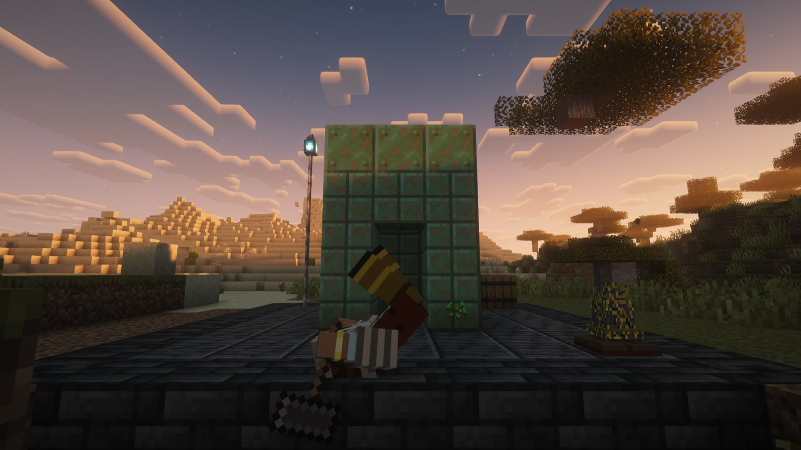
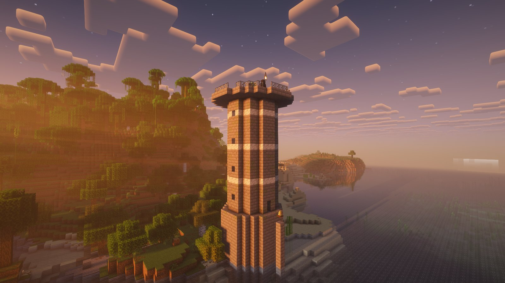

<div align="center">

**EN** | [繁中](../README.md)

<h1>
  <picture>
    <source media="(prefers-color-scheme: dark)" srcset="../assets/logo/mistinn-wordmark-en-light.png">
    
  </picture>
</h1>

**A hunter sent by Rust Anchor Station walks into the forbidden zone at the edge of the world.**

A souls-like Minecraft Java mod: salt for currency, residue where you fall, golden bells to rest at,<br>
damage by body part, gear in seven tiers, a grid inventory inspired by extraction shooters, and a keeper atop a lighthouse.

[](https://github.com/keeiv/mistinn-exile/actions/workflows/ci.yml)


[MoriTeahouse](https://moriteahouse.shizune.life) ·
[Features](#features) ·
[Playing](#playing) ·
[Phase 2 design](phase2-design.md) (Chinese) ·
[Contributing](CONTRIBUTING.en.md)

</div>


> [!NOTE]
> This is a translation of the [Chinese README](../README.md), which remains the primary version. Pages marked (Chinese) are only available in Chinese for now.

## Contents

- [Features](#features)
- [Playing](#playing)
- [World and structures](#world-and-structures)
- [Body parts](#body-parts)
- [Swings, stamina and rolls](#swings-stamina-and-rolls)
- [The fog-shore lighthouse and the Snuffer](#the-fog-shore-lighthouse-and-the-snuffer)
- [Controls](#controls)
- [Tiers and gear](#tiers-and-gear)
- [Grid inventory](#grid-inventory)
- [Building from source](#building-from-source)
- [What comes next](#what-comes-next)
- [Contributing](#contributing)
- [License](#license)

## Features

| Area | What it does |
| --- | --- |
| Salt | The currency. Defeating a hostile creature gives salt equal to its maximum health; others give a fifth (at least 1). Salt found in structures is worth 10 each when used. |
| Residue and gravestones | When you fall, all the salt you carry becomes residue held by a gravestone where you fell; hit it to take the salt back. Fall again first and the old residue fades. |
| Golden bells | Save points. Rest at one to restore every body part (destroyed ones too), eat and set it as your respawn point. The border world has no such metal, so they cannot be crafted. |
| Body parts | Hearts are replaced by six parts (head, torso, both arms, both legs), 80 health each; three destroyed parts kill. Each part is protected only by the gear that covers it, and a destroyed one has lasting effects. |
| Bell Salve | Made from gold ore, salt and a honey bottle; away from a golden bell, the only cure for a destroyed part. |
| One-time bells | Cast from gold ore (ore or raw gold) and an iron chain; brings you back once, then cracks. |
| Minimap | Built in, north up; shows your heading, your bell and where you fell, pinned to the edge when off the map. |
| Weapons | Five branches (blade, greatsword, spear, dagger, hammer) in five materials (wood, stone, iron, diamond, netherite), so there is something to fight with from day one; plus four named weapons: Anchor Blade, Sunken Bell Greatsword, Mistwalker Spear and Salt Fang. Each has vanilla-style art and a held model, its own swing and hit sounds, and its own first- and third-person swing. |
| Swings | Every blow has a wind-up, a strike, an overshoot and a recovery: the arms strain and shake as it winds up, the weapon breaks loose, and its weight carries the body past the line. Third person twists and steps into it; in first person the view swings with the blow and jolts on a hit. |
| Stamina and rolls | Swings, sprints and rolls cost stamina. A roll passes through blows; how far it goes depends on the legs, how it looks on the arms. With both legs destroyed you can only dive, and the landing falls on the upper body. |
| Title screen | An original misty shore with a dead lighthouse: drifting fog, glinting water and a last ember in the lamp room. |
| Hunter's Guide | Placed in your hotbar the first time you join; nine pages on the world, the mission and the rules. |
| World and structures | You always start at a broken or counterfeit drop station; drop stations, salt cairns, anchor wrecks and mist watchposts with supplies are scattered across the world. |
| Tiers | N and I–VI; names show as "◆ name" in the tier colour, and inventory cells sit on the tier colour. |
| Gear | A helmet, mask, body armour, chest rig and backpack per tier, plus leggings and boots from N to V; each with its own durability, protection, capacity, layout and a two-line story. |
| Grid inventory | Four pockets, the chest rig's and backpack's grids, and a safe box kept through death; every item takes a footprint by kind and can be rotated. In survival the inventory is the mod's own screen, and the 27 vanilla slots are sealed off. |
| Fog-shore lighthouses | Dead lighthouses on the coast; the lamp room at the top is held by the first keeper, **the Snuffer**, whose every move strikes a set part of the body. |
| Languages | Traditional Chinese and English. |

### Weapons

Each branch has its own swing, footprint and feel; the material sets damage, durability and tier.

| Branch | Swing | Attacks per second | Reach | Footprint | Recipe (`X` material, `#` stick, `.` empty) |
| --- | --- | --- | --- | --- | --- |
| Blade | Diagonal slash, upper right to lower left | 1.6 | 3 | 1×3 | `..X` / `.X.` / `#..` |
| Greatsword | Raised over the shoulder, then brought down | 0.7 | 3.5 | 1×4 | `.XX` / `.XX` / `#..` |
| Spear | Draw back, then thrust | 1.1 | 4 | 1×4 | `..X` / `.#X` / `#..` |
| Dagger | Two crossing cuts in one swing | 2.6 | 2.6 | 1×2 | `X` / `#` |
| Hammer | Wound up at the side, then swept across; extra knockback | 0.8 | 3 | 2×3 | `XXX` / `XXX` / `.#.` |

| Material | Tier | Durability | Blade | Greatsword | Spear | Dagger | Hammer |
| --- | --- | --- | --- | --- | --- | --- | --- |
| Wood | N | 59 | 4 | 7 | 4.5 | 2.5 | 6 |
| Stone | N | 131 | 5 | 8 | 5.5 | 3.5 | 7 |
| Iron | I | 250 | 6 | 9 | 6.5 | 4.5 | 8 |
| Diamond | IV | 1561 | 7 | 10 | 7.5 | 5.5 | 9 |
| Netherite | V | 2031 | 8 | 11 | 8.5 | 6.5 | 10 |

Materials match vanilla tools (any planks, cobblestone-like stones, iron ingots, diamonds); netherite weapons are upgraded from diamond ones at a smithing table. Named weapons:

| Weapon | Swing | Damage | Attacks per second | Reach |
| --- | --- | --- | --- | --- |
| Anchor Blade | Diagonal slash, upper right to lower left | 7 | 1.6 | 3 |
| Sunken Bell Greatsword | Raised over the shoulder, then brought down; tolls on hit | 12 | 0.7 | 3.5 |
| Mistwalker Spear | Draw back, then thrust | 8 | 1.1 | 4.5 |
| Salt Fang | Two crossing cuts in one swing | 5 | 2.6 | 2.6 |

Damage is the tooltip value (including the 1 point of a bare hand).

## Playing

You need Minecraft Java Edition 26.3, [Fabric Loader](https://fabricmc.net/use/) 0.20.1 or newer, [Fabric API](https://modrinth.com/mod/fabric-api) and Java 25. Put `mistinn-<version>.jar` and Fabric API in your `mods` folder and enter a survival world.

> [!NOTE]
> Only Minecraft 26.3 is supported. Creative mode keeps the vanilla inventory; the grid inventory is active in survival and adventure.

## World and structures

Rust Anchor drops its hunters into the zone from beyond the edge. Where you wake is not a real drop station but one of two: a long-abandoned **broken drop station**, or a **counterfeit drop station** someone built in Rust Anchor's image. You always start on its platform, never inside a wall, with a *Hunter's Guide* in your hotbar.

| Structure | Where | What it holds |
| --- | --- | --- |
| Drop station | On land, uncommon | A one-time bell; a supply barrel with stone and iron weapons, rations and tier I–II gear |
| Salt cairn | Beaches and badlands | A chest on top: salt, quartz, low-tier backpacks, sometimes a Salt Fang |
| Anchor wreck | Beaches | A huge anchor half sunk in the sand, a chest buried beside it: iron weapons, tier I–III armour, sometimes an Anchor Blade |
| Mist watchpost | On land, rare | The lookout's chest at the top: iron and diamond weapons, tier II–IV gear, sometimes a Mistwalker Spear or a one-time bell |

| | |
| --- | --- |
|  |  |
|  |  |

## Body parts


| Part | Health | Protected by |
| --- | --- | --- |
| Head (with the face) | 80 | Crown: helmet; face: mask |
| Torso | 80 | Body armour |
| Left and right arm | 80 each | Nothing |
| Left and right leg | 80 each | Leggings and boots |

- **Death**: any three parts destroyed. Damage to a destroyed part spreads, weakened, over the others, so you cannot become unkillable.
- **Where hits land**: by height and direction. High from the front is the face, from behind the crown; the middle is the torso or the arm on that side; low is the leg on that side. Falls land on both legs, drowning and starving on the torso, fire and explosions over the whole body.
- **Recovery**: slow and natural while your food is at 6 or more; potions and golden apples mend the most hurt parts first. Only a golden bell or Bell Salve brings a destroyed part back.
- **Destroyed parts**: legs slow you and cut your jump; arms weaken blows, attack speed and mining; the torso makes you hungry faster; the head darkens the edges of your view and stops the minimap.
- **HUD**: a small figure where the hearts were, each part green to red by its health.

## Swings, stamina and rolls

| | |
| --- | --- |
|  |  |

- **Swings**: every blow has four beats: the wind-up strains harder towards its end and the arms shake, the strike breaks loose and accelerates, the weapon's weight carries the body past the line, and the recovery hauls it back. Heavy weapons wind up and recover longer.
- **View**: in first person the view turns, dips and tilts with the swing and jolts on a hit. Press `J` to turn this off; the setting is kept in `config/mistinn-client.properties`.
- **Stamina**: 100 at most. Swings (misses too), sprinting and rolls cost it, and it starts coming back a second after you stop spending. At zero you cannot sprint or swing.

| Weapon | Stamina per swing |
| --- | --- |
| Dagger | 7 |
| Blade | 11 |
| Spear | 13 |
| Greatsword | 22 |
| Hammer | 24 |
| Anything else | 4 |

- **Roll** (Left Alt): 22 stamina, in the direction you are moving, or a step back if you are not. You cannot be hit for 10 ticks on whole legs, fewer as they are hurt, and the roll gets shorter too.
- **The arms shape the roll**: a whole arm tucks in and pushes off; a destroyed arm hangs and is flung about, and the roll leans to that side; with both arms destroyed you roll over a shoulder.
- **Dive**: with both legs destroyed you cannot roll, only throw yourself forward. 28 stamina, no protection, and the landing (12 points) is shared over head, torso and arms, so every dive costs you.
- A destroyed torso slows stamina recovery; destroyed legs make sprinting cost more.

## The fog-shore lighthouse and the Snuffer

Rust Anchor says the coasts at the world's edge are lined with dead lighthouses, each held by a keeper. Now and then a beach has a **fog-shore lighthouse**: a golden bell by the door, a ladder up past a supply floor, and at the top the lamp room where the Snuffer waits.

| | |
| --- | --- |
|  |  |

| Move | Tell | Where it lands |
| --- | --- | --- |
| Sweep | The lantern flares, it leans back | Torso, or the arm on that side |
| Slam | Salt grains rise where it will land | The shockwave takes both legs |
| Hook | The hook is drawn back, the chain rattles | Drags you in, then strikes your face; only a mask helps |

- 300 health, 8 armour, and a boss health bar.
- Below half health every lamp in the room goes out and you are in darkness. Right-click the four lamp stands to light them; with all four lit it staggers for five seconds and takes half again as much damage, then snuffs them out one by one.
- It drops **the Rust God's salt block**, 3000 salt, and a 30% chance of one piece of tier III–IV gear.

## Controls

| Input | Action |
| --- | --- |
| Use a golden bell | Rest, set respawn point, restore every body part |
| Hit a gravestone | Take back the salt in the residue |
| `M` | Minimap zoom (1, 2 or 4 blocks per pixel) |
| `E` | Inventory (gear, chest rig, backpack and body) |
| Right-click the helmet slot | Switch to the mask slot |
| Right-click a lamp stand | Light it |
| Left Alt | Roll; dive when both legs are destroyed |
| `J` | Toggle the first-person swing view |
| Click a cell | Pick up or put down |
| Drag | Move between cells, or between the grid and the hotbar or a chest |
| `R` while carrying | Rotate |
| `Q` over an item | Drop it |
| Shift-click | Grid item to the hotbar; chest item into the grid |

## Tiers and gear

| Tier | Colour | Helmet | Mask | Body armour | Leggings | Boots | Chest rig | Backpack |
| --- | --- | --- | --- | --- | --- | --- | --- | --- |
| N | Rust brown | Rustleather Hood | Rustleather Face Wrap | Rustleather Vest | Rustleather Leg Wraps | Rustleather Boots | Rustleather Bandolier | Rust-Buckle Sack |
| I | Grey | Dockhand Helm | Dockhand Goggle Mask | Dockhand Plate | Dockhand Leg Guards | Dockhand Work Boots | Dockhand Belt Rig | Dock Canvas Bag |
| II | Green | Tidewatch Helm | Tidewatch Mask | Tidewatch Cuirass | Tidewatch Greaves | Tidewatch Waders | Tidewatch Chest Rig | Tidewatch Pack |
| III | Blue | Anchorguard Helm | Anchorguard Jaw Guard | Anchorguard Plate | Anchorguard Greaves | Anchorguard War Boots | Anchorguard Chest Rig | Anchorguard Rucksack |
| IV | Purple | Mistwalker Visor | Mistwalker Filter Mask | Mistwalker Harness | Mistwalker Greaves | Mistwalker Climbing Boots | Mistwalker Chest Rig | Mistwalker Pack |
| V | Gold | Bellkeeper Crown | Bellkeeper Faceplate | Bellkeeper Mail | Bellkeeper Greaves | Bellkeeper Iron Boots | Bellkeeper Tactical Vest | Bellkeeper Frame |
| VI | Red | Rust God's Skull | Rust God's Face | Rust God's Scales | — | — | Rust God's Harness | Rust God's Reliquary |

Helmets last 70–640, masks 50–480, body armour 110–940, leggings 90–610, boots 60–430; higher tiers protect more and armour and leggings get heavier. A helmet only covers the crown and a mask the face; body armour covers the torso, leggings and boots the legs, and nothing covers the arms. Vanilla items follow their material (iron I, gold II, emerald III, diamond IV, netherite V) or vanilla rarity. Salt repairs gear at an anvil.

## Grid inventory

| Backpack | Layout (top pockets + main) | Cells | Speed |
| --- | --- | --- | --- |
| N | 3×2 | 6 | — |
| I | 4×3 | 12 | — |
| II | 1×2, 1×2 + 3×4 | 16 | −1% |
| III | 1×2, 2×2, 1×2 + 4×4 | 24 | −1% |
| IV | 1×2, 2×2, 1×2 + 4×5 | 28 | −1% |
| V | 1×2, 3×2, 1×2 + 5×5 | 35 | −2% |
| VI | 1×2, 3×2, 1×2 + 5×6 | 40 | −2% |

| Chest rig | Layout | Cells |
| --- | --- | --- |
| N | 1×2 ×2 | 4 |
| I | 1×2 ×4 | 8 |
| II | 2×2 + 1×2 ×4 | 12 |
| III | 2×2 ×2 + 1×2 ×4 | 16 |
| IV | 2×2 ×2 + 1×3 ×4 | 20 |
| V | 2×2 ×3 + 1×3 ×4 | 24 |
| VI | 2×3 ×2, 2×2 + 1×3 ×4 | 28 |

Pockets are four 1×1 cells and the safe box is 2×2. Pickups fill the pockets, then the chest rig, then the backpack. On death the pockets, chest rig, backpack and mask drop; the safe box stays. Footprints: gems and ingots 1×1, sticks 1×2, tools and swords 1×3, ore and other blocks 2×2, armour 2×2 or 2×3. A backpack's contents live in the backpack item, so they travel with it.

## Building from source

JDK 25 is required. From a OneDrive folder or a path with non-ASCII characters use `build.ps1`; otherwise `./gradlew build` works.

```powershell
.\build.ps1 build               # mistinn-<version>.jar
.\build.ps1 runClient           # development client
.\build.ps1 runClientGameTest   # a real client plays the core loop and saves screenshots
```

Textures, models and sounds are original work by MoriTeahouse; the repository holds the finished files (PNG, OGG, JSON), not the working files they were drawn from.

## What comes next

1. **The rest of the forbidden zone**: fog that thickens near a lighthouse and on the minimap, the fog wall of the lamp room, creatures of the mist and the keeper's mist doubles ([design, in Chinese](phase2-design.md)).
2. **More keepers**: the Sunken Bell and the Rust Wheel, and backpacks worn on the model.
3. **Later**: levelling with salt at bells, more weapons and charged attacks, stamina and dodge rolls, co-op.

## Contributing

Bug fixes, features, tests, art and documentation are welcome; read the [contributing guide](CONTRIBUTING.en.md) first.

> [!IMPORTANT]
> AI-assisted contributions are treated like hand-written ones. A pull request is merged only without security issues, and **assets must be original**; assets from other games or packs are not accepted.

## License

Copyright (c) 2026 Keeiv.

Licensed under the **GNU Affero General Public License v3.0 only (AGPL-3.0-only)**; see [LICENSE](../LICENSE) and [NOTICE](../NOTICE). The original textures, models and sounds share the code's license.

> [!NOTE]
> The wordmark is drawn with [Fusion Pixel Font](https://github.com/TakWolf/fusion-pixel-font) (SIL Open Font License 1.1). Minecraft is a trademark of Mojang Studios; this mod is not affiliated with Mojang or Microsoft.
