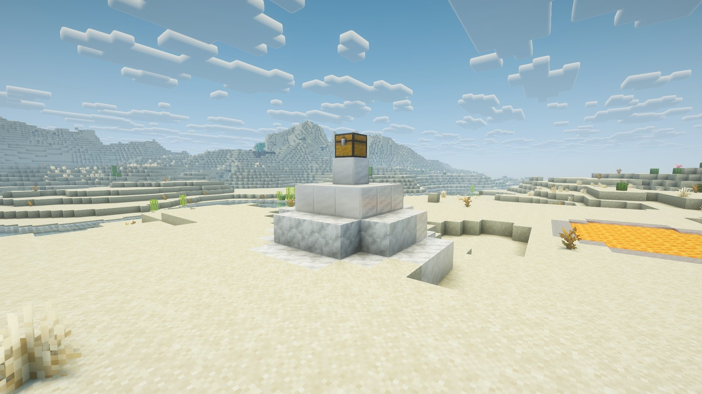

<div align="center">

**EN** | [繁中](../README.md)

<h1>
  <picture>
    <source media="(prefers-color-scheme: dark)" srcset="../assets/logo/mistinn-wordmark-en-light.png">
    
  </picture>
</h1>

**A hunter sent by Rust Anchor Station walks into the forbidden zone at the edge of the world.**

A souls-like Minecraft Java mod: salt for currency, residue where you fall, golden bells to rest at,<br>
gear in seven tiers, and a grid inventory inspired by extraction shooters.

[](https://github.com/keeiv/mistinn-exile/actions/workflows/ci.yml)


[MoriTeahouse](https://moriteahouse.shizune.life) ·
[Features](#features) ·
[Playing](#playing) ·
[Phase 2 design](phase2-design.md) (Chinese) ·
[Contributing](CONTRIBUTING.en.md)

</div>


> [!NOTE]
> This is a translation of the [Chinese README](../README.md), which remains the primary version. Pages marked (Chinese) are only available in Chinese for now.

## Contents

- [Features](#features)
- [Playing](#playing)
- [World and structures](#world-and-structures)
- [Controls](#controls)
- [Tiers and gear](#tiers-and-gear)
- [Grid inventory](#grid-inventory)
- [Building from source](#building-from-source)
- [What comes next](#what-comes-next)
- [Contributing](#contributing)
- [License](#license)

## Features

| Area | What it does |
| --- | --- |
| Salt | The currency. Defeating a hostile creature gives salt equal to its maximum health; others give a fifth (at least 1). Salt found in structures is worth 10 each when used. |
| Residue and gravestones | When you fall, all the salt you carry becomes residue held by a gravestone where you fell; hit it to take the salt back. Fall again first and the old residue fades. |
| Golden bells | Save points. Rest at one to heal, eat and set it as your respawn point. The border world has no such metal, so they cannot be crafted. |
| One-time bells | Cast from gold ore (ore or raw gold) and an iron chain; brings you back once, then cracks. |
| Minimap | Built in, north up; shows your heading, your bell and where you fell, pinned to the edge when off the map. |
| Weapons | Five branches (blade, greatsword, spear, dagger, hammer) in five materials (wood, stone, iron, diamond, netherite), so there is something to fight with from day one; plus four named weapons: Anchor Blade, Sunken Bell Greatsword, Mistwalker Spear and Salt Fang. Each has vanilla-style art and a held model, its own swing and hit sounds, and its own first- and third-person swing. |
| Hunter's Guide | Placed in your hotbar the first time you join; nine pages on the world, the mission and the rules. |
| World and structures | You always start at a broken or counterfeit drop station; drop stations, salt cairns, anchor wrecks and mist watchposts with supplies are scattered across the world. |
| Tiers | N and I–VI; names show as "◆ name" in the tier colour, and inventory cells sit on the tier colour. |
| Gear | A helmet, body armour and backpack per tier, each with its own durability, protection, capacity, layout and a two-line story. |
| Grid inventory | Four pockets, a layout set by the backpack, and a safe box kept through death; every item takes a footprint by kind and can be rotated. |
| Languages | Traditional Chinese and English. |

> [!TIP]
> The easiest way to play is the **Mistinn Launcher**: it installs the game, Java, Fabric, this mod and a performance pack, and tunes the settings to your computer as Smooth, Normal or Ultra.

### Weapons

Each branch has its own swing, footprint and feel; the material sets damage, durability and tier.

| Branch | Swing | Attacks per second | Reach | Footprint | Recipe (`X` material, `#` stick, `.` empty) |
| --- | --- | --- | --- | --- | --- |
| Blade | Diagonal slash, upper right to lower left | 1.6 | 3 | 1×3 | `..X` / `.X.` / `#..` |
| Greatsword | Raised over the shoulder, then brought down | 0.7 | 3.5 | 1×4 | `.XX` / `.XX` / `#..` |
| Spear | Draw back, then thrust | 1.1 | 4 | 1×4 | `..X` / `.#X` / `#..` |
| Dagger | Two crossing cuts in one swing | 2.6 | 2.6 | 1×2 | `X` / `#` |
| Hammer | Wound up at the side, then swept across; extra knockback | 0.8 | 3 | 2×3 | `XXX` / `XXX` / `.#.` |

| Material | Tier | Durability | Blade | Greatsword | Spear | Dagger | Hammer |
| --- | --- | --- | --- | --- | --- | --- | --- |
| Wood | N | 59 | 4 | 7 | 4.5 | 2.5 | 6 |
| Stone | N | 131 | 5 | 8 | 5.5 | 3.5 | 7 |
| Iron | I | 250 | 6 | 9 | 6.5 | 4.5 | 8 |
| Diamond | IV | 1561 | 7 | 10 | 7.5 | 5.5 | 9 |
| Netherite | V | 2031 | 8 | 11 | 8.5 | 6.5 | 10 |

Materials match vanilla tools (any planks, cobblestone-like stones, iron ingots, diamonds); netherite weapons are upgraded from diamond ones at a smithing table. Named weapons:

| Weapon | Swing | Damage | Attacks per second | Reach |
| --- | --- | --- | --- | --- |
| Anchor Blade | Diagonal slash, upper right to lower left | 7 | 1.6 | 3 |
| Sunken Bell Greatsword | Raised over the shoulder, then brought down; tolls on hit | 12 | 0.7 | 3.5 |
| Mistwalker Spear | Draw back, then thrust | 8 | 1.1 | 4.5 |
| Salt Fang | Two crossing cuts in one swing | 5 | 2.6 | 2.6 |

Damage is the tooltip value (including the 1 point of a bare hand).

## Playing

You need Minecraft Java Edition 26.3, [Fabric Loader](https://fabricmc.net/use/) 0.20.1 or newer, [Fabric API](https://modrinth.com/mod/fabric-api) and Java 25. Put `mistinn-<version>.jar` and Fabric API in your `mods` folder and enter a survival world.

> [!NOTE]
> Only Minecraft 26.3 is supported. Creative mode keeps the vanilla inventory; the grid inventory is active in survival and adventure.

## World and structures

Rust Anchor drops its hunters into the zone from beyond the edge. Where you wake is not a real drop station but one of two: a long-abandoned **broken drop station**, or a **counterfeit drop station** someone built in Rust Anchor's image. You always start on its platform, never inside a wall, with a *Hunter's Guide* in your hotbar.

| Structure | Where | What it holds |
| --- | --- | --- |
| Drop station | On land, uncommon | A one-time bell; a supply barrel with stone and iron weapons, rations and tier I–II gear |
| Salt cairn | Beaches and badlands | A chest on top: salt, quartz, low-tier backpacks, sometimes a Salt Fang |
| Anchor wreck | Beaches | A huge anchor half sunk in the sand, a chest buried beside it: iron weapons, tier I–III armour, sometimes an Anchor Blade |
| Mist watchpost | On land, rare | The lookout's chest at the top: iron and diamond weapons, tier II–IV gear, sometimes a Mistwalker Spear or a one-time bell |

| | |
| --- | --- |
|  |  |
|  |  |

## Controls

| Input | Action |
| --- | --- |
| Use a golden bell | Rest, set respawn point |
| Hit a gravestone | Take back the salt in the residue |
| `M` | Minimap zoom (1, 2 or 4 blocks per pixel) |
| `E` | Inventory and grid |
| Click a cell | Pick up or put down |
| Drag | Move between cells, or between the grid and the hotbar or a chest |
| `R` while carrying | Rotate |
| `Q` over an item | Drop it |
| Shift-click | Grid item to the hotbar; chest item into the grid |

## Tiers and gear

| Tier | Colour | Helmet | Body armour | Backpack |
| --- | --- | --- | --- | --- |
| N | Rust brown | Rustleather Hood | Rustleather Vest | Rust-Buckle Sack |
| I | Grey | Dockhand Helm | Dockhand Plate | Dock Canvas Bag |
| II | Green | Tidewatch Helm | Tidewatch Cuirass | Tidewatch Pack |
| III | Blue | Anchorguard Helm | Anchorguard Plate | Anchorguard Rucksack |
| IV | Purple | Mistwalker Visor | Mistwalker Harness | Mistwalker Pack |
| V | Gold | Bellkeeper Crown | Bellkeeper Mail | Bellkeeper Frame |
| VI | Red | Rust God's Skull | Rust God's Scales | Rust God's Reliquary |

Helmets last 70–640, body armour 110–940; higher tiers protect more and body armour gets heavier (0% to −6% movement speed). Vanilla items follow their material (iron I, gold II, emerald III, diamond IV, netherite V) or vanilla rarity. Salt repairs gear at an anvil.

## Grid inventory

| Backpack | Layout | Cells | Speed |
| --- | --- | --- | --- |
| N | 3×2 | 6 | — |
| I | 4×3 | 12 | — |
| II | 3×5 | 15 | −1% |
| III | 2×2, 2×2, 4×3 | 20 | −1% |
| IV | 4×6 | 24 | −1% |
| V | 2×3, 2×3, 4×5 | 32 | −2% |
| VI | 2×4, 2×4, 5×6 | 46 | −2% |

Pockets are four 1×1 cells and the safe box is 2×2. On death the pockets and the whole backpack drop; the safe box stays. Footprints: gems and ingots 1×1, sticks 1×2, tools and swords 1×3, ore and other blocks 2×2, armour 2×2 or 2×3. A backpack's contents live in the backpack item, so they travel with it.

## Building from source

JDK 25 is required. From a OneDrive folder or a path with non-ASCII characters use `build.ps1`; otherwise `./gradlew build` works.

```powershell
.\build.ps1 build               # mistinn-<version>.jar
.\build.ps1 runClient           # development client
.\build.ps1 runClientGameTest   # a real client plays the core loop and saves screenshots
```

Textures, models and sounds are original work by MoriTeahouse; the repository holds the finished files (PNG, OGG, JSON), not the working files they were drawn from.

## What comes next

1. **Phase 2: the forbidden zone and the Lighthouse Keepers.** Fog-shore lighthouses, the first keeper, creatures of the mist and tiered loot ([design, in Chinese](phase2-design.md)).
2. **More grid inventory**: chest rigs, side-by-side dragging with chests, backpacks worn on the model.
3. **Later**: levelling with salt at bells, more weapons and charged attacks, stamina and dodge rolls, co-op.

## Contributing

Bug fixes, features, tests, art and documentation are welcome; read the [contributing guide](CONTRIBUTING.en.md) first.

> [!IMPORTANT]
> AI-assisted contributions are treated like hand-written ones. A pull request is merged only without security issues, and **assets must be original**; assets from other games or packs are not accepted.

## License

Copyright (c) 2026 Keeiv.

Licensed under the **GNU Affero General Public License v3.0 only (AGPL-3.0-only)**; see [LICENSE](../LICENSE) and [NOTICE](../NOTICE). The original textures, models and sounds share the code's license.

> [!NOTE]
> The wordmark is drawn with [Fusion Pixel Font](https://github.com/TakWolf/fusion-pixel-font) (SIL Open Font License 1.1). Minecraft is a trademark of Mojang Studios; this mod is not affiliated with Mojang or Microsoft.
