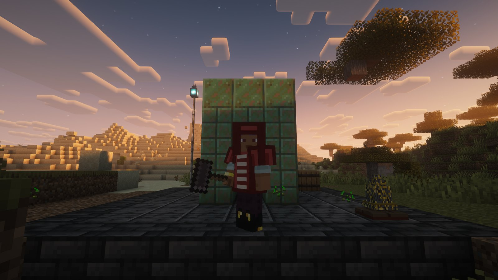
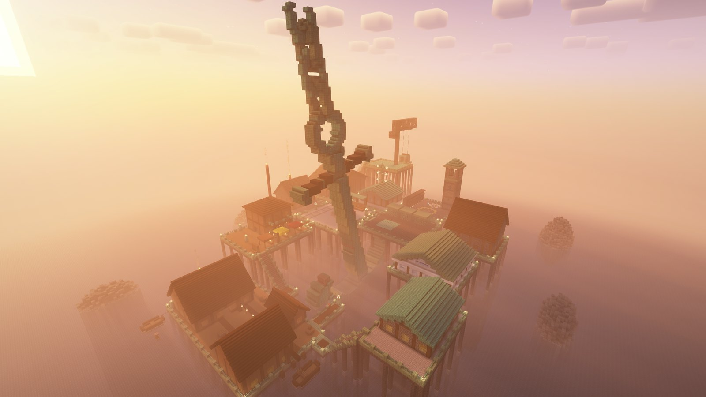
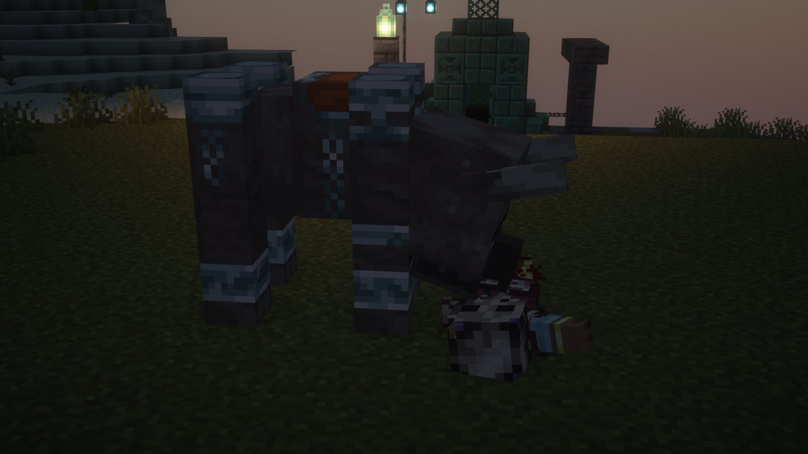
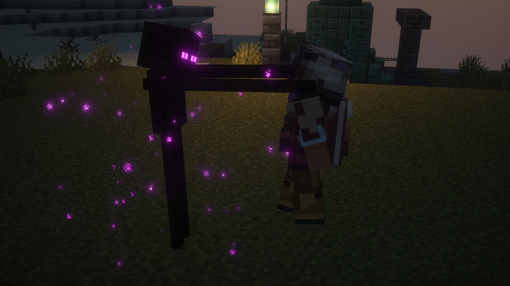
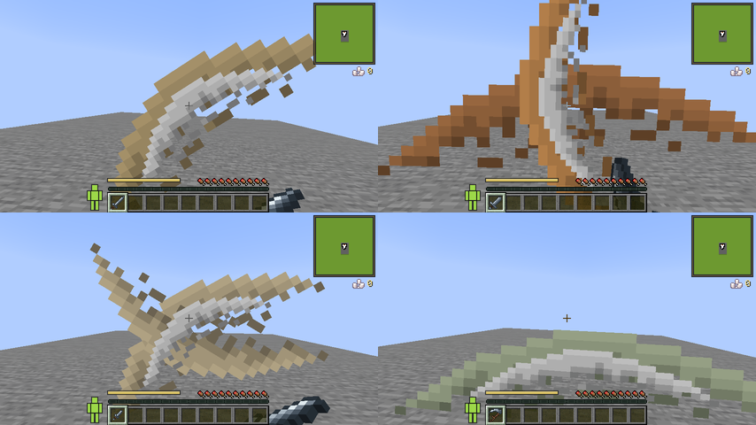
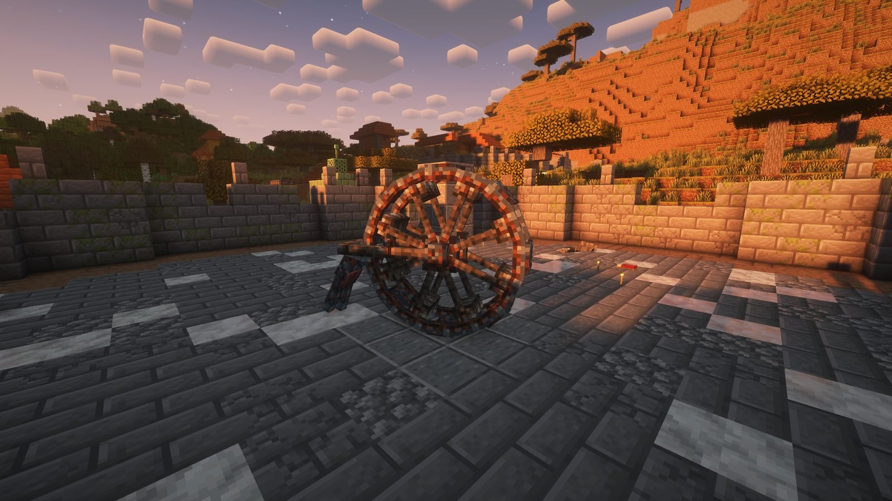
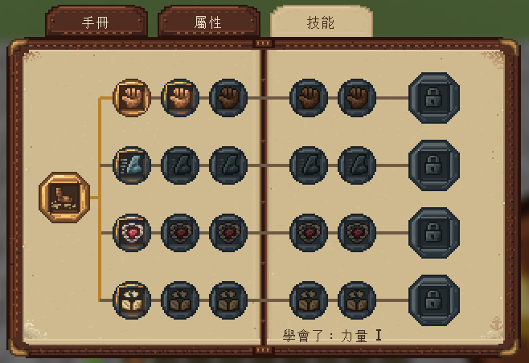
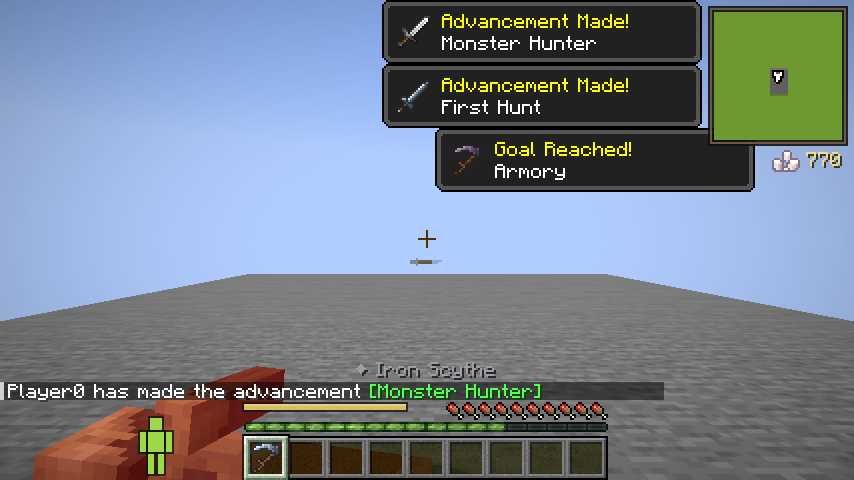

<div align="center">

**EN** | [繁中](../README.md)

<h1>
  <picture>
    <source media="(prefers-color-scheme: dark)" srcset="../assets/logo/mistinn-wordmark-en-light.png">
    
  </picture>
</h1>

**A hunter sent by Rust Anchor Station walks into the forbidden zone at the edge of the world.**

A souls-like Minecraft Java mod: salt for currency, residue where you fall, golden bells to rest at,<br>
damage by body part, gear in seven tiers, a grid inventory inspired by extraction shooters, and a keeper atop a lighthouse.

[](https://github.com/keeiv/mistinn-exile/actions/workflows/ci.yml)


[MoriTeahouse](https://moriteahouse.shizune.life) ·
[Features](#features) ·
[Playing](#playing) ·
[Phase 2 design](phase2-design.md) (Chinese) ·
[Phase 3 design](phase3-design.md) (Chinese) ·
[Phase 4 design](phase4-design.md) (Chinese) ·
[Phase 5 design](phase5-design.md) (Chinese) ·
[Contributing](CONTRIBUTING.en.md)

</div>



> [!NOTE]
> This is a translation of the [Chinese README](../README.md), which remains the primary version. Pages marked (Chinese) are only available in Chinese for now.

## Contents

- [Features](#features)
- [Playing](#playing)
- [Difficulty and Rust Anchor](#difficulty-and-rust-anchor)
- [Story mode](#story-mode)
- [World and structures](#world-and-structures)
- [Body parts](#body-parts)
- [Vanilla monsters and executions](#vanilla-monsters-and-executions)
- [Death and the end of the mission](#death-and-the-end-of-the-mission)
- [Swings, stamina and rolls](#swings-stamina-and-rolls)
- [The fog-shore lighthouse and the Snuffer](#the-fog-shore-lighthouse-and-the-snuffer)
- [The fog-bell station and the Sunken Bell](#the-fog-bell-station-and-the-sunken-bell)
- [The salt works and the Rust Wheel](#the-salt-works-and-the-rust-wheel)
- [Stats and skills](#stats-and-skills)
- [Achievements](#achievements)
- [Controls](#controls)
- [Tiers and gear](#tiers-and-gear)
- [Grid inventory](#grid-inventory)
- [Building from source](#building-from-source)
- [What comes next](#what-comes-next)
- [Contributing](#contributing)
- [License](#license)

## Features

| Area | What it does |
| --- | --- |
| Salt | The currency. Defeating a hostile creature gives salt equal to its maximum health; others give a fifth (at least 1), and an elite that again for each of its affixes. Salt found in structures is worth 10 each when used. |
| Residue and gravestones | When you fall, all the salt you carry becomes residue, and everything else you carry (gear, hotbar, pockets, chest rig and backpack; not the safe box) goes into the same gravestone instead of onto the ground; right-click it to take it all back. Fall again first and the old residue fades: the salt is lost and the things spill where the stone stood. |
| Death scene | Killed by a creature, every other creature vanishes; the hunter drops to one knee, topples onto one side and turns to smoke. Other deaths are a plain fall. Then the mission ends: the cause, a line from Rust Anchor, and the choice to return or to rest. |
| Story mode | A prologue and three chapters with objectives, radio calls, tags left by the hunters before you, pixel-art story cards and in-world scenes, with a mission journal on `K`. Later chapters are still being made. |
| Difficulty | Story and training worlds choose Easy, Normal or Rust Anchor. Rust Anchor feeds you only the station's twenty foods, makes weapons from outside hit soft and break fast, can cost you a limb, wears your gear down and takes four tenths of your salt when you fall, and sets creatures and keepers on you without mercy (shorter tells, blows twice as often, feints); the safe box is 3x3. See [Difficulty and Rust Anchor](#difficulty-and-rust-anchor). |
| Hunter Training | An optional course for a new singleplayer world. Follow the instructor's radio, the glowing arrows and Rust Anchor's staff (report to Steelyard, the quartermaster, first; right-click staff to talk) through equipment, heavy blows, sprinting, rolling and sliding, reading a monster's windup, crossing the listening pen without a sound, medicine, crafting, the guide and your stats, the bell and residue, radio repair, and a keeper rehearsal (the lent slide, practice stat points and achievements earned in training are taken back when you leave), all at Rust Anchor Station, a base built over the sea round a giant anchor. Board the drop pod to choose Story or Free exploration. |
| Golden bells | Ring one to set your respawn point; the ring also restores you: every part whole (a lost limb stays lost), bleeding stopped and bones set, tourniquets and splints off, fed, the fire out, and every harmful status effect gone. Each bell cools for an hour of real time for each hunter apart, so teammates need not wait for you. The border world has no such metal, so they cannot be crafted. |
| Body parts | Hearts are replaced by six parts (head, torso, both arms, both legs), 80 health each (up to 120 with constitution); three destroyed parts kill. Each part is protected only by the gear that covers it, and a destroyed one has lasting effects. |
| Bleeding and broken bones | Blows can open a bleeding wound that slowly kills the part until a tourniquet stops it; falls, explosions and crushing blows can break a limb, which then works as if destroyed (a broken leg only dives) until surgery sets it; a splint holds it for a while. |
| Medicine and repair | Potent injector, surgery kit, painkillers, tourniquet, splint, and tier III–VI armour and helmet repair kits; each takes a few seconds with its own motion and sounds, and a heavy hit or a roll breaks it off; those in the pockets or the rig can be used from the wheel (hold `R`). On Easy and Normal every hunter gets some medicine once per world (two tourniquets, a splint, painkillers and a potent injector); Rust Anchor gives none. |
| Crafting | Every medical item, repair kit, piece of gear and weapon can be crafted or smithed, and the Hunter's Guide's Crafting bookmark shows every recipe with its grid and a description (in chapters: weapons, gear, medicine, repair kits, food and other; the contents page turns to each). Permanent golden bells are found in the world. Keepers drop the Rust God's salt block, an ingredient in tier VI gear. Redstone soil breeds redstone by itself: ripe every few minutes, it gives two or three to an empty hand, so mending the radio no longer means hunting for redstone. Small patches of grassy redstone soil lie here and there on the surface (red grains show between the blades from above), and dirt redstone soil in the dirt layers, both ripe when found; four dirt, a bone meal and an iron nugget also make two dirt redstone soil, and grassy soil dug without silk touch becomes the dirt kind. It is found only in chunks generated from now on, not in places an old world has already been. Weapons and helmets, body armour, leggings and boots take enchantments at the table or the anvil: weapons take Sharpness, Smite, Bane of Arthropods, Fire Aspect, Knockback and Looting, armour takes the protections and its own slot's enchantments, and all of them Unbreaking and Mending; heavy blows count Sharpness and Fire Aspect too. |
| One-time bells | Fragile bells cast from gold ore (ore or raw gold) and an iron chain. Ringing one restores you too. Every hunter can have it remember them once; it calls each one it remembers back once, and breaks after the last of them. A bell that has rung drops nothing when broken. |
| Minimap | Built in, north up; shows your heading, your bell and where you fell, pinned to the edge when off the map. |
| Weapons | Six branches (blade, greatsword, spear, dagger, hammer, scythe) in five materials (wood, stone, iron, diamond, netherite), so there is something to fight with from day one; four named weapons: Anchor Blade, Sunken Bell Greatsword, Mistwalker Spear and Salt Fang; and five special weapons that only answer a hunter who has earned them: the Snuffer's Hook, the Mist-Lantern Staff, the Tide-Bell Maul, the Bell Clapper and the Rust Rim. Each has vanilla-style art and a held model, its own swing and hit sounds, and its own first- and third-person swing. |
| Swings | Every blow has a wind-up, a strike, an overshoot and a recovery, and leaves a cut of vanilla-style pixel light where it lands, turned to the blow: the blade's diagonal, the greatsword's chop, the spear's line, the dagger's two crossing cuts, the hammer's sweep, the scythe's rising reap. Hold use to charge a **heavy blow** that hits everything in its reach. Third person twists and steps into it. In first person the view swings with the blow and jolts on a hit. |
| Vanilla monsters | Their voices are built from CC0 recordings, lower and more savage; their movement and poses are remade for each rig. They stalk low once they have a hunter, and every melee blow has a windup you can see and hear, and roll away from. A hunter whose legs are both destroyed is executed: see [Vanilla monsters and executions](#vanilla-monsters-and-executions). |
| Elites | Creatures that spawn of themselves are now and then elites: a golden name, gold dust about them, half again the life, and one to three affixes (Swift, Ironclad, Hulking, Bloodthirsty, Mistwalker, Volatile, Warchief). Commoner by night and far out; they pay more salt and may drop medical supplies. See [Elites](#elites). |
| Fog tide | From a world's third night on, each night has about a 15% chance (10% on Easy, 25% at Rust Anchor): a bell tolls far off and the fog rolls in on every side and stays all night, the world ending twenty or thirty blocks off. Every 20 seconds one to three of the place's own creatures walk out of the dark 20 to 36 blocks from each hunter (none while 16 hostile creatures are already within 48 blocks), elites come twice as often and pirate landings twice as readily. At dawn it ebbs; a hunter who was there when it rose and never fell earns the achievement. With mob spawning turned off by game rule, nothing walks out. |
| Stamina and rolls | Swings, sprints and rolls cost stamina. The legs determine how far a roll goes and the arms shape its motion. Badly injured legs can force a dive, whose landing strains the upper body. |
| Title screen | An original misty shore with a dead lighthouse: drifting fog, glinting water and a last ember in the lamp room. |
| World map | The title menu's *World Map* is one cut through the world, scrolled top to bottom: the End, Rust Anchor Station on its sea and the water under it, the misty coast, the Nether. It opens on the station and sinks with the drop pod through the water to the coast while the way the story walks draws itself, stop by stop; a stop opens its chapter's story card and what the chapter asks. Chapters this computer has not reached yet stay in the fog, unless you choose to see everything. |
| Pirates of the fog sea | Sail a boat far out, out of sight of land, for a while, and a horn sounds in the fog: the view drops to the water as a black-sailed pirate ship comes out of the fog, its name and its captain's come up, and the fight's music begins (space or Esc skips it); it heaves to nearby, broadside on, with a warning shot: boarders, marksmen, gunners and a captain on its deck. While a gunner lives the guns fire broadside after broadside (shot on an arc, a column of spray where it falls, boats smashed); a marksman's lock clicks before the shot, so move when you hear it. Ride out the guns, or row through them to the hull and climb its ladders. When the captain falls the ship is taken: the crew go over the side, the ship stays, the captain's chest is in the cabin at the stern (now and then with a treasure map) and the hold's barrels keep stores. The ◆ on the bar are the crew still standing. Every ship taken makes the next crews more and harder. If everyone in the fight leaves or falls, the ship and its crew wait where they are. |
| Pirate landings | By night on the shore, pirates may row in and land: two or three boarders and a marksman, their boat left at the water's edge. At most once every two days for each hunter, and more of them as the fog sea grows wary. Beat them and the shore is held; at dawn, or if it drags on, the rest go back to the sea. |
| Bounties | From a world's second day, about a third of mornings bring a bounty: an elite of three affixes and twice the life, unafraid of the sun, 150 to 300 blocks from a hunter; the chat gives the way and the distance and the minimap marks it with a red cross. It shows when a hunter comes within 48 blocks. Its killer is paid 800 salt and every hunter within 32 blocks 400, and it leaves a piece of tier III or IV gear; unclaimed, it is withdrawn after three days. |
| Throwables | A salt bomb bursts where it lands: creatures within 4 blocks are staggered and their windups broken off, but it is loud and draws others; a flare burns half a minute, lighting the ground and showing creatures within 16 blocks through the fog; a bell lure rings ten seconds, drawing idle creatures within 20 blocks. Crafted at the table, one a second. |
| Flintlock and pistol | Taken from pirates (a captain always carries a pistol, a marksman now and then leaves a musket, the captain's chest may hold one). Hold use to raise and aim, let go to fire one paper cartridge; the musket reaches further and hits harder, the pistol comes up quicker. Paper cartridges: paper, gunpowder and an iron nugget make three; they are taken from the hotbar, the offhand, or the pockets, rig and backpack. |
| Hunter's Guide | Placed in your hotbar the first time you join. A guide screen of its own: thirty-two pages on the world, the mission, the rules and what you hunt, the stats, the skill tree, the recipes and the achievements. |
| Achievements | Twenty-eight of them (one hidden), from the first hunt, a monster down with each of the six branches and three hit by one heavy blow, to bringing down the Snuffer, the Sunken Bell and the Rust Wheel, taking a pirate ship, holding the shore, bringing down an elite of three affixes, and the story's two endings. The game's toast shows at the top right and some salt is paid; all are kept on the mod's own tab of the advancements screen. See [Achievements](#achievements). |
| World and structures | You always start at a broken or counterfeit drop station; drop stations, salt cairns, anchor wrecks and mist watchposts with supplies are scattered across the world. |
| Tiers | N and I–VI; names show as "◆ name" in the tier colour, and inventory cells sit on the tier colour. |
| Gear | A helmet, mask, body armour, chest rig and backpack per tier, plus leggings and boots from N to V, and two more lines beside them, light (helmet, armour, pack) and heavy (helmet, armour, rig, pack): see [Light and heavy lines](#light-and-heavy-lines); each with its own durability, protection, capacity, layout and a two-line story. |
| Grid inventory | Four pockets, the chest rig's and backpack's grids, and a safe box kept through death. Every item takes a footprint by kind and can be rotated. Packs, rigs and some medical supplies have sprites drawn for their footprints. Packs and rigs also show on the body; each of the seven rigs is built after its own icon: a bandolier with its row of cartridges, the dockworker's canvas belt, the tide patrol's upright pouches and signal-lamp pouch, the anchor guard's brass-snapped square pouches, the mist walker's long pouches and document pouch, the bell keepers' full vest with a small bell on every pouch flap, and the rust god's ribs, all worn over a chestplate; looking down through your own eyes, the straps over the shoulders stay out of the way. Survival and adventure use the mod's own inventory screen and seal off the 27 vanilla slots. |
| Fog-shore lighthouses | Dead lighthouses on the coast; the lamp room at the top is held by the first keeper, **the Snuffer**, whose every move strikes a set part of the body. The fight has its own music, which turns more frantic in its dark half. |
| Fog-bell stations | Bell towers on reefs in the shallows off the misty shore, held by the second keeper, **the Sunken Bell**. Each toll of its bell rolls a ring out along the floor and thickens the mist by a layer; a fully charged heavy blow rings its own bell and thins the mist again. See [The fog-bell station and the Sunken Bell](#the-fog-bell-station-and-the-sunken-bell). |
| Salt works | Dead salt works inland, held by the third keeper, **the Rust Wheel**. It rolls and rams, faster with every run; its front is iron, its back is its weak spot, and a pillar in its way leaves it stuck. See [The salt works and the Rust Wheel](#the-salt-works-and-the-rust-wheel). |
| Stats and skills | Bring back a keeper's rust god salt to learn the **slide**, the first major skill, on the guide's skills page; after that, salt buys strength, speed, constitution and intellect a point at a time. See [Stats and skills](#stats-and-skills). |
| Languages | Traditional Chinese and English. |

### Weapons

Each of the six branches has its own swing, footprint and feel; the material sets damage, durability and tier.

| Branch | Swing | Attacks per second | Reach | Footprint | Recipe (`X` material, `#` stick, `.` empty) |
| --- | --- | --- | --- | --- | --- |
| Blade | Diagonal slash, upper right to lower left | 1.6 | 3 | 1×3 | `..X` / `.X.` / `#..` |
| Greatsword | Raised over the shoulder, then brought down | 0.7 | 3.5 | 1×4 | `.XX` / `.XX` / `#..` |
| Spear | Draw back, then thrust | 1.1 | 4 | 1×4 | `..X` / `.#X` / `#..` |
| Dagger | Two crossing cuts in one swing | 2.6 | 2.6 | 1×2 | `X` / `#` |
| Hammer | Wound up at the side, then swept across; extra knockback | 0.8 | 3 | 2×3 | `XXX` / `XXX` / `.#.` |
| Scythe | Two-handed, reaped up from lower left to upper right | 1.0 | 3.8 | 2×4 | `XXX` / `..#` / `.#.` |

| Material | Tier | Durability | Blade | Greatsword | Spear | Dagger | Hammer | Scythe |
| --- | --- | --- | --- | --- | --- | --- | --- | --- |
| Wood | N | 59 | 4 | 7 | 4.5 | 2.5 | 6 | 5.5 |
| Stone | N | 131 | 5 | 8 | 5.5 | 3.5 | 7 | 6.5 |
| Iron | I | 250 | 6 | 9 | 6.5 | 4.5 | 8 | 7.5 |
| Diamond | IV | 1561 | 7 | 10 | 7.5 | 5.5 | 9 | 8.5 |
| Netherite | V | 2031 | 8 | 11 | 8.5 | 6.5 | 10 | 9.5 |

Materials match vanilla tools (any planks, cobblestone-like stones, iron ingots, diamonds); netherite weapons are upgraded from diamond ones at a smithing table. Named weapons:

| Weapon | Swing | Damage | Attacks per second | Reach |
| --- | --- | --- | --- | --- |
| Anchor Blade | Diagonal slash, upper right to lower left | 7 | 1.6 | 3 |
| Sunken Bell Greatsword | Raised over the shoulder, then brought down; tolls on hit | 12 | 0.7 | 3.5 |
| Mistwalker Spear | Draw back, then thrust | 8 | 1.1 | 4.5 |
| Salt Fang | Two crossing cuts in one swing | 5 | 2.6 | 2.6 |

Damage is the tooltip value (including the 1 point of a bare hand).

### Special weapons

Four special weapons only answer a hunter who meets their requirements. Short of them, the weapon hits at half strength, swings slowly and gives no heavy blow; its tooltip lists the requirements, green when met and red when not.

| Weapon | Branch | Requires | Special heavy blow | Found |
| --- | --- | --- | --- | --- |
| Snuffer's Hook | Scythe (8 damage) | The Snuffer brought down, strength 3 | After the reap, the farthest foe it caught is hooked to your feet and its attack broken off | Dropped by the Snuffer |
| Mist-Lantern Staff | Spear (6 damage) | Intellect 4 | The lantern bursts ahead: everything within 3.5 blocks is hurt and set alight, for (6 + intellect) × (1 + the charge) | `..L` / `.#.` / `#..` (L soul lantern) |
| Tide-Bell Maul | Hammer (13 damage) | Strength 5, constitution 3 | The bell tolls: everything within 4.5 blocks all around is thrown up | `IBI` / `.#.` / `.#.` (I iron block, B bell) |
| Bell Clapper | Hammer (11 damage) | The Sunken Bell brought down, strength 4 | Rung back: a full blow rings out all round and breaks off every windup within 6 blocks, struck or not | Dropped by the Sunken Bell |
| Rust Rim | Greatsword (12 damage) | The Rust Wheel brought down, constitution 4 | Rolling on: a full blow rolls you on some six blocks, running over everything in the path (six tenths of the blow each) and throwing it aside; a wall stops you, dazed for two seconds | Dropped by the Rust Wheel |

## Playing

The easiest way is the [Mistinn Launcher](https://github.com/keeiv/mistinn-launcher/releases): it downloads the game, Java, Fabric and this mod, and tunes the settings to your computer. For now it is an offline launcher: play with an offline account.

To install it yourself: you need Minecraft Java Edition 26.3, [Fabric Loader](https://fabricmc.net/use/) 0.20.1 or newer, [Fabric API](https://modrinth.com/mod/fabric-api) and Java 25. Put `mistinn-<version>.jar` and Fabric API in your `mods` folder and enter a survival world.

> [!NOTE]
> Only Minecraft 26.3 is supported. Creative mode keeps the vanilla inventory; the grid inventory is active in survival and adventure.

Existing Bell Salve stacks turn into the same amount of raw gold when the save is loaded.

### Playing with friends

The host enters a Story or Free exploration world, presses Esc, and chooses **World & Multiplayer → Open Room**. An invite code starting with `MIST-` appears; **Copy Invite** puts it on the clipboard to send to friends. Friends paste it into **Join a Friend** in the Mistinn Launcher and go straight into the room, or use **Multiplayer → Join with Invite** in game. The host can close the room from the same screen, and the world stays on their computer.

- **No router setup**: the room is opened to the internet through the public relay of [e4mc](https://modrinth.com/mod/e4mc) (MIT licence), which the Mistinn Launcher installs. The relay is run by e4mc's author, and the game's connection passes through it.
- **Offline accounts can join**: only people with the invite get in. Each time the room opens it gets a new invite, and old ones stop working once it closes. A guest whose name is already in the room is turned away.
- **Same version**: everyone needs the same Mistinn version; the join screen says so when they differ.
- **Skins**: the skin set in the launcher is shown to everyone in the room.
- **Three at most**: a world takes three hunters at most; a fourth is turned away at the door with a message saying so.
- **Growing together**: major skills (the ones a rust god salt unlocks, such as the slide) belong to the whole team: when one hunter learns one, everyone has it, those who join later included. Minor skills and salt are still each hunter's own. Major skills already learned in an old world are handed to the others the next time they arrive.
- **No friendly fire**: the first time a world is loaded, friendly fire is turned off (old worlds too); the host can turn it back on with `/gamerule pvp true`.
- **Knowing who is who**: every hunter's name has a colour of its own (name tag, chat, player list), and the minimap marks the others in the same colour, pinned to its edge when they are far.
- **Marker beacons**: a torch, an iron ingot and a stick in a column make two. Plant one to mark a place: everyone's minimap draws it, and looking its way shows its name and distance over it (within a thousand blocks). Name it at an anvil; it takes its planter's colour, and a dye right-clicked onto it changes the colour. A world keeps 64; past that the oldest goes.
- **Marks for the team**: press `G` to mark what is under the crosshair, up to 160 blocks off. On a creature the mark rides on it and reads Enemy; on a thing on the ground, Item. The whole team sees it in your colour with how far it is and who made it, blinking on the minimap too, for twelve seconds; when it is out of view a small pointer round the crosshair shows which way. Three each at most.
- **One story for the team**: in story mode the objective is the team's. When any hunter completes one (the salt, a place reached, the radio mended, the delivery, a keeper down, the bell rung…), everyone moves on together and gets the same lines and cards: those near see the whole scene, those far off get the lines, and the full-screen card waits until they are out of a fight. A hunter who joins late or was away catches up the moment they arrive. Everyone keeps their own copy of the tags under the cairns.
- **Downed and rescued**: while a teammate is still standing, a killing blow puts you down instead (doubled over the wound you drop to your knees, then go over onto your back, a hand pressed to it, breathing hard, looking about for help and now and then raising an arm): you cannot move, fight or use anything, and creatures and keepers leave you be. Without help you bleed out in a minute, and every hit you take on the ground costs ten seconds of it (at most once a second). A teammate beside you **holds F** to bring you back where you lie (down on both knees at your side, both hands pressing on the wound, while you turn your head to them), or **presses H** to drag you along (H again lets go; the one dragging bends into the pull with the left hand reached back, the one dragged lies head toward them holding on, heels trailing); either takes ten seconds, and every part comes back to at least a quarter of its ceiling. Alone, with everyone down, at a finisher's last blow, in the void or with `/kill` you still die outright. Log out while down and you are still down when you come back. The keys can be changed under Mistinn in the controls.
- **Update notes**: when an update changes how an old world plays, those who played it before read a line per change in the chat the next time they arrive, once; the last line says to press T and scroll up to read them all.
- **When the relay cannot be reached**: the screen switches to a direct connection. Enter an address your friends can reach (a public IP, hostname or virtual LAN address). For a public IPv4 connection, forward the TCP port (default `25565`) to the host computer and allow it through the firewall. [Minecraft Java multiplayer help](https://help.minecraft.net/hc/en-us/articles/32899741198989)

Story worlds remember whether the keeper has fallen and the salt block has been turned in. Friends who join later can continue their own objectives when they reach those steps.

## Difficulty and Rust Anchor

Story and Hunter Training ask how hard the world will be when you create it; Normal is the default. Free exploration created on its own does not ask and is always Normal; boarding the drop pod after Hunter Training, for Story or Free exploration, keeps the difficulty chosen for the course (it is kept with the world).

| | Easy | Normal | Rust Anchor |
| --- | --- | --- | --- |
| Damage taken | x0.7 | x1 | x1.25 |
| Chance of bleeding and broken bones | x0.5 | x1 | x1.5 |
| Bleeding speed | x0.75 | x1 | x1.5 |
| Natural healing | twice as fast | as before | half as fast |
| Hunger | x0.8 | x1 | x1.25 |

**Rust Anchor** also lives by the station's rules:

- **Station food only**:
  - Vanilla food turns into red-named Damp Food the moment it is in your hands; each one eaten takes a drumstick off the hunger bar for good, down to four, and the lost ones are drawn mouldy. Cake cannot be eaten.
  - Animals and catches drop pig, beef and mutton fat, sinew, chicken scraps and fish offal instead; cook them, or make hardtack, kelp cake, drippings porridge, bone broth, offal soup and mushroom mash.
  - Crates hold ration biscuits and rusted cans. All twenty foods exist on every difficulty.
- **Weapons from outside**: vanilla weapons (netherite aside) hit for half and wear 2.5 times as fast; the station's own hit 5% harder and wear 1.15 times as fast.
- **Lost limbs**:
  - A destroyed arm or leg struck hard again, a blow that goes clean through, or a limb left to rot under a tourniquet may be lost for good, until death.
  - A lost leg takes the sprint, the jump, the roll and the slide; with both gone you crawl.
  - Without your working arm you cannot dig or strike; a lost hand holds nothing, and two-handed things cannot be used.
- **When you fall**: the gear you carried loses six tenths of its durability (never below one point), four tenths of your salt is lost, and you wake with half your health and 10 hunger.
- **Safe box**: grows to 3x3.
- **Creatures without mercy**:
  - Windups are about half as long (a zombie's 7 ticks become 4).
  - About three in ten are feints: the creature stops halfway, then strikes from a very short second windup. About one in four is held a few ticks longer, to catch a hunter who rolled on the beat.
  - Melee blows come twice as often, every half second; skeletons shoot nearly twice as fast.
  - Three of a pack go in at once instead of two, your noises carry half as far again, and hostile creatures run 15% faster and follow you further.
- **Keepers without mercy**:
  - Their tells run half as fast again, their recoveries nearly twice as fast, and their blows faster too.
  - They see what you do almost at once and think again on the move twice as often.
  - They feint and hold their blows more, with a longer hold besides.
  - It takes four heavy blows in a row to rock one, and they come after you faster.
- On the training ground, lost limbs and the heavier death do not apply.

## Story mode

When creating a new world from the world list, choose **Story**, **Free exploration**, or **Hunter Training**. Free exploration has no mission and otherwise plays the same. Story mode has the prologue, *The Drop*, chapter 1, *Lights Out*, chapter 2, *The Salt Road*, chapter 3, *The Sunken Bell*, chapter 4, *The Salt Works*, and chapter 5, *The Anchor*, whose ending is yours to choose.

Hunter Training creates a save with standard survival settings and sends you to Rust Anchor Station, a base built over the sea round a giant anchor standing slanted in the water. You wake in the barracks. The docks, the market and mess, the forge, the drill yard, the infirmary, the workshop, the archive, the bell tower and memorial wall, the radio room and the lamp hall spread over three decks, quieter the higher you go, with the drop crane alone at the top by the fog. Fifteen staff keep their posts: right-click them to talk and ask questions, and they call out as you pass; dock hands carry cargo up and down the quay, and Helm speaks over the station speakers now and then; near the forge you hear the hammer, and on the quay barrels, chains and water against the boats. Fall into the sea and you are fished out onto the nearest deck. At the end of the course the whole station gathers on the drop platform to see your bunkmate, number 3411, go down first. Then walk into the drop pod and press the console button to take your seat, and choose where to deploy in the same save: the station bell rings three times, with every ring there are fewer people on the deck, and the screen goes dark. Practice salt and gear stay at the range.



- **Guaranteed places**: a new story world builds an intact drop station about 150 to 240 blocks from spawn, looking for flat land first. It searches from the station for a beach to build the lighthouse on, or uses open ground farther out if it finds no beach.
- **Objectives**: shown in the top-left corner with a hint and the distance, lit up when they change. The amber diamond on the minimap is where to go.
- **The radio**: the drop station's radio has burned out. Mend it by using it with 4 redstone, and Helm, Rust Anchor's operator, starts calling; the lines appear as typed subtitles.
- **Story cards**: chapters open and close on full-screen pixel art; click to continue, `Esc` to skip.
- **Scenes**: when the Snuffer or the Sunken Bell falls, or the Rust Wheel stops, black bars close in and the view leaves you to circle it while it says its last words; `Esc` skips.
- **The salt road**: after chapter 1, the first night you are out under the sky a bell sounds three times through the fog. The story builds a fog-bell station out the other way from the lighthouse, with three salt cairns on the way; under each lies an earlier hunter's tag with the last words they left.
- **The answer**: after you ring the fog-bell station's bell, Rust Anchor lowers a supply pod onto the way inland, and its radio sends you on to a salt works. The pod and the salt works are built the first time the story gets there, so a hunter whose old save waits for word from Rust Anchor picks up chapter 4 on entering the world.
- **Two endings**: once the Rust Wheel stops, go back to a drop station's radio. Helm asks for the Rust God's salt; number 3401 cuts in and asks you to keep it and bring it to an inn in the mist, the Mist Inn. Right-click the radio with the salt to send it up in the pod: the ending *The Anchor*. Throw it into the Mist Inn's fire: the ending *Mist Inn*. Whichever comes first is how the world ends, the same for everyone in it; the world goes on afterwards. The Mist Inn is built the first time the story reaches chapter 5.
- **Mission journal** (`K`): the objectives so far and every call you have heard.

| Chapter | Objectives |
| --- | --- |
| Prologue: The Drop | Gather 10 salt → find an intact drop station → repair its radio |
| Chapter 1: Lights Out | Reach the fog-shore lighthouse → rest at the bell by its door → climb to the lamp room → bring down the Snuffer → hand the Rust God's salt block in at a drop station |
| Chapter 2: The Salt Road | Listen for the bell at night → find the three salt cairns → go to the fog-bell station |
| Chapter 3: The Sunken Bell | Rest at the fog-bell station's golden bell → climb to the belfry → bring down the Sunken Bell → ring the station's bell |
| Chapter 4: The Salt Works | Find the pod that came down → go to the salt works → rest at the bell by its gate → walk into the wheel's yard → stop the Rust Wheel |
| Chapter 5: The Anchor | Hear from Rust Anchor → send the salt, or keep it (the ending *The Anchor* or *Mist Inn*) |

## World and structures

Rust Anchor drops its hunters into the zone from beyond the edge. Where you wake is not a real drop station but one of two: a long-abandoned **broken drop station**, or a **counterfeit drop station** someone built in Rust Anchor's image. You always start on its platform, never inside a wall, with a *Hunter's Guide* in your hotbar.

| Structure | Where | What it holds |
| --- | --- | --- |
| Drop station | On land, uncommon | A one-time bell; a supply barrel with stone and iron weapons, rations and tier I–II gear |
| Salt cairn | Beaches and badlands | A chest on top: salt, quartz, low-tier backpacks, sometimes a Salt Fang |
| Anchor wreck | Beaches | A huge anchor half sunk in the sand, a chest buried beside it: iron weapons, tier I–III armour, sometimes an Anchor Blade |
| Mist watchpost | On land, rare | The lookout's chest at the top: iron and diamond weapons, tier II–IV gear, sometimes a Mistwalker Spear or a one-time bell |

| | |
| --- | --- |
|  |  |
|  |  |

**Footsteps and landings**: on stone, wood, grass, gravel, sand, snow, wool and metal (35 kinds of block in all), steps and landings from a height are Kenney's CC0 recordings reworked, so you can hear what you walk on; hunters and monsters alike.

## Body parts


| Part | Health | Protected by |
| --- | --- | --- |
| Head (with the face) | 80 | Crown: helmet; face: mask |
| Torso | 80 | Body armour |
| Left and right arm | 80 each | Nothing |
| Left and right leg | 80 each | Leggings and boots |

- **Death**: any three parts destroyed. Damage to a destroyed part spreads, weakened, over the others, so you cannot become unkillable.
- **Where hits land**: by height and direction. High from the front is the face, from behind the crown; the middle is the torso or the arm on that side; low is the leg on that side. Falls land on both legs, drowning and starving on the torso, fire and explosions over the whole body.
- **Recovery**: living parts that are no longer losing blood mend slowly while your food is at 6 or more. Potions and golden apples mend the most hurt living parts first. A surgery kit brings back one destroyed part at a time.
- **Destroyed parts**: legs slow you and cut your jump; arms weaken blows, attack speed and mining; the torso makes you hungry faster; the head darkens the edges of your view and stops the minimap.
- **HUD**: a small figure where the hearts were, each part green to red by its health; a bleeding part flashes red, a broken one shows a crack, and tourniquets and splints show too. The inventory lists each part's wounds and the time left on them.

### Bleeding and broken bones

| Wound | From | What it does | What to do |
| --- | --- | --- | --- |
| Bleeding | Creatures' blows, arrows | The part loses 0.5 a second until it is destroyed, and does not mend by itself | A **tourniquet** stops it. After 3 minutes under a tourniquet, the part starts to die. Only a surgery kit takes it off |
| Broken bone (arms and legs) | Falls, explosions, very heavy blows | The limb works as if destroyed before it is: a broken leg cannot roll, only dive, and slows you; a broken arm weakens blows and mining | A **splint** holds it for 4 minutes, then it is broken again; a **surgery kit** sets it |

- A **surgery kit** treats one part at a time, in order of priority: destroyed parts, broken bones, tourniquets, then bleeding. A destroyed part comes back with 24 health.
- **Painkillers** temporarily suppress the effects of destroyed parts.

## Vanilla monsters and executions

| | |
| --- | --- |
|  |  |
|  |  |
|  |  |

- **Hearing and smell**: what a hunter does makes noise. A hostile monster nearby with nothing to chase freezes, turns its head toward the sound, then walks over to look, and gives up if it finds nothing. Heard is not seen: it only locks on once it sees you.

  | Action | Carries (blocks) |
  | --- | --- |
  | Swing, roll, dive | 10 |
  | Sprinting, slide | 12 |
  | Starting a treatment | 16 |
  | Heavy blow | 18 |
  | Resting at a golden bell | 24 |

  Crouching halves swings, rolls, slides and sprinting; treatment and the bell are as loud crouched. A bleeding hunter gives off a scent every two seconds that monsters within 20 blocks smell without seeing them, 4 blocks further for each destroyed part. Creatures that only fight when provoked (endermen, zombified piglins, wolves, polar bears) are left alone, and piglins, hoglins, wardens, breezes and the creaking hunt the vanilla way.
- **Hunting as a pack**: when three or more melee monsters hunt the same hunter, two at most go in to strike and the rest spread round you about 4.5 blocks off, circling and watching. A striker that has struck, or taken too long, gives its turn to whichever has worked furthest round behind you, so the blows keep coming, often from where you are not looking. One or two monsters each hunt as they please; once both your legs are gone they stop taking turns, and whoever can reach you goes in.
- **Still while watched**: the walking dead (zombies, husks, drowned and zombie villagers) hunting you from 12 to 32 blocks away stop dead and stare back while you look straight at them; the moment you turn away they come on, faster than they walk. A stare holds one for three seconds at most, after which it comes on whether you look or not. Within 12 blocks they hunt as before. No other monster does this.
- **Stalking and windups**: a monster that has a hunter closes in low. Before each melee blow it winds up (zombies and spiders quickly, wardens and ravagers slowly) with a cry, then lunges. A roll or a step back during the windup avoids it; backing off too far is chased a short way.
- **Voices**: 35 creatures (zombies, piglins, the warden, endermen, spiders, wolves with a set for each of their seven variants, polar bears and more) speak with CC0 recordings from OpenGameArt, layered and reshaped. Skeletons and the creaking have no throat; their windups are bone and wood.
- **Executions**: when both legs are destroyed, a monster in reach pins the hunter and kills them. Each family has its own paired move:

| Move | Who | How |
| --- | --- | --- |
| Grapple and bite | Zombies, zombie villagers, husks, drowned, zombified piglins | Twists the wrist behind the back until it breaks, forces the hunter down, bites the shoulder and tears |
| Neck pounce | Spiders, cave spiders, wolves, silverfish, endermites, phantoms, and every young monster | Knocks the hunter flat and rides them, biting the throat |
| Leap and slam | Slimes, magma cubes, sulfur cubes | Leaps high and flattens the hunter, bounces, slams again |
| Fist slam | The warden, the creaking | The warden lifts the hunter overhead and slams them down; the creaking knocks them down; both arms are broken, then the ribs |
| Charge and maul | Ravagers, hoglins, zoglins, polar bears | Throws the hunter down, bites into the belly, shakes and drags them |
| Stomp and stab | Vindicators, piglins, piglin brutes, vexes | Kicks the hunter down, stands on the chest and drives the weapon in |
| Slash | Wither skeletons, and skeletons without a bow | Cuts down both arms, holds the forehead and cuts the throat |
| Neck twist | Endermen | Wrenches both wrists, lifts the hunter by the head and breaks the neck |
| Headshot | Skeletons, strays, bogged and parched with a bow | Stands still, aims, and puts an arrow through the head |

- Another hunter's blow on the monster saves the victim; the victim's own blows do not. Where the monster has no room to stand (a corridor, a cave) there is no execution and the blow is an ordinary one.
- Bodies do not pass through each other: every move is measured against every monster, tick by tick, and no model box goes more than 0.1 blocks into another.

### Elites

Zombies of every kind, skeletons of every kind, spiders, endermen and wither skeletons that spawn of themselves are now and then **elites**, creatures that stayed too long in the fog: their names show gold when you look at them (say, "Swift Ironclad Zombie"), gold dust drifts about them, they have half again the life, and they carry one to three affixes. About 3% anywhere by day, 5% by night, and 1% more for every 500 blocks out from the world's spawn (4% more at most); halved on Easy, half again at Rust Anchor. A second affix comes a quarter of the time, and beyond 1500 blocks from spawn a third may. Never in a training world, on Peaceful, nor the young or a rider.

| Affix | What it does |
| --- | --- |
| Swift | A third faster |
| Ironclad | +8 armour, and hardly knocked back |
| Hulking | A third larger, four fifths more life again, hits a third harder, a tenth slower; finishers are measured for the usual size, so it kills without one |
| Bloodthirsty | Every blow opens a bleeding wound where it lands, and the damage heals it |
| Mistwalker | Struck by a hunter, 35% of the time it goes into the fog and steps out beside or behind you (once in three seconds; never mid-windup, staggered or in a finisher) |
| Volatile | A breath and a half after it dies it bursts: white salt gathers and hisses first, so back off |
| Warchief | Once it is after a hunter, its kind within 12 blocks go faster and hit harder, and those with no quarry join in |

- While an elite is fighting you (or you it), hunters within 24 blocks see its golden bar at the top of the screen.
- An elite pays (its affixes + 1) times its kind's salt, counting the extra life; brought down by a hunter, each affix has a 60% chance to leave something: salt, a tourniquet, a splint, painkillers, now and then a surgery kit or a potent injector.

## Death and the end of the mission


- **Killed by a creature** (keepers too): every other creature vanishes and the view swings out in front of and above the hunter, who drops to one knee, holds themselves up on a shaking hand, then topples onto one side and turns to smoke, leaving the residue.
- **Any other death** (hunger, a fall, drowning, fire): a stagger, then a fall face down, and the same smoke.
- **The end of the mission**: the view darkens to red words saying the mission is terminated, the cause of death and a line from Rust Anchor that fits it. *Return to the mission* respawns you at your golden bell; *Rest* saves and goes back to the title screen. Below them, a heart run through by a short knife slowly stops; after an execution the heart is bitten open, and the word *executed* in the cause is crimson.
- The gravestone rises as the body turns to smoke. If something was put down on that spot in the meantime, it rises nearby instead and the minimap mark follows.

## Swings, stamina and rolls

| | |
| --- | --- |
|  |  |

- **Swings**: every blow has four beats: the wind-up strains harder towards its end and the arms shake, the strike breaks loose and accelerates, the weapon's weight carries the body past the line, and the recovery hauls it back. Heavy weapons wind up and recover longer.
- **Sword qi**: every blow leaves a cut of vanilla-style pixel light where it lands, turned to the blow and mirrored for the left hand.
- **Heavy blows**: with a weapon in hand, **hold use** to charge (a gauge appears under the crosshair) and **let go** to strike. A heavy blow hits everything in its reach, not only what the crosshair is on, for the weapon's damage × (1 + the charge), and 4% more per point of strength; at a full charge a bell chimes, and the blow breaks off the attack a creature it hits was winding up. Let go under 30% and nothing happens. You walk slowly and cannot sprint while charging, and stamina does not come back; letting go costs the swing's stamina × (1 + the charge) and 2 durability. Speed makes the charge quicker.

| Branch | Full charge | Heavy blow |
| --- | --- | --- |
| Dagger | 0.6 s | Two crossing cuts across 90° in front, 0.6× each |
| Blade | 0.8 s | A diagonal cut across 110° in front |
| Spear | 0.9 s | Straight through a whole line, 2 blocks farther than usual |
| Scythe | 1 s | A reap across 200° in front that drags what it catches toward you |
| Hammer | 1.2 s | A sweep across 180° in front, with heavier knockback |
| Greatsword | 1.3 s | A chop across 50° in front, 1 block farther, and the ground shakes where it lands (half damage) |

| | |
| --- | --- |
|  |  |

- **View**: in first person the view turns, dips and tilts with the swing and jolts on a hit (harder for a heavy blow). Press `J` to turn this off; the setting is kept in `config/mistinn-client.properties`.
- **Stamina**: 100 at most (3 more per point of constitution). Swings (misses too), sprinting and rolls cost it, and it starts coming back a second after you stop spending. At zero you cannot sprint or swing.

| Weapon | Stamina per swing |
| --- | --- |
| Dagger | 7 |
| Blade | 11 |
| Spear | 13 |
| Greatsword | 22 |
| Hammer | 24 |
| Scythe | 15 |
| Anything else | 4 |

- **Roll** (Left Alt): 22 stamina, in the direction you are moving, or a step back if you are not. You cannot be hit for 10 ticks on whole legs, fewer as they are hurt, and the roll gets shorter too.
- **The arms shape the roll**: a whole arm tucks in and pushes off; a destroyed arm hangs and is flung about, and the roll leans to that side; with both arms destroyed you roll over a shoulder.
- **Dive**: an unsplinted broken leg or two destroyed legs without painkillers force a dive. It costs 28 stamina and gives no protection from blows. The usual landing spreads 12 points of damage over the living parts of the upper body.
- A destroyed torso slows stamina recovery; destroyed legs make sprinting cost more.

### Through your own eyes

In first person you have a body: look down and there is your chest, your legs walking, your hands hanging at your sides with whatever they hold. They come up in front of you only to swing, charge, draw a bow, eat or dig, and sink back afterwards.

- **The hand that holds it**: the work is done by the body's own arms, raised from its shoulders, fist closed on the grip of what it holds; a swing, a heavy blow, a drawn bow, a pick at work or food brought up is those hands moving the thing. No second pair of hands floats in front of the eye, and the body never loses its arms. While the hands work the body steps up under the eye and turns square to where you look, so they reach far enough. Each of the six weapon branches has its own swing, the hand stays in sight all the way through it, and a left-handed hunter sees it mirrored.
- **The view moves with the body**: it rocks from foot to foot at a walk and harder at a sprint; a landing dips it, harder from higher. Below 35% stamina it heaves with your breath.
- **Running looks like running**: at a sprint the body leans in and the arms pump, in the same stride the view rocks to. A hand with a weapon in it pumps less.
- **Treatment with your own hands**: to inject, tie a tourniquet, splint or operate, the body's own hands come up in front of the eye: one holds the tool and the other forearm is held out for it to work on, so the hand with the needle never works on its own arm. The injector is drawn back and driven into the forearm near the wrist, the tourniquet slipped over the hand, pulled up the forearm and wrenched tight, the splint laid along the forearm, the stitches put in one after another; pills are tipped to the mouth with one hand and the head thrown back. Whatever the other hand held is put away meanwhile and taken up again after; left-handed, the sides swap. Armour and helmet repair are still done looking down at the body, pressed beat by beat.
- **Your own voice**: the first time you enter a world you are asked for a man's voice, a girl's, or none (you can listen first), and it stays with that hunter; `V` changes it at any time. You hear yourself struck, badly wounded, straining behind a heavy blow or a roll, out of breath, landing hard and falling; others nearby hear your cries too.

## The fog-shore lighthouse and the Snuffer

Rust Anchor says the coasts at the world's edge are lined with dead lighthouses, each held by a keeper. Now and then a beach has a **fog-shore lighthouse**. A golden bell waits in a stone shrine by the door. The spiral stair climbs past the supplies to the lamp room, where the Snuffer waits.

| | |
| --- | --- |
|  |  |

| Move | Tell | Where it lands |
| --- | --- | --- |
| Sweep | The lantern flares, it leans back, and metal scrapes | Torso, or the arm on that side |
| Slam | Salt crackles underfoot and grains rise where it will land | The shockwave takes both legs |
| Hook | The hook is drawn back and the chain snaps taut | Drags you in, then strikes your face; only a mask helps |

- 300 health, 8 armour, and a boss health bar.
- Below half health every lamp in the room goes out and you are in darkness. Right-click the four lamp stands to light them; with all four lit it staggers for five seconds and takes half again as much damage, then snuffs them out one by one. In the dark, the ◆ marks on its health bar are the lamps lit.
- It drops **the Rust God's salt block**, 3000 salt, and a 30% chance of one piece of tier III–IV gear.
- In the lamp room, or within 32 blocks once it is wounded, the keeper's fight music plays. Below half health, a low bell marks the blackout and leads into the dark track. The music stops when the fight is over.

## The fog-bell station and the Sunken Bell

Now and then, in the shallows off the misty shore, a **fog-bell station** stands on a reef: in the old days a bell was rung here in the mist to guide the boats in. A golden bell waits in a stone shrine where the boats tied up. The square tower has three floors, the lowest half under water, a stair climbing its walls and stores that get better the higher they are; on top, in an open belfry, a great bell hangs, and the second keeper, **the Sunken Bell**, waits beneath it.

The Sunken Bell is a drowned bell-ringer, his head and shoulders sealed in a cracked bronze bell grown over with verdigris and barnacles, the bell's chained tongue in his fists. He is shorter than the Snuffer but far broader, and thinks with the same brain that looks ahead and learns you.

- 360 health and 10 armour; he cannot be pushed, and has a boss bar.
- **Toll**: he strikes his own bell with the clapper and a ring rolls out along the floor. Standing on the floor where it passes takes a blow to the head; jump it or roll through it. The bell hums before a toll.
- **Mist layers**: each toll thickens the mist of his room by a layer, and how far you see shrinks from 16 blocks down to 4.5, the map with it; a layer thins after fifteen quiet seconds. At the fourth layer he gives the **deep toll**: three tolls, each ring further than the last. The ◆ marks on his health bar are the layers of mist.
- **Ringing it back**: a fully charged heavy blow rings his own bell at him and thins the mist a layer; three in a row throw him off balance for five seconds, taking half again as much damage, and thin the mist by two more.
- Below half health the bell cracks: his tolls come double and the mist is slower to thin, and he leaps to bring the bell down over you: shut in under it you can neither see nor move, and he tolls with you inside. Roll out before he lands.
- Once you are up in the belfry, the mist closes the stair behind you until he falls.
- Left alone at night, he now and then tolls his bell by himself: it carries a long way, but no ring rolls out and no mist comes of it. Lost in the mist, you can follow the sound.
- He drops the **Rust God's salt block**, 3500 salt, and a 30% chance of a piece of tier III–IV gear.

## The salt works and the Rust Wheel

| | |
| --- | --- |
|  |  |

Inland on level ground, rarer than the lighthouses, stand dead **salt works**: a round yard walled in stone, four stone pillars in it and a dry channel round its edge; outside the gate a golden bell, the boiling house with what stores are left, and the salt pans gone to crust. In the middle of the yard waits the third keeper, **the Rust Wheel**.

The Rust Wheel is the great brine wheel itself, still turning: an iron-shod rim with rivets and plates, rotten buckets between the spokes, and a yoke back from the axle with a man chained across it, bent over, his feet dragging. It fights with the same brain as the other keepers, one that plans ahead and learns your habits.

- 420 health, 12 armour, unshakeable, with a boss bar.
- **Front and back**: a blow on its front lands on the iron rim for only 35% of its weight and throws sparks; a blow on its back lands on the axle and the man for half again, and a full heavy blow there counts twice toward its balance. It turns slowly; getting round to its back is the opening.
- **Ram**: it rocks back and spins in place, grinding sparks off the floor, then rolls straight at you and runs over your legs. Every run that hits nothing builds a layer of momentum (three at most), faster and harder each time; the ◆ marks on its health bar show how much it has. It also fakes the spin-up and does something else.
- **Stuck**: running into a wall or a pillar leaves it stuck for about two and a half seconds, its momentum gone and its back bare; one full heavy blow while it is stuck throws it off balance at once. Lure it into the pillars.
- **Close in**: a rim sweep, a hop and slam (the shock runs along the floor; jump or roll), and a back-roll when a run overshoots. Stay at its back too long and the man lashes out with his chain; after a lash the chain rests three seconds, and the wheel comes round.
- Below half health the man tears a chain loose and plates fall from the rim: its front takes 55% now; its runs turn toward you once halfway, its slams and crashes spill brine that slows you, and it runs a lap round the edge of the yard before cutting in.
- Once you are in the yard, the mist closes the gate behind you until it falls.
- It drops the **Rust God's salt block**, the special weapon **Rust Rim**, 4000 salt, and a 30% chance of a piece of tier IV–V gear.

## Stats and skills

| | |
| --- | --- |
|  |  |

A hunter starts growing once a keeper falls and its rust god salt comes home. Open the **Hunter's Guide** on its Skills page: major nodes are unlocked with a rust god salt, the first being the **slide**; after that, salt buys minor nodes one at a time, each adding to one of four stats. Every node needs the one before it; click once to choose a node and again to learn it.

| Stat | Per point (0 to 20) |
| --- | --- |
| Strength | Melee damage +3% |
| Speed | Moving +1%, swings +1.5%, roll speed +1.5%; one more tick of roll dodge every 5 points |
| Constitution | Each body part holds 2 more (up to 120), stamina 3 more (up to 160), bleeding and fractures 3% less likely |
| Intellect | Treatment and repair take 2.5% less time (never less than half), surgery kits and injectors heal 3% more |

- **Major nodes** take one rust god salt, from the hands, the hotbar or the grid. Later keepers guard the other major nodes; the guide shows them as not yet open.
- **Minor nodes** cost 200 salt for the first and 100 more for each one after. Each of the four branches has five.
- **Slide** (crouch while running): feet first for about five blocks, slowing as it goes. The body leans back only about 40 degrees with the head up and looking ahead, the lead leg straight and the other folded under it, the hand on the low side taking the weight on the floor and the other out in front for balance, then it pushes off and stands; 18 stamina, a 1.2 second cooldown, and it breaks off a treatment in hand. Every hostile creature in the way is swept off its feet for 3 damage, once each. The slide gives no dodge, and two dead legs cannot slide.
- Skills are saved with the hunter and kept through death. The guide's Stats page shows what each stat does for you now, and the salt and rust god salt you carry.

## Achievements

| | |
| --- | --- |
|  |  |

Achievements are the game's own **advancements**: press `L` and the mod has a tab of its own (the golden bell), which the guide's deeds bookmark opens too. When you do something worth remembering, the game's toast shows at the top right (left of the minimap, so neither hides the other), a bell chimes and some salt is paid (the first time only); the chat tells everyone who earned what, as it does for the game's own advancements (hover the name for what it asks; `/gamerule show_advancement_messages false` turns it off). The Armory shows how many of the six weapon branches are done. Achievements are saved and kept through death; achievements in an older save are moved into the advancements when you enter the world, without paying their salt again; bringing down the Snuffer is also what the Snuffer's Hook asks for.

| Achievement | How | Salt |
| --- | --- | --- |
| First Hunt | Bring down a monster yourself | 50 |
| Armory | Bring one down with each of the six branches: blade, greatsword, spear, dagger, hammer, scythe | 600 |
| Three in One | Hit three or more with one heavy blow | 200 |
| Broken Off | Break off a monster's attack with a full heavy blow | 200 |
| Close Shave | Roll through an attack | 150 |
| Swept Away | Hit a monster with a slide | 150 |
| First Skill | Learn the slide in the guide | 100 |
| Mastery | Bring any stat to 5 | 300 |
| All Round | At least 1 in all four stats | 200 |
| Chosen | Land a special weapon's own heavy blow | 400 |
| Snuffer Slain | The Snuffer falls with you near | 1000 |
| Sunken Bell Silenced | The Sunken Bell falls with you near | 1200 |
| Rust Wheel Stopped | The Rust Wheel stops with you near | 1500 |
| Prize of the Fog Sea | Take a pirate ship: its captain falls with you near | 1200 |
| Fleet Breaker | Be near when the third pirate ship of this world is taken | 2000 |
| Shore Held | Fight off a pirate landing by night | 400 |
| Sharpshooter | Bring down a pirate with a flintlock or pistol | 300 |
| Elite Hunter | Bring down an elite | 300 |
| Triple Threat | Bring down an elite of three affixes | 900 |
| Through the Fog Tide | Be there when a fog tide rises and hold out till dawn without falling once | 500 |
| Bounty Hunter | Bring down an elite the anchor station put a bounty on | 500 |
| Apostle of the Rust Anchor | Hidden; how it is earned is not told. Once earned, 8% less from every blow and 2 more in each of the four stats (past the cap) | 5000 |
| The Anchor | Send the Rust God's salt up | 2000 |
| Mist Inn | Throw the Rust God's salt into the Mist Inn's fire | 2000 |
| Steady Hands | Save a destroyed part with a surgery kit | 150 |
| The Bell | Rest at a golden bell | 50 |
| Gathered Back | Take your residue back from your gravestone | 100 |
| Salt Merchant | Carry 5000 salt | – |

## Controls

| Input | Action |
| --- | --- |
| Use a golden bell | Ring it to set your respawn point and be restored |
| Right-click a gravestone | Take back the salt and things in the residue |
| `M` | Minimap zoom (1, 2 or 4 blocks per pixel) |
| `E` | Inventory (gear, chest rig, backpack and body) |
| Right-click the helmet slot | Switch to the mask slot |
| Right-click a lamp stand | Light it |
| Use a drop station radio | Mend it with 4 redstone; in the story, hand in the Rust God's salt block |
| `K` | Mission journal |
| Left Alt | Roll or dive, depending on leg injuries and painkillers |
| Crouch while running | Slide (once learned) |
| Hold use with a weapon | Charge; let go for a heavy blow |
| Use the Hunter's Guide, or `B` | Open the guide: pages, stats, skills and recipes |
| Hold `R` | Quick-use wheel: food, medicine and repair kits in the pockets and rig, used where they lie; move the mouse to pick, let go to use, or bring it back to the middle and let go to put it away; keep walking |
| Hold `F` (by a downed teammate) | Bring them back where they lie, ten seconds |
| `H` (by a downed teammate) | Drag them along while bringing them back, ten seconds; `H` again lets go |
| `G` | Mark what is under the crosshair (a place, a creature or a thing) for the whole team |
| `J` | Toggle the first-person swing view |
| `V` | Change your voice (a man's, a girl's, none) |
| Click a cell | Pick up or put down |
| Drag | Move between cells, or between the grid and the hotbar or a chest |
| `R` while carrying | Rotate |
| `Q` over an item | Drop it |
| Right-click | Take half; while carrying, put one down |
| Click a different item while carrying | Swap the two |
| Double-click | Gather the same item from the grid and the hotbar into one stack (not the safe box) |
| The Sort button (by the backpack's and rig's titles) | Stacks of a kind merged, the largest laid first; if it all would not fit again, nothing moves |
| `Q` over an item | Throw one; `Ctrl`+`Q` the whole stack |
| Number keys, `F` over a cell | Swap with that hotbar slot or the offhand |
| Shift-click | Grid item: into the open chest, armour onto the body, else to the hotbar; chest item: the hotbar first, then the grid; hotbar item: into the grid, a backpack or rig put on |

## Tiers and gear

| Tier | Colour | Helmet | Mask | Body armour | Leggings | Boots | Chest rig | Backpack |
| --- | --- | --- | --- | --- | --- | --- | --- | --- |
| N | Rust brown | Rustleather Hood | Rustleather Face Wrap | Rustleather Vest | Rustleather Leg Wraps | Rustleather Boots | Rustleather Bandolier | Rust-Buckle Sack |
| I | Grey | Dockhand Helm | Dockhand Goggle Mask | Dockhand Plate | Dockhand Leg Guards | Dockhand Work Boots | Dockhand Belt Rig | Dock Canvas Bag |
| II | Green | Tidewatch Helm | Tidewatch Mask | Tidewatch Cuirass | Tidewatch Greaves | Tidewatch Waders | Tidewatch Chest Rig | Tidewatch Pack |
| III | Blue | Anchorguard Helm | Anchorguard Jaw Guard | Anchorguard Plate | Anchorguard Greaves | Anchorguard War Boots | Anchorguard Chest Rig | Anchorguard Rucksack |
| IV | Purple | Mistwalker Visor | Mistwalker Filter Mask | Mistwalker Harness | Mistwalker Greaves | Mistwalker Climbing Boots | Mistwalker Chest Rig | Mistwalker Pack |
| V | Gold | Bellkeeper Crown | Bellkeeper Faceplate | Bellkeeper Mail | Bellkeeper Greaves | Bellkeeper Iron Boots | Bellkeeper Tactical Vest | Bellkeeper Frame |
| VI | Red | Rust God's Skull | Rust God's Face | Rust God's Scales | — | — | Rust God's Harness | Rust God's Reliquary |

Helmets last 70–640, masks 50–480, body armour 110–940, leggings 90–610, boots 60–430; higher tiers protect more and armour and leggings get heavier. A helmet only covers the crown and a mask the face; body armour covers the torso, leggings and boots the legs, and nothing covers the arms. Vanilla items follow their material (iron I, gold II, emerald III, diamond IV, netherite V) or vanilla rarity. Salt repairs gear at an anvil.

### Light and heavy lines

Beside each tier's standard issue there are two lines. Light gear stops less and holds less, but never slows you, is quieter and lets stamina come back faster; heavy gear stops more and holds more, but is slower, louder and hard on the breath. The tooltip lists what each piece costs.

| Tier | Light (helmet, armour, pack) | Heavy (helmet, armour, rig, pack) |
| --- | --- | --- |
| N | Scavenger: Scavenger's Cloth Cap, Scavenger's Padded Coat, Scavenger's Hip Pouch (4 cells) | Scrap: Scrap Bucket Helm, Scrap Plate, Scrap Tool Harness (6 cells), Scrap Frame (11 cells, 1% slower) |
| I | Fisher: Fisher's Oilskin Hat, Fisher's Oilskin Coat, Fisher's Sling Bag (8 cells) | Stevedore: Stevedore's Iron Helm, Stevedore's Heavy Leathers, Stevedore's Tool Vest (12 cells), Stevedore's Great Sack (17 cells, 2% slower) |
| II | Tide Scout: Tide Scout Light Helm, Tide Scout Leathers, Tide Scout Daypack (11 cells) | Breakwater: Breakwater Heavy Helm, Breakwater Heavy Armour, Breakwater Ammo Vest (16 cells), Breakwater Supply Pack (26 cells, 2% slower) |
| III | Anchor Scout: Anchor Scout Helm, Anchor Scout Jack, Anchor Assault Pack (16 cells) | Anchor Breacher: Anchor Breacher Helm, Anchor Breacher Plate, Anchor Assault Vest (20 cells), Anchor Siege Pack (36 cells, 3% slower) |
| IV | Mistveil: Mistveil Hood, Mistveil Quilted Armour, Mistveil Light Pack (19 cells) | Mistwall: Mistwall Full Helm, Mistwall Plate, Mistwall Ammo Vest (24 cells), Mistwall Expedition Pack (42 cells, 3% slower) |
| V | Bell Herald: Bell Herald Helm, Bell Herald Coat, Bell Herald's Satchel (24 cells) | Belltower: Belltower Great Helm, Belltower Heavy Mail, Belltower Heavy Vest (32 cells), Belltower Carrying Frame (53 cells, 4% slower) |
| VI | Rustfeather: Rustfeather Crown, Rustfeather Mantle, Rustfeather Pouch (26 cells) | Rust Coffin: Rust Coffin Skull, Rust Coffin Armour, Rust Coffin Harness (34 cells), The Rust Coffin (56 cells, 5% slower) |

- Light helmets: seven tenths the durability, 1 less armour; noise -5%, stamina recovery +4%. Heavy helmets: 1.4 times the durability, 1 more armour and toughness, a visor from II up (+1 face armour, on top of the mask); movement -1%, swing -3%, noise +5%, stamina recovery -4%.
- Light body armour: three quarters the durability, 2 less armour, no slowing; noise -10%, stamina recovery +8%. Heavy: 1.4 times the durability, 2 more armour, 1.5 more toughness, 0.1 more knockback resistance and 3% slower again; swing -6%, noise +15%, stamina recovery -12%.
- Light packs: about three fifths the room, a small footprint, no slowing; noise -5%, stamina recovery +3%. Heavy packs: about half as much room again, wide rather than tall, 1% to 5% slower; noise +8%, stamina recovery -8%. Heavy rigs: about 1.4 times the room, 0.5% to 2% slower; noise +5%, stamina recovery -3%.
- Noise multiplies how far every action carries (never below half); stamina recovery multiplies how fast it comes back (never below two fifths); the helmet, armour, rig and pack add up.
- Whole sets: the light helmet, armour and pack of one tier make you 15% quieter again with stamina recovering 10% faster again; the heavy helmet, armour, rig and pack of one tier make wounds and broken bones a quarter rarer.
- All are crafted from their tier's material (the light line with string and wool, the heavy with iron or a chest) and turn up in structure chests as often as the standard issue; what a keeper leaves may be of any line, and an elite brought down leaves a piece of tier I to III (by its affixes) a quarter of the time.

## Grid inventory

| Backpack | Layout (top pockets + main) | Cells | Speed |
| --- | --- | --- | --- |
| N | 3×2 | 6 | — |
| I | 4×3 | 12 | — |
| II | 1×2, 1×2 + 3×4 | 16 | −1% |
| III | 1×2, 2×2, 1×2 + 4×4 | 24 | −1% |
| IV | 1×2, 2×2, 1×2 + 4×5 | 28 | −1% |
| V | 1×2, 3×2, 1×2 + 5×5 | 35 | −2% |
| VI | 1×2, 3×2, 1×2 + 5×6 | 40 | −2% |

| Chest rig | Layout | Cells |
| --- | --- | --- |
| N | 1×2 ×2 | 4 |
| I | 1×2 ×4 | 8 |
| II | 2×2 + 1×2 ×4 | 12 |
| III | 2×2 ×2 + 1×2 ×4 | 16 |
| IV | 2×2 ×2 + 1×3 ×4 | 20 |
| V | 2×2 ×3 + 1×3 ×4 | 24 |
| VI | 2×3 ×2, 2×2 + 1×3 ×4 | 28 |

Pockets are four 1×1 cells and the safe box is 2×2. Pickups top up matching stacks first, then go to the hotbar, the pockets, the backpack and the chest rig, in that order. On death the pockets, chest rig, backpack and mask go into the gravestone with everything else you carry; the safe box stays. Footprints: gems and ingots 1×1, sticks 1×2, tools and swords 1×3, ore and other blocks 2×2, armour 2×2 or 2×3; the injector, painkillers and tourniquet 1×1, the surgery kit and splint 1×2, and repair kits grow with their tier (armour: III 1×2, IV 1×3, V/VI 2×2; helmet: III/IV 1×2, V 1×3, VI 2×2). A backpack's contents live in the backpack item, so they travel with it. Backpacks and rigs never go into the pockets, a backpack, a rig or the safe box (no bags in bags): wear them, keep them on the hotbar or leave them in a chest; any an old save keeps inside are taken out when you arrive or put a bag on, onto the hotbar or at your feet. The backpack and chest rig you wear show on your body.

**Sounds**: setting a thing down in the pack or lifting it out sounds like what it is made of: blades and tools knock as metal, armour from tier II clanks, cloth rustles, salt and sand settle in grains, bottles clink, books and papers turn, wood taps. Putting on a backpack, chest rig, mask, helmet or armour has a sound of its own as well: slung on, straps pulled, hook-and-loop torn, buckles shut, a breath through the filter.

## Building from source

JDK 25 is required. From a OneDrive folder or a path with non-ASCII characters use `build.ps1`; otherwise `./gradlew build` works.

```powershell
.\build.ps1 build               # mistinn-<version>.jar
.\build.ps1 runClient           # development client
.\build.ps1 runClientGameTest   # a real client plays the core loop and saves screenshots
```

Textures and models are original work by MoriTeahouse. Sound effects combine edited CC0 recordings with noise synthesis made for the mod. The repository holds the finished PNG, OGG and JSON files. See [CREDITS.md](../CREDITS.md) for the audio sources.

## What comes next

1. **The people of the Mist Inn**: number 3401 and the other hunters who never went home, to talk to ([design, in Chinese](phase5-design.md)).
2. **Later**: co-op.

## Contributing

Bug fixes, features, tests, art and documentation are welcome; read the [contributing guide](CONTRIBUTING.en.md) first.

> [!IMPORTANT]
> AI-assisted contributions are treated like hand-written ones. Pull requests must pass security review, and all textures and models must be original to the project.

## License

Copyright (c) 2026 Keeiv.

Licensed under the **GNU Affero General Public License v3.0 only (AGPL-3.0-only)**; see [LICENSE](../LICENSE) and [NOTICE](../NOTICE). The original textures and models share the code's license. The sound effects use edited CC0 recordings, some layered with the project's own noise synthesis. The score is arranged from CC0 instrument and metal percussion samples. Every sound file's sources are listed in [CREDITS.md](../CREDITS.md).

> [!NOTE]
> The wordmark is drawn with [Fusion Pixel Font](https://github.com/TakWolf/fusion-pixel-font) (SIL Open Font License 1.1). Minecraft is a trademark of Mojang Studios; this mod is not affiliated with Mojang or Microsoft.
